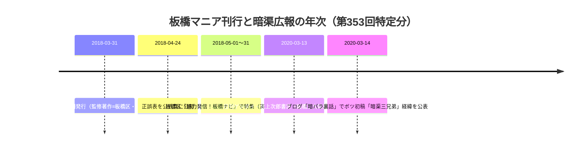

# 第353回（2026-11-27）実行記録 — 都公報新経路・2070カテゴリ掃引・板橋マニア書誌特定の新規3 source

- **継承**: 第352回bot完了（HEAD=ceadcef1・2026-11-27 00:07）からの継続。push前HEAD再照合で並走なしを確認し第353回として採番。
- **最大成果①: 都公報の新経路発見**。専門ドメイン **tokyoto-koho.metro.tokyo.lg.jp**（東京都公報専用サイト）を特定し、**第18677号（2026-11-27発行・定刊・198KB）のPDFが `https://www.tokyoto-koho.metro.tokyo.lg.jp/files/koho/y2026/18677.pdf` でopen_url直接取得・冒頭部のテキスト抽出に成功**〔確認〕（URLパターンは既知の y2022/17571.pdf から類推・命中）。目次・告示（選）・公告・告示第千百五十四号（生活保護法介護機関指定）までの抽出で、抽出部に四河川関連文言なし〔陰性: 部分走査〕。**本経路ではAESV3復号なしでテキストが出るか、抽出が打ち切られているかは未分離**〔次回、全文取得可否を検証。labのAESV3レーンとの併用判断材料〕。**増刊94号（11/27発行・3ファイル 2.1/2/1.7MB・2026_94-01〜03.pdf）も発行を公式頁で確認**したが、取得サービス一時不通で本文未走査〔次回課題〕。
- **最大成果②: 暗渠ハンター2070カテゴリ（cat_189274）掃引と板橋マニア書誌特定**（第352回回送⑥）:
  - カテゴリID特定: 2070=cat_189274・2080=cat_189268・2060=cat_189269・2055=cat_189272・2056=cat_189276・1001=cat_189275（brave検索で特定）。2070はp1〜17を掃引し、板橋関係記事（板橋マニア刊行系・板橋暗渠番組・蓮根川展示等）を検出。蓮根川スライド暗渠さんぽ（2025-12-01付表示）・いたばし暗渠マニアック展Vol.2蓮根川水系辺（2025-11-30トーク）の開催記録も確認〔蓮根川は四河川外だが板橋区暗渠ブームの継続状況の観察記録〕。
  - **GOV-620**: 板橋区公式頁1006722で『板橋マニア』の書誌を公式確定（監修・著作=板橋区、発行・販売=フリックスタジオ、2018-03-31初版第一刷、1,800円＋税、2章に「発見！板橋暗渠」等3項目、試し読みPDF・正誤表公開）。
  - **BLOG-340**（2020-03-14・22573862）: 『暗渠パラダイス！』[コラム3]「キャラが際立つ板橋三大暗渠」の存在と『板橋マニア』初稿「暗渠三兄弟」ボツ経緯〔repo初出〕。**板橋三大暗渠が何かは未同定**〔次回課題〕。
  - **BLOG-341**（2018-05-01・8800970）: 板橋区『魅力発信！板橋ナビ』2018年5月特集・「開始3分以降全部暗渠の話題」〔repo初出〕。
- **ノートのみの記録（source file化せず）**:
  - **「蓋on蓋」に夢中。（2020-09-25・カテゴリ1001+2080）**: **板橋区役所付近の高速（都心環状線と本文表記）と千川上水の「蓋on蓋」**＝暗渠の蓋の上に首都高の蓋が被さる構造の実例として本文+写真で言及・**首都高×水路の全貌地図・一覧表の作成言及**〔千川上水×首都高の重複蓋構造の観察はrepo初出候補〕。**記事URLは特定できず**（月別アーカイブ・カテゴリ頁は本文全文取得済みだがopen_urlのリンク抽出不可・IDは2x百万台で推定域が広い）〔次回: cocolog月別頁の生HTMLリンク抽出かnote/X告知の確認〕。
  - 都公文書館: rootは200応答だが**/list 検索実行系はopen_urlで遮断**（chkCls個別繰り返し形式・最小形式とも不可）＝「養水」「樋口」「白山御殿」掃引はcookie jar+curlのlab環境必須で回送〔詳細頁(/detail)単体は前回実績あり〕。
  - jpsearch API・TOA（都立図書館デジタルアーカイブ）・nabunken・ro-da.jp・kanzyou7: いずれもopen_url経路は遮断（kanzyou7は第337回200から変化）〔4語カウント・TOA検索系・板橋区郷土資料館紀要はlab環境で実施〕。
  - 陰性: 7711989「蛇崩川・風薫る弦巻付近の二つの支流」（2011-05-18・2021目黒川水系カテゴリ）＝**弦巻は目黒区弦巻町の別地名**で四河川の弦巻川と無関係〔同名異所の確認記録〕。2011渋谷川水系・2021目黒川水系カテゴリは水系として四河川と直接接続しないため掃引優先度低と判断（音羽川・水窪川系の神田川水系2055は第349/352回で掃引済み）。
  - 「江古田散歩」（中野区ことぶき大学大学院）・「懐かしい江古田村の生活と自然」（BLOG-336二次転記）の書誌特定はweb検索で不成功〔継続課題〕。
  - 開札2026-12-02（GOV-148）・12-16（GOV-582）は未開札〔開札後最初の実行で最優先・継続〕。
- **技術メモ（第353回）**: ①この実行環境（Vibe定期実行・lab非搭載）ではcurl・git・PDFレーンが使えず、**open_urlとGitHub APIのみ**。README bullet挿入は第352回ヘルパー方式を踏襲し、**INDEX.mdの更新もヘルパー（GitHub Actions上のpython）に担わせた**（INDEX全文414KBはAPI転送不可のため）。②暗渠ハンターblog.jpのカテゴリ頁・月別頁はopen_urlで本文全文取得可だが**リンク抽出不可**＝URL特定はbrave検索かID既知記事経由が有効。③60秒実行バジェットのため1回のrun_typescriptで4〜6取得まで。
- **push構成（第353回）**: push①=GOV-620・BLOG-340・BLOG-341＋本ノートの4ファイル。push②=.353-bullet.txt＋.353-insert.py＋.github/workflows/insert-353.yml（README bullet＋INDEX 3行挿入・計数更新〔行政617→618・ブログ338→340・総数1,905→1,908〕をbotが実施）。
- **採番現況（第353回終了時点・INDEX 1,908件＝地図241・地誌197・書籍336・論文121・行政618・企業50・ブログ340・消失5）**: 使用済み最大＝**GOV-620・BLOG-341**。次回新規は**GOV-621・BLOG-342・BOOK-338・ORG-051・PAP-124・GAZ-198・MAP-242・LOST-006**から（push前にINDEX.md実測再確認が約束）。
- **次回（第354回）課題（優先順）**: ①**開札2026-12-02（GOV-148）・12-16（GOV-582）の入札結果確認＝開札後最初の実行で最優先**。②都公報第18677号の全文走査（tokyoto-koho直取得の全文可否検証）・**増刊94号（2026_94-01〜03.pdf）の走査**・第18678号以降の新経路監視。③「蓋on蓋」記事URL特定と千川上水×首都高観察のsource化。④『板橋マニア』2章試し読みPDF（公式頁から1020KB）で「発見！板橋暗渠」の実文確認・板橋三大暗渠の同定。⑤『暗渠パラダイス！』[コラム3]本文（BOOK-042）。⑥lab環境での都公文書館「養水」掃引・jpsearch 4語カウント・TOA検索系。⑦「江古田散歩」「懐かしい江古田村の生活と自然」書誌特定（継続）。⑧human判読系（GOV-616全2コマ等＝デスクトップ環境時回送・継続）。**この定期タスクは更新可否にかかわらず継続（停止しない）**。

