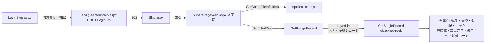

# 第356回（2026-11-27）・SEMIS台帳属性の実データ取得成功と都公文書館「養水」掃引初実施

## 概要

- **第355回最大の未解決だった「SEMIS（下水道台帳情報システム）の実データ取得」に成功**し、[GOV-621](sources/gov/GOV-621.md)を追記した〔確認〕。**第24回以来の「下水道台帳直接確認」課題が属性値レベルまで到達**。詳細はGOV-621第356回追記のとおり（リダイレクト先 `SuperaPageWeb.aspx`・アプリ本体 `spclient-core.js`・`GetAddressInfo` 成功・`SetupInitDisp` 前置きで `GetRangeRecord`/`GetSingleRecord` が属性レコードを返す）。
- **第337回以降403化で回送が続いていた都公文書館「養水」掃引を初実施**（98件・`chkCls` 個別パラメータ反復のGETレシピ・第337回ノート§1）し、四河川関連8項目（下石神井村田養水旧復願1882・神田上水路并助水路実地検査1881・関口町神田上水田養水分水1874・王子村養水群1875×2/1881・石神井村養水水掛反別1882・橋場町養水費決議1879）の詳細頁書誌を確定して[GOV-622](sources/gov/GOV-622.md)として新規登録〔所在のみ: 8項目とも本文（MF）未確認〕。
- [BLOG-343](sources/blogs/BLOG-343.md)の残務だったペイサージュ東京「江戸の街作り」特集第2〜8回を走査し**四河川固有文言なし〔陰性〕**＝source追加なし・BLOG-343追記のみ。
- 監視系は全局不変（jpsearch 132/45/7/70・NDL SRU 千川上水117・kanzyou7 WHAT'S NEW 2026/11/20・ro-daスタブ・wanjin 674以降404）。

## §1 SEMIS到達の経緯と意味（GOV-621追記の要約）

- 第355回レシピとの差分: ①同意POSTは `TspAgreementWeb.aspx` 自身のformの `__EVENTVALIDATION` が必要（LoginSkip頁には同フィールドなし）②302先 `Skip.aspx` はさらに302で `SuperaPageWeb.aspx` が本体③`GetRangeRecord` は `SetupInitDisp` 呼び出し後でないと空応答④住所検索 `GetAddressInfo` は機能している（第355回の「Status:-1」はアドレス検索サービス側ではなく呼び出し方が未特定だったため〔確認〕）。
- **幹線名称（OV61）・処理区名（OV113）のレイヤーは存在し `SetSingleDisp` で表示制御できるが、属性取得対象は `GetTermInfo` GroupMap（マンホール/下水道管/ます/弁類）の設備群に限定**され、ラベル層のレコードはこのAPI経路では取得できず〔確認〕。管路レコードには「流域特性:幹線」（例: 9055）「流域特性:処理排水区」（例: 9）が**コード値**で入る＝**幹線コード→名称文言（谷端川幹線/千川幹線など）の対応付けが最後の未解決**〔次回: 管路レコードを谷端川・千川沿いで多数採録してコードの空間分布から対応を推定する方法（推定）か、別経路のコード表〕。
- 板橋区役所付近の合流枝線1レコード（recid 1820152551010467907）: 陶管・25cm円形・勾配8‰・延長37m・**1968-12-18工事完了・1969-2-25供用開始・1969-3-22管理引継**〔確認〕＝板橋区中心部の合流枝線の1968-69年整備記録として、谷端川流域の下水道整備年代（BLOG-070・GOV-080等）の台帳側対応データ。
- `所在地:区` コード=住所検索NodeList（板橋区=119）と一致〔観察〕＝所在地コードの復号手段。

## §2 都公文書館「養水」掃引（GOV-622）

- 掃引結果の整理: 98件中、四河川関連と判断した8件（GOV-622掲載）のほか、既収録群（481565=GOV-608・330166/689285/699054/822393/819071等=GOV-615/588・496761=GOV-619）・スコープ外群（三田養水・六郷領養水・久我山村・千駄ヶ谷〔渋谷〕・牟礼村〔玉川上水〕・石神井川以南戸数取調〔第344回見送り継続〕）に分割〔確認/見送り〕。
- 見送りのうち注記: **298636「武州豊島郡千駄ヶ谷町字大谷戸養水云々之件」1870**＝旧豊島郡千駄ヶ谷（現渋谷区）の大谷戸（谷戸地名）と養水の組み合わせは地形名対照の観点で記録価値があるが、水系は渋谷川側と判断し本回は見送り〔推定〕。**422689（橋場町養水費）は水系帰属未確定のままGOV-622に採録**（千川用水系下流の可能性は本文確認まで断定しない）。
- 8項目の本文（MF府明Ⅱ）確認が次の一手。特に385669（下石神井村・1882）は[GOV-005](sources/gov/GOV-005.md)（葛ケ谷村分水・千川90度曲折点）・[GOV-068](sources/gov/GOV-068.md)（上下石神井村分水）の明治15年時点の後段実務、704813は[GOV-366](sources/gov/GOV-366.md)（助水堀筋）の明治14年実地検査実施記録として、文言確認の価値が高い〔仮説〕。

## §3 その他の観測

- ペイサージュ東京特集: 第5回（edocreate5）のみ404で所在未特定〔観察〕。第8回の神田上水懸樋文言はBLOG-343追記に引用記録。
- jpsearch（jps-cross API）: 千川上水132・谷端川45・弦巻川7・水窪川70＝前回値と完全一致〔陰性〕。第355回「SPA化で取得不能」は誤りで、`https://jpsearch.go.jp/api/item/search/jps-cross?csid=jps-cross&from=0&keyword=<URLエンコード>` で取得可（hitフィールド）〔確認・第355回ノート記載の訂正〕。
- NDL SRU title検索: 千川上水117〔不変〕。kanzyou7 WHAT'S NEW 2026/11/20〔不変〕・wanjin entry-674/675 404（新規投稿なし）〔不変〕・ro-da wwwスタブ254bytes〔不変〕・nabunken DNS不通継続〔不変〕。
- 開札2026-12-02（GOV-148）・12-16（GOV-582）: 11/27時点では開札前＝次回（12/2以降最初の実行）で最優先確認〔回送〕。
- 都公報第18677号（11/27発行）: 今回はtokyoto-koho経路を未走査〔回送: 第354回レーン（labのpdf.js系）で次回〕。

## §4 次回（第357回）課題（優先順）

1. **開札2026-12-02（GOV-148）の入札結果確認＝開札後最初の実行で最優先**（12-16 GOV-582も・kensetsunews.com等）。
2. **SEMIS幹線コード→名称対応**: 谷端川・千川沿いのbboxで管路レコードを複数採録し、流域特性:幹線コードの空間分布から谷端川幹線/千川幹線コードを比定（推定の域を出ない場合はコード分布の記録のみ）＋人孔番号体系（図面番号10141等）の規則性。
3. **都公報第18677号の全文走査**（第354回labレーン再構築・増刊94号の画像目視はhuman回送）。
4. GOV-622の8項目の本文（MF）確認手段（都公文書館のデジタル公開範囲の再確認・複写はhuman依頼候補）＋「養水」掃引残り項目の精査。
5. 都公文書館「水車要録」簿冊残り・橋々銘書残差の仕分け（第337回ノート§1 GETレシピ・sleep 6秒）。
6. 監視系（kanzyou7・wanjin・ro-da・『生活と文化』第35号・jpsearch・NDL SRU）。
7. human判読系（増刊94号画像・板橋マニア2章試し読み・GOV-616全2コマ等）＝ユーザーPC到達不可のためデスクトップ環境時に回送。

**この定期タスクは更新可否にかかわらず継続（停止しない）。**
