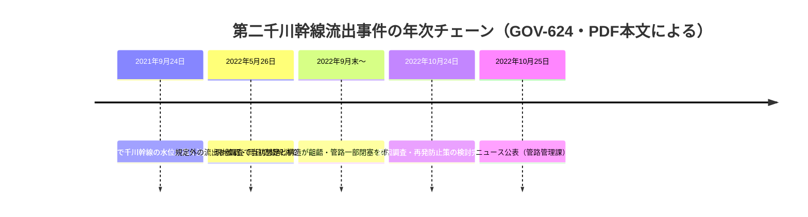

# 第360回（2026-11-27）・第二千川幹線流出資料の全文直接確認（GOV-624新規）と水車要録簿冊全アイテム掃引完結（GOV-618追記）・監視系の記録

## 概要

- 第359回bot完了（HEAD=980f44d393）からの継続。本回は実行環境がupgrade済み（curl・node・python3可用・git/pipなし）で、第359回が回送した「lab環境時」課題の一部を実施できた。**新規1 source（GOV-624）＋既存1 source追記（GOV-618）をmainへ反映**。
- **最大成果①: 都下水道局2022年10月25日ニュース「下水道幹線（第二千川幹線）から河川への放流状況について」＋資料PDF（2頁）の本文全文抽出に成功（[GOV-624](sources/gov/GOV-624.md)）**〔確認〕。千川幹線の水位高（2021年9月・小石川四丁目の公共ます工事）→第二千川幹線への流下経路切替→規定外流出確認（2022年5月26日）→切替解消→現地調査で想定構造と齟齬・管路一部閉塞確認（2022年9月末）の年次チェーンが一次文書レベルで確定。第二千川幹線の放流先=神田川水道橋分水路（文京区後楽1-3付近）・吐口は潮位で常時水没も官文で確認。
- **最大成果②: 都公文書館「水車要録」簿冊（601.C8.04）の全アイテム掃引を完結（[GOV-618](sources/gov/GOV-618.md)第360回追記）**〔確認〕。キーワード「水車」掃引798件から同簿冊35件（綴込(001)〜(036)のうち(003)(033)欠落）の件名を列挙確定。**大沢民五郎の水車発電機械使用願（1894）が[GOV-592](sources/gov/GOV-592.md)②の高田村大沢民五郎（1883年分水堰修繕願出）と同姓同名**＝高田村の大沢家系水車の発電転用願の対照候補、岩崎喜之助（千川水路掛水車1887年）の水料更正願、渡辺政方の営業継続願（BLOG-094渡辺水車系候補）など。

## §1 GOV-624（第二千川幹線規定外流出）の調査経緯

- SEMIS幹線コード→名称対応の「公開資料側でのコード表探索」（第359回課題④）で「千川幹線」を検索したところ、都下水道局ニュース2022-10-25（[1025_6233](https://www.gesui.metro.tokyo.lg.jp/news/2022/1025_6233.html)）を発見〔確認〕。repo grep（規定外・放流状況・1025_6233・後楽一丁目三番地）で既収録なし。
- 本環境のcurlでニュース本文（200・JSなし静的HTML）と資料PDF（[shiryou_kandagawa](https://www.gesui.metro.tokyo.lg.jp/documents/d/gesui/shiryou_kandagawa)・168,042bytes・2頁）を取得。PDFはFlateDecode+Tj/TJ直接抽出では取れず、**pdfjs-dist 4.2.67（legacy build・CDNからcurl取得）をnodeで実行して本文全文抽出に成功**〔確認〕＝ AESV3等の暗号なし・テキスト埋め込みPDF。
- 千川幹線と第二千川幹線の接続（小石川四丁目・流下切替可能）は、[BLOG-134](sources/blogs/BLOG-134.md)（千川増強幹線の人孔3接続部・試掘で千川幹線位置が想定と違っていた）と連続する**千川幹線の水位・位置問題**の2021〜22年の実務例として、谷端川〜千川上水旧河道の下水幹線史に直接追加される〔観察〕。

## §2 水車要録簿冊掃引の完結（GOV-618追記）

- 第337回ノート§1のGETレシピ（chkCls個別繰り返し・cookie jar・UA偽装）で「水車」798件（8頁・sleep 6秒・403化なし）を掃引し、**水車要録（601.C8.04）収録35件を列挙**〔確認〕。詳細頁はJS描画で値が取れないため一覧頁目録文言で列挙＝第348回で残されていた「簿冊全体の走査」課題（GOV-618制限・GOV-623「残りアイテム」）を完結。
- 対照上の要点: (001)大沢民五郎発電機械使用願・(007)発電器譲受＝GOV-592②の1883年高田村大沢民五郎と同姓同名〔比定保留〕、(008)岩崎喜之助水料更正＝GOV-618⑥aの1887年千川水路掛水車と同姓同名〔比定保留〕、渡辺姓系列5名の譲渡・相続・営業継続、(012)東京砲兵工廠水車用配水復旧、(016)玉川上水路水車新設願はスコープ外見送り。
- 制限: 35件とも本文未見（MF 0647-1112）。(003)(033)欠落と明治28〜29年度分の有無はMF判読要。簿冊ヒットはすべて明治27年分。

## §3 監視系と環境面の観察

- **jpsearch 4語: 千川上水132・谷端川45・弦巻川7・水窪川70＝前回値と完全一致〔陰性〕**（jps-cross API・curlで取得可）。
- **NDL SRU: 今回のクエリ形式（any=語・any="語"・title=語）がいずれもillegal query syntaxで不成立**＝第359回までの117/31/2/2の取得に使ったクエリ形式の再特定が必要〔課題〕。ndlsearch.ndl.go.jp自体は応答あり。
- kanzyou7: WHAT'S NEW 2026/11/24（現場見学会募集）・11/20（工程表）で不変〔陰性〕。ro-da: トップに四河川文言なし〔陰性〕。wanjin entry-674〜676: 302継続。TOA: 当該ドメイン接続不能（000）＝回送継続。
- **都公報第18678号: 404（11/28発行前）＝第361回の初走査課題**〔確認〕。増刊94号（2026_94-01〜03.pdf）の取得自体はcurlで成功したが、第354回の走査どおり本文はCCITT G4画像埋め込みで文言抽出不能＝human判読系回送のまま。
- **開札2026-12-02（GOV-148）・12-16（GOV-582）は本回時点で未開札＝第361回以降も最優先**（kensetsunews検索は空応答・ページ側の検索機能不調のため開札後に別経路で確認要）。
- 環境メモ: 本回はupgrade環境（curl・node・python3）でpip/git不可。都公文書館GET掃引・都下水道局PDF取得・jpsearchはcurlで実施可。pdfjs-dist（legacy）をCDNからcurlで取りnodeで使うPDF本文抽出レーンが確立（暗号なしPDF限定）。

## §4 採番・反映状況（第360回終了時点）

- **新規: GOV-624**（都下水道局・直接確認）。**追記: GOV-618**（第360回追記節）。INDEXは行政621→622件・総数1,913→1,914件。
- 採番現況: 使用済み最大＝GOV-624。次回新規は**GOV-625・BLOG-344・BOOK-338・ORG-051・PAP-124・GAZ-198・MAP-242・LOST-006**から（push前にINDEX実測再確認）。
- 次回（第361回）課題（優先順）: ①**開札12-02（GOV-148）の入札結果確認＝最優先**（12-16 GOV-582も・kensetsunews以外の経路併用）。②**都公報第18678号の初走査**（tokyoto-koho.metro.tokyo.lg.jp/files/koho/y2026/18678.pdf・pdfjsレーン）③NDL SRUクエリ形式の再特定。④水車要録(001)(007)大沢民五郎の本文（MF判読手段）と明治28〜29年度分。⑤SEMIS幹線コード表の公開資料探索の続き（管理基準・工事仕様書類）。⑥TOA・『生活と文化』第35号・ro-da 12月新着。⑦human判読系（増刊94号・GOV-624流下経路図・板橋マニア2章・MAP-164 zoom・GOV-616全2コマ）＝デスクトップ環境時回送。**この定期タスクは更新可否にかかわらず継続（停止しない）**。
