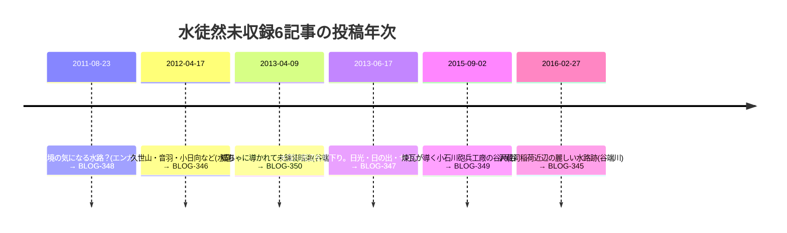

# 第366回（2026-11-27）水徒然カテゴリ別掃引でBLOG-345〜350の6 source採録・都公報18678号404・監視系の記録

## 1. 実行概要

- 開始HEAD: d70ca060a5（第365回bot「ヘルパー自己削除」・並走なしをpush前に再照合）。
- 実行環境: upgrade環境（curl・node・python3可・git/pip不可）。repo tarball（codeload）をlab/baseへ展開してdedupeに使用（rgベース）。
- 成果: **新規6 source（BLOG-345〜350）＝第365回の「水徒然カテゴリ別掃引は潜在収穫が期待できる未実施掃引」の予測が的中**。INDEX総数1,915→1,921件・ブログ343→349件。

## 2. 水徒然カテゴリ別掃引の方法と結果〔確認〕

- **カテゴリ頁は直でも取得可（記事頁のみCloudFront 403）**: トップ頁のカテゴリサイドバーで i7=千川上水・i17=水窪川・i18=えんが堀・i26=谷端川等を特定し、`https://yatolove.exblog.jp/iN/` をcurlで直接取得（いずれも200）。**カテゴリ件数表示は「千川上水(0)・水窪川(3)・えんが堀(2)・谷端川(6)」**＝千川上水カテゴリの0件は不自然（別カテゴリに再割り当てされた可能性・未解決）。archiveheader以降の記事リストからID抽出し、repo grep（docs/全体）で既未収録を仕分け。
- **既収録**: 水窪川=19601548（BLOG-173）・谷端川=23248324（BLOG-065）・18908041（BLOG-066）・18551285（BLOG-105）・えんが堀=15737114（BLOG-344）〔重複確認〕。
- **未収録6件をWaybackで本文全文取得**（web.archive.org/web/2024id_系URL・--compressed必須〔gzipのまま保存する事故防止〕）:

## 3. 各sourceの要旨

- **BLOG-345（2016-02-27・22925526）沢蔵司稲荷近辺の麗しい水路跡＝本回の目玉**: ①**沢蔵司稲荷西方（小石川2丁目）私有地内の石造り水路跡（落差・架橋・下水道局プレート）の観察＝repo初出** ②**「続・後楽2丁目の水路跡」記事で使用した地籍図に当該水路が青線で記載（出発点=春日通り・富坂警察と礫川小の間、終点=沢蔵司稲荷窪地）＝repo初出** ③**コメント欄の水道工事店従業員（nori-p）による「礫川小の水路（下水道）に私道のお宅の排水を流していた」実務証言＝現役の雑排水ラインであることの生証言・repo初出** ④**藤橋（ふじはし）親柱の2015年8〜9月再訪確認＝BLOG-322（2011年）に続く第2の独立観察** ⑤水上勉『私版東京図絵』（BOOK-026）の礫川小6〜7m崖記述の**引用元記事は本記事**（BOOK-026の「2016年記事からの二次引用」の実体が確定）。
- **BLOG-346（2012-04-17・15572826）久世山・音羽・小日向など**: ①**「解体中の中学で神田上水白堀の遺構が発掘されたと新聞で読んだ」＝伝聞・repo初出**（原報道の特定が次の一手）②**水窪川が神田川に注ぐ辺りの桜木町の小町名**（GAZ-080の嘉永期桜木町と対照）③湧水の20年ぶり再訪での水量減少観察・今宮神社南の水流・八幡坂の洗い場。
- **BLOG-347（2013-06-17・18903004）水窪川周辺を川下り前編**: ①水窪川源流部（東池袋4丁目・造幣局南西角の井戸〜日の出町）の2013年実況観察②**日光広場の看板文言「1990年の設置・地下貯水槽」＝BLOG-106〜110の辻広場整備史に看板レベルの設置年次を追加**③補助81号線（昭和21年計画決定）と一帯のフェンス・小公園（BLOG-066/184と整合）④巣鴨プリズン排水口跡の2013年探索目撃（BLOG-099/107の対校定点）。
- **BLOG-348（2011-08-23・14396894）区境の気になる水路？**: ①向原ゴルフセンター付近の区境水路の住宅地図上の線が平成2年→近年で半減した対校観察②**品川電線の開渠が2011年時点で既に消えた＝BLOG-329（暗渠ハンター品川電線記事）の独立裏付け**③練馬区「こもれび」水路敷・谷戸区民調査隊募集（貫井特集・2011年）・田柄用水PDFの記録。
- **BLOG-349（2015-09-02・22106158）煉瓦が導く小石川砲兵工廠の谷戸**: ①**小石川トンネル射撃場（明治16〜18年頃完成・1999年返還）とその北端の「窪地」＝明治迅速地図に2本の谷が描かれる（中央大学〜戦沒者墓苑〜礫川公園）＝repo初出の谷構造データ**（比定は筆者も保留・神田川支流説を併記）②牛天神石段脇側溝の流水（2015年）・後楽園〜ラクーア付近の明治期古地図の水路判読。
- **BLOG-350（2013-04-09・18393410）猫ちゃに導かれて未舗装暗渠**: 板橋区熊野町の谷端川緑道への未舗装暗渠道合流（手前に大きめの石）の2013年定点観察＝BLOG-069（2022年）・BLOG-114（2026年）に加わる合流部データ。

## 4. 陰性・スコープ外〔観察〕

- カテゴリ「千川上水」(0件)の件数表示は不自然で、千川上水関連記事の実態は別カテゴリ（専用水道・石神井川系等）に散在する可能性＝i8=専用水道・i6=田柄川の掃引は403（throttle型）のため**第367回回送**。
- 最新記事「姿見の井戸と御廟橋（練馬高野台）」30531169は石神井川系（御廟橋）と推定されスコープ外扱い〔本文未確認〕。
- BLOG-344が参照する「板橋区中板橋その② 弥生町・大谷口・向原の溜池跡」のURLは本回も特定できず（15737114本文内に記事リンクなし）＝**継続課題**。

## 5. 監視系観測（第366回）

- **都公報第18678号**: tokyoto-kohoのpdf = **404（11-28発行前）＝第367回初走査**（301リダイレクト→www付きで404）。
- **開札2026-12-02（GOV-148）・12-16（GOV-582）**: 未開札＝**第367回以降も最優先**。
- **都公文書館**: www.soumu.metro.tokyo.jp = **DNS解決不能（000）継続**＝「千川」「谷端」「弦巻」初クロス掃引は引き続き回送。
- **jpsearch（jps-cross API）**: 千川上水132・谷端川45・弦巻川7・水窪川70＝**全件不変**〔陰性〕。
- **ro-da**: 200応答だが**スタブ頁264B不変**（四半期新着は確認不能のまま）。**kanzyou7**: WHAT'S NEW最新=2026/11/24不変・四河川語なし〔陰性〕。**wanjin**: entry-676=302（新規投稿なし）。
- NDL SRU・TOA・nabunkenは本回未試行（前回値維持・SRUは429回避のsleep設計時に実施）。

## 6. push構成・検証（第366回）

- push①: BLOG-345〜350の6 source＋第366回ノート。
- push②: ヘルパー3点（.366-bullet.txt・.366-insert.py・insert-366.yml）＝README bullet挿入＋INDEX更新（BLOG-344行直後に6行挿入・ブログ343→349・総数1,915→1,921）をbotが兼務。
- push前にHEAD再照合・bot完了後にSHA固定rawでREADME bullet行・INDEX計数・md5検証・ヘルパー404確認（本ノートに記録のとおり）。

## 7. 次回（第367回）課題（優先順）

1. **開札2026-12-02（GOV-148）の入札結果確認＝開札後最初の実行で最優先**（12-16 GOV-582も・kensetsunews・日本工業経済新聞等の複数経路）。
2. **都公報第18678号の初走査**（tokyoto-koho新経路・pdf.js(node)レーンで都度再取得）。
3. **水徒然カテゴリ掃引の残り（i8=専用水道・i6=田柄川等）＝403解除後に再試行**。「中板橋その②溜池跡」記事のURL特定。「続・後楽2丁目の水路跡」記事（BLOG-345の地籍図の出典）の取得。
4. **神田上水白堀遺構発掘の原新聞特定**（BLOG-346伝聞・江戸川橋の解体中の中学）。
5. 都公文書館DNS/403解除待ち「千川」「谷端」「弦巻」初クロス掃引＋水車要録(001)(007)大沢民五郎本文・橋々銘書残差・養水掃引残り。
6. SEMIS幹線コード→名称対応続き。TOA result_s系500解除監視。NDL SRU残り3語。
7. 監視系（ro-da 12月新着・『生活と文化』第35号・wanjin・kanzyou7・jpsearch）。
8. human判読系（増刊94号・板橋マニア2章・MAP-164 zoom・GOV-616全2コマ・GOV-624流下経路図・日光広場看板文言・沢蔵司稲荷親柱採録）＝ユーザーPC到達不可（scheduled task実行）のためデスクトップ環境時に回送。**この定期タスクは更新可否にかかわらず継続（停止しない）**。
