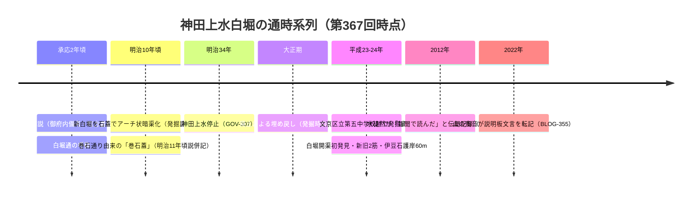

# 2026-11-27（第367回）・水徒然カテゴリ掃引完結（専用水道・田柄川・後楽2丁目）と神田上水白堀発掘の特定

- 開始HEAD=8dae290480（第366回bot・並走なし・api.github.comで照合）。第366回に続き水徒然（yatolove.exblog.jp）のカテゴリ別掃引を実施し**新規5 source（BLOG-351〜355）＋既存1追記（BLOG-346）**をmainへ反映。総数1,921→1,926件・ブログ349→354件。
- **掃引手法の変化**: exblogが本日はカテゴリ頁含め全面403化したため、**Wayback Machine収蔵のカテゴリ頁スナップショット（2024-05-24）で記事ID・タイトル対を抽出**して既未収録仕分け（repo grep）→未収録9件の本文をWayback（2024年スナップショット・id_形式）で全文取得。第366回の「カテゴリ頁は直で取れる」前提は時刻により変わる（throttle型・要再試行）。

## 1. 水徒然「専用水道」カテゴリ（3件・完結）→ BLOG-351

- **最大成果＝天祖神社の「玉川上水分水」碑**（14494355・2011-09-11）: 冒頭「玉川上水分水……」以下漢詩調の碑で、「用水不足で田を作ることが困難・荒地が多かったことから、官の許可を得て玉川上水の分水を（田無で）受け、村民協力で水路を掘り灌漑用水を導入して美田とした」旨を後日資料照合でまとめる。**千川上水（＝玉川上水分水・田無取水）と田柄灌漑用水の接続を頌徳碑レベルで裏付ける独立記録候補**＝BLOG-118（千川から田柄川を引いた説）・GOV-068（分水の設計思想）・BLOG-331（田柄川/田柄用水系統整理）を強める根拠。碑文全文・建立年の採録が次の一手（human確認待ち）。
- 専用水道の定義・田柄水道利用組合3204㎥/日（平成22年統計・23区内屈指）・北町南水道組合解散（2010年頃）・田柄3丁目「水源地」表記・愛宕神社の用水洗い場と金魚市〔聴取〕・四葉地区平成元年解散式〔伝聞〕＝千川上水沿いの水利用が地下水・専用水道へ移行した後の分布記録（GOV-063/081の対照）。

## 2. 水徒然「田柄川」カテゴリ（6件・完結）→ BLOG-352・353

- 2011-12年観察4本をBLOG-352に集約（水位計のある緑道＝水位管理の継続・2013年マンホール埋設による暗渠道消失追記・田柄3丁目のビールケース状橋脚の未同定遺構・相撲部屋）。2016年（平和台の道路計画で1997年撮影Google Earthの水路跡消滅）と2022年（「水路敷」ペイント刷新・寄贈蓋情報）をBLOG-353に集約。**第366回予測「水徒然カテゴリ掃引は潜在収穫手段」が第2弾も的中**。

## 3. 水徒然「後楽2丁目の水路跡」前後編 → BLOG-354（第366回課題の解消）

- BLOG-345が参照した「続・後楽２丁目の水路跡～地籍図から判ったこと」（21957011）の本文をWaybackで全取得（前編21755048も）。**地籍図の青線3水路**（当該水路＝春日通り〜諏訪神社側窪地・三井邸直下から巻石通りへ落ちる流路・諏訪神社南側の第3水路）＋**江戸初期の白鳥池〜小石川沼大湿地帯枠組み**＋**2020年8月追記＝文京区水道1丁目の地籍図記載水路跡現存**＋「復元江戸情報地図」書誌候補。地籍図の正式書誌特定（MAP-045文の京デジタル小石川区地籍図 data_id=825/827との照合）が次の一手。

## 4. 神田上水白堀発掘の特定 → BLOG-355＋BLOG-346追記（第366回課題の大幅進展）

- **BLOG-346の伝聞「解体中の中学で神田上水白堀の遺構が発掘」の対象が文京区立第五中学校（旧黒田小学校跡・現文京区総合福祉センター）と特定**。山の風音（yamakazeoto.jugem.jp・2022-05-18・EUC-JP頁をcurl直接取得）が説明板文言として転記する内容: 平成23〜24年（2011-12）発掘調査・白堀（開渠）の初発見・**新旧2筋・伊豆石石積み護岸60m**・**新白堀は明治10年（1877）頃石蓋アーチ状暗渠化**（発掘時石蓋取り外し・石積み一部破損＝大正期埋戻し状態）・発掘は左岸のみ・『東京市史稿上水篇』川幅約3m。巻石通りの由来（明治11年頃・「巻石蓋」）も記録。
- **江戸期白堀文言群（GAZ-049・GAZ-169・GAZ-102・第200回桜木町群）に対する初の考古学的裏付け**。川幅3m（発掘+市史稿）vs 巾五間（御府内備考・不同）の対校材料。残務＝一次の発掘調査報告書の書誌・原新聞の特定・説明板の実物採録。

## 5. 陰性・見送り・監視系（第367回観測）

- **都公報第18678号=404（11-28発行前）＝第368回初走査**。**開札2026-12-02（GOV-148）・12-16（GOV-582）は未開札＝第368回以降最優先**。都公文書館はDNS不通（000）継続＝「千川」「谷端」「弦巻」初クロス掃引は第368回回送。TOA top=200・result系=500継続（「湧水」「練馬」「要町」・48527/48529は回送）。
- jpsearch 4語132/45/7/70不変〔陰性〕。NDL SRU 千川上水title=117不変。kanzyou7 WHAT'S NEW 2026/11/20不変。wanjin entry-677=302（新規投稿なし）。ro-da=スタブ264B。『生活と文化』第34号不変。
- 水徒然i7（千川上水）カテゴリは2019年スナップショットでも実質0件（カテゴリ再編か）＝掃引完了扱い。i5（石神井川系）・i12（白子川）等はスコープ判断で第368回以降に検討。
- yagopin.seesaa.net（2018年・黒田小学校記述）は直403・Wayback未収蔵＝検索スニペット確認のみ（BLOG-355に二次転記として記録）。

## 6. 採番現況（第367回終了時点・INDEX 1,926件＝地図241・地誌197・書籍336・論文121・行政622・企業50・ブログ354・消失5）

- 使用済み最大＝**BLOG-355**（行政はGOV-624・書籍BOOK-337・論文PAP-123・地図MAP-241・GAZ-197・ORG-050のまま）。次回新規は**GOV-625・BLOG-356・BOOK-338・ORG-051・PAP-124・GAZ-198・MAP-242・LOST-006**から（push前にINDEX.md実測再確認）。

## 7. 次回（第368回）課題（優先順）

1. **開札2026-12-02（GOV-148）の入札結果確認＝開札後最初の実行で最優先**（12-16 GOV-582も・複数経路）。
2. **都公報第18678号の初走査**（tokyoto-koho/files/koho/y2026/18678.pdf・pdf.js(node)レーンは都度再取得）。
3. **天祖神社「玉川上水分水」碑の碑文全文・建立年の特定**（愛宕神社・天祖神社の所在地確定＝human確認待ち。「田柄」関係の郷土史料（『練馬区史』昭和32年版等）で頌徳碑の記載有無を確認）。
4. **白堀発掘調査報告書の書誌特定**（文京区教育委員会・埋蔵文化財の発掘調査報告書一覧で平成23〜24年・第五中学校跡地を検索）。
5. 後楽2丁目の地籍図の正式書誌特定（MAP-045・文の京デジタル小石川区地籍図との照合）＋「復元江戸情報地図」書誌特定。
6. 都公文書館DNS/403解除待ち「千川」「谷端」「弦巻」初クロス掃引＋水車要録(001)(007)大沢民五郎本文・橋々銘書残差・養水掃引残り。
7. SEMIS幹線コード→名称対応続き・TOA result_s系500監視・NDL SRU残り3語。
8. 監視系（ro-da 12月新着・『生活と文化』第35号・wanjin・kanzyou7・jpsearch・nabunken）。
9. human判読系（増刊94号・板橋マニア2章・MAP-164 zoom・GOV-616全2コマ・GOV-624流下経路図・天祖神社碑・旧白堀跡説明板）＝**ユーザーPC到達不可（scheduled task実行）のためデスクトップ環境時に回送**。

**この定期タスクは更新可否にかかわらず継続（停止しない）。**
