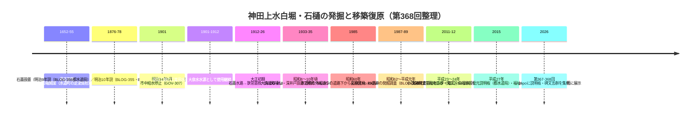

# 2026-11-27（第368回）・神田上水白堀発掘の説明板・碑文群の全面資料化（BLOG-356〜358・GOV-625）

## 概要

第367回で特定した神田上水旧白堀跡の発掘調査（平成23〜24年・文京区総合福祉センター）について、その後の検索で発見した3つの二次記録と水道歴史館公式頁を資料化し、**新規4 source（BLOG-356〜358・GOV-625）をmainへ反映**した。総数1,926→1,930件・ブログ354→357件・行政622→623件。

## 新規採録の内容

1. **BLOG-356（hotyuweb「神田上水遺構（本郷）」2023-05-12・curl直接取得）**: 本郷給水所公苑（本郷2-7-1）の神田上水石樋碑文（東京都水道局・内部寸法上幅150/下幅120/高120-150cm・蓋石180×60×30cm・昭和62〜平成元年発掘＝repo初出の定量寸法）＋**神田上水白堀移設復元説明板（平成27年3月都水道局）全文＝間知石（四角錐）・胴木基礎・石積1〜3段・新旧流路の相対年代（左=江戸時代19世紀前・中葉頃・右=幕末〜明治以降）・明治9年石蓋設置説・巻石通り呼称由来がいずれもrepo初出**＋春日1-16-27「ポケットパーク テーマ水」の昭和62年水道橋発掘石展示（文京区説明掲示全文）。**明治9年（1876）石蓋説は明治10年説（BLOG-355・BOOK-147）・明治11年頃説（旧町名案内）に並ぶ第4の年次**で、石蓋（巻石蓋）設置年次の対校課題に追加。
2. **BLOG-357（ma-maison「神田上水の流れた道をゆく」・小石川歴史散歩・curl直接取得・投稿年2015以降〔推定〕）**: ①文京総合福祉センター敷地の復原展示の独立観察、②**水道歴史館東側への石樋（文京区No.49遺跡・昭和62〜平成元年・外堀通り神田川分水路工事中発掘）と平成23年白堀一部の移築復原文言＝No.49遺跡の遺跡番号と白堀移築先がrepo初出**、③春日町交差点石展示の独立観察、④小日向水道町・関口水道町・水道端・水道町の範囲区分文言（「昭和31年（1966）まで」は年次誤記の可能性を注記）。
3. **BLOG-358（TEIONE「神田川（4）巻石通り」2017・閲覧ツールで全文取得・直curlは403）**: 文京区教委「神田上水旧白堀跡」説明板全文＝**①正式遺跡名「文京区小日向1・2丁目南遺跡」（BLOG-355の「小日向1・2丁目遺跡」に対し「南」付き・nabunken WebGIS抄録〔文京区No.118遺跡〕も「南」付きを支持〔スニペット確認〕）、②遺構番号15a（新白堀）・15b（旧白堀）の対、③「万年巻石蓋」複合語、④明治34年以降の砲兵工廠（小石川後楽園）での工業用水・大泉水水源使用の継続、⑤大正初期の鉄管置換、⑥関口大洗堰取壊し・庭園用深井戸設置に伴う昭和8〜10年（1933-35）頃の神田上水終焉、の6点がrepo初出**。⑥は既存の「1935年頃まで工業用水路」（都水道歴史館）を年次・原因の両面で具体化する公式説明。
4. **GOV-625（東京都水道歴史館「収蔵資料」頁・curl直接取得）**: 神田上水石樋の公式解説＝**昭和60年（1985）水道橋発見説（碑文の昭和62〜平成元年〔1987-89〕発掘との表記差は対立として記録・断定しない）・安山岩構築・『上水記』樋線図「万年石樋」文言・本郷給水所公苑内移築復元・元々全体に蓋**。下部内法12㎝の表記は碑文の下幅120cmと桁が違い誤植の可能性もあり原文のまま記録。

## 解釈・対校メモ

- 石蓋（巻石蓋）設置年次は明治9/10/11年の3説が併存した。設置主体（都水道局=9年説・説明板系=10年説）別の系統差の可能性があるが断定しない。
- 石材表記は「伊豆石」（BLOG-355）と「間知石」（BLOG-356・358・「間知石の下に胴木」）が併存。石材名と積み方の別表記の可能性があり断定しない。
- 「萬年樋」（GAZ-068）・「万年石樋」（上水記樋線図・GOV-625）・「万年巻石蓋」（BLOG-358）の語彙系列は対照表の将来課題。
- 水道橋発掘石の展示先は本郷給水所公苑・春日1-16-27ポケットパーク・水道歴史館収蔵の3系統が確認された。

## 見送り・陰性

- nabunken文化財総覧WebGIS（144724小日向一・二丁目南遺跡）はJS描画で本文取得不能・スニペットで要約のみ確認（遺跡=文京区No.118・江戸川橋駅北方約200m・調査区=龍興寺境内（1654-1908）・約1,150基の遺構）。sitereports検索は429。発掘調査報告書の書誌特定は次回課題。
- 開札2026-12-02（GOV-148）は本回時点で未開札＝第369回以降も最優先。
- 都公報第18678号は404（11-28発行前）＝第369回初走査。
- 都公文書館はroot 403継続＝「千川」「谷端」「弦巻」初クロス掃引・水車要録残り等は回送。
- jpsearch 4語132/45/7/70不変・NDL SRU 429（2回とも）・TOA結果頁系遮断・exblog i8/i6カテゴリ頁403（throttle型・回送）・kanzyou7 11/24不変・wanjin 675=302・ro-da www=スタブ264B・暗渠ハンター新記事なし。

## push構成・検証

- 開始HEAD=2b23db95f6（第367回bot・並走なし・push前再照合）。
- push①＝BLOG-356〜358・GOV-625・第368回ノート（b64レーン・file_system.read_file→自作デコーダ→push_files）。
- push②＝ヘルパー3点（.368-bullet.txt・.368-insert.py〔README bullet＋INDEX 4行挿入＋計数更新兼務〕・insert-368.yml）→bot がREADME bullet挿入＋INDEX更新＋ヘルパー自己削除。
- README挿入アンカー＝「- **第367回:」行の直後。INDEX挿入＝GOV-624行直後にGOV-625行・BLOG-355行直後にBLOG-356〜358の3行・計数 行政622→623・ブログ354→357・総数1926→1930。

## 次回（第369回）課題（優先順）

1. **開札2026-12-02（GOV-148）の入札結果確認＝開札後最初の実行で最優先**（12-16 GOV-582も）。
2. **文京区小日向1・2丁目南遺跡（文京区No.118）発掘調査報告書の書誌特定**（nabunken sitereports復旧後・報告書名・発行年・掲載頁で白堀・龍興寺境内の記述を確認）。
3. **文京区No.49遺跡（1987-89水道橋外堀通り）の発掘調査報告書の書誌特定**（石樋の発掘報告）。
4. 都公報第18678号の初走査（tokyoto-koho新経路・pdf.js(node)レーンで都度再取得）。
5. 石蓋設置年次の対校（明治9/10/11年説）・大洗堰取壊し年次の原拠探索（後楽園・砲兵工廠側の年表資料）。
6. 都公文書館403解除待ち「千川」「谷端」「弦巻」初クロス掃引＋水車要録(001)(007)大沢民五郎本文・橋々銘書残差・養水掃引残り。
7. 天祖神社「玉川上水分水」碑の碑文全文・建立年の特定（BLOG-351残務・本回は検索で直接の碑文情報に到達できず）。
8. 水徒然カテゴリ掃引残り（i8=専用水道・i6・403解除後）。
9. human判読系（増刊94号・板橋マニア2章・GOV-616全2コマ・GOV-624流下経路図・沢蔵司稲荷親柱採録）＝ユーザーPC到達不可（scheduled task実行）のためデスクトップ環境時に回送。**この定期タスクは更新可否にかかわらず継続（停止しない）**。
