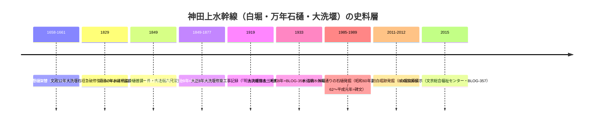

# 2026-11-27（第369回）・神吉和夫2014流量論文・千代田区懸樋跡文化財頁・アド街大洗堰跡の新規収録（PAP-124・GOV-626・BLOG-359）

第369回定期調査の実行記録。開始HEAD=02bf13dc8（第368回bot・push前に再照合・並走なし）。新規3 sourceをmainへ反映（総数1,930→1,933件・論文121→122件・行政623→624件・ブログ357→358件）。

## 今回の成果

### 1. PAP-124: 神吉和夫「神田上水の幹線ルートにおける流量と流れ」（2014）

- 検索で偶然発見した土木学会附属土木図書館「学術論文等公開」PDF（69-04-0063）。**PDF本体はcurlで直接取得（208KB）したがStandard暗号のため本環境ではテキスト抽出不能**、本文文言は検索スニペットで確認（その旨をstatusに明記）。
- 収穫: ①流量・流速の定量推定（大洗堰107立方尺/秒時に26立方尺/秒=0.72㎥/s・流速毎秒八寸四分=0.25m/s）②**万年石樋断面（高120-150cm・上部内法約150cm・下部内法約120cm）の発掘報告書由来の確認**＝BLOG-356碑文と寸法が完全一致する第3の独立層＝第368回の「発掘調査報告書の書誌特定」課題に、報告書が御茶ノ水分水路工事のものであること・石蓋付き石垣樋であったことの傍証を追加 ③嘉永2年「水道橋脇掛樋其外石垣樋枡普請一件」内法幅六尺深五尺（GOV-244の[17][18]と対応）④『東京市史稿』附図「神田玉川両上水全図」の万年樋内法上口五尺敷四尺五寸深四尺 ⑤「玉川神田両上水平面圖」（東京都水道局所蔵）の流量観測記録の存在 ⑥慶長13年江戸図（内藤昌）重ね合わせによる「小石川大沼迂回・神田明神山岸」経由の幹線ルート復元と成立年代再検討 ⑦『明治以前日本土木史』大正8年修築工事記録の引用。
- 万年石樋の寸法が「碑文＝発掘報告書＝市史稿附図＝嘉永2年普請一件」の**4層で対校可能**になったのが本回最大の前進（石蓋年次明治9/10/11年の対校課題と並ぶ定量情報の層化）。

### 2. GOV-626: 千代田区文化財サイト「神田上水懸樋跡」

- 文京区側説明板群（BLOG-356〜358）に対する**千代田区側（神田川北岸）の公式説明板本文**。万治年間架替→俗に万年樋・慶長年間着手「説」・給水範囲の四至（京橋川・永代橋〜大川以西・神田川・大手町〜一橋門外）・**牛込門外（飯田橋）から下流は神田川とする呼称区分の明文**＝いずれもrepo初出の公式文言。

### 3. BLOG-359: アド街ック天国公式サイト 2024年3月2日江戸川橋回・20位関口大洗堰跡

- **「昭和8年に撤去」の明示年次**＝BLOG-358「昭和8〜10年頃」の1933年側を支持するメディア由来の独立傍証（典拠記載なしのため断定せず）＋**江戸川公園内の池に大洗堰の一部が復元**＝repo初出の現況記録。

## 大洗堰・万年樋の年次・寸法の現況整理

## 陰性・アクセス不能の記録

- **nabunken sitereports 429継続**（小日向1・2丁目南遺跡・文京区No.49遺跡の発掘報告書書誌特定は第370回課題。ただしPAP-124で御茶ノ水分水路工事報告書の内容の一部が間接確認できた）。
- **都公報第18678号**: 11-28発行前のため未公開（DNS/遮断も継続）。第370回初走査。
- **開札2026-12-02（GOV-148）**: 未開札のため確認できず。**開札後最初の実行で最優先**（12-16 GOV-582も）。
- **都公文書館**: DNS解決不能（curl exit 6）・open_url遮断。「千川」「谷端」「弦巻」初クロス掃引は継続課題。
- **nikoukei（日本工業経済新聞）**: DNS解決不能のため雑司ヶ谷幹線その11入札結果頁を取得できず。
- **水徒然exblog i8/i6カテゴリ**: 403継続（第368回と同じ）。
- **天祖神社「玉川上水分水」碑の碑文全文・建立年**: 検索では新情報に到達できず（BLOG-351残務のまま）。
- JSCE土木図書館目録（N2search移行後）でPAP-124の刊行物名確定を試みたが検索クエリが実行されず未了。

## 採番現況（第370回起点）

- GOV-626・BLOG-359・BOOK-338・ORG-051・PAP-124・GAZ-198・MAP-242・LOST-006。

## 次回（第370回）課題（優先順）

1. **開札2026-12-02（GOV-148）の入札結果確認＝開札後最初の実行で最優先**（12-16 GOV-582も）。
2. **小日向1・2丁目南遺跡・文京区No.49遺跡の発掘調査報告書の書誌特定**（nabunken sitereports復旧後。PAP-124の「御茶ノ水分水路工事報告書」との異同確認を含む）。
3. **PAP-124の本文確認と刊行物名の確定**（暗号解除環境・土木図書館目録）・「速力八寸四分」の典拠冊特定・『明治以前日本土木史』大正8年修築記録の原典確認。
4. 都公報第18678号の初走査。
5. 天祖神社「玉川上水分水」碑の碑文全文・建立年（BLOG-351残務）。
6. 江戸川公園の大洗堰一部復元の現地確認・文京区資料との突合（BLOG-359残務）。
7. 都公文書館DNS/403解除待ち「千川」「谷端」「弦巻」初クロス掃引＋水車要録(001)(007)大沢民五郎本文・橋々銘書残差・養水掃引残り。
8. human判読系（増刊94号・板橋マニア2章・MAP-164 zoom・GOV-616全2コマ・GOV-624流下経路図・日光広場看板文言・沢蔵司稲荷親柱採録）＝ユーザーPC到達不可（scheduled task実行）のためデスクトップ環境時に回送。

**この定期タスクは更新可否にかかわらず継続（停止しない）。**
