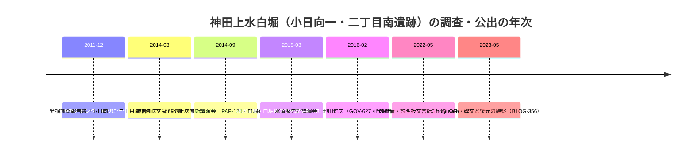

# 2026-11-27（第370回）・PAP-124本文全文抽出と発掘報告書書誌特定（BOOK-338新規）・水道歴史館白堀講演会頁（GOV-627新規）

## 1. 実行環境と取得経路

- 第369回botコミット（README bullet挿入＋ヘルパー自己削除）後のHEAD（41383ef8系）から継続。本回はupgrade実行環境（curl・node 22・pdf.jsレーン）で実施。
- 第369回の次回課題（①開札12-02 ②発掘報告書書誌 ③PAP-124本文確認と刊行物名確定 ④18678号走査 ⑤監視系）のうち②③を解消し、新規2 source（BOOK-338・GOV-627）＋既存1件の大幅追記（PAP-124）を反映。総数1,933→1,935件・書籍336→337件・行政624→625件。

## 2. 最大成果＝PAP-124の本文全文抽出成功（格上げ）と新文言群

- **Standard暗号（空パスワード）PDFの本文全文抽出に成功**（pdf.js 4.10.38 legacy＋node 22＋cMap17本・第354回確立の標準レーン・約11,800字・4頁）。第369回の「Standard暗号で抽出不能」は、第354回と同一の `/Length` 混同系ではなく単にレーン未適用だったためと判明。**PAP-124の文言群をスニペット確認から全文直接確認へ格上げ**。
- **刊行物名確定**: 本文頁脚刷り込み「土木学会第69回年次学術講演会（平成26年9月）」＝第369回の推定（年次学術講演会概要集）が確定。
- **新文言群（いずれも全文直接確認・repo grepで初出）**:
  - 『上水記』七「神田上水目白下附洲より江戸内水掛り絵図」（都水道局所蔵）の図名・取水樋門「甲蓋」（差し蓋による流入量調節・洪水時閉鎖）。
  - **白堀の施設文言**: 小洗堰・小吐口・吐樋各1か所（余水排水）、**箱下水10か所＋大下水潜り樋2か所**（小日向台北側の小河川（下水）から白堀への流入防止・潜り樋部分は入子樋補強）＝白堀と谷端川水系小河川群の遮断・立体交差の設計文言。
  - **白堀の取水実務**: 小日向町田用水引取樋筋（灌漑期に江戸川へ懸樋・平生は取り払う）＋都市用水は牛天神広小路組合・小石川御門外組合引取樋筋のみ（水戸屋敷手前）。
  - **明治26年『東京市水道要覧』の神田上水文言**（井ノ頭池に発し・善福池の末流と玉川上水の助水と相合・三池水55立方尺余→大洗堰107立方尺有余→上水使用26立方尺許）。
  - **「速力八寸四分」の典拠が「第壱號 玉川神田両上水平面圖」の関口大洗堰近くの神田上水路の記載と確定**（第369回の『神田上水留』推定を修正・観測文言全文「速力八寸四分 一時間ニ二十六立方尺三二 二十四時間ニ二百三十六万四千○四十八立方尺」）。
  - **白堀断面の定量復元**: 『東京市史稿 上水篇』巻三「幅一丈高七尺五寸、左右石垣高四尺、太鼓形」＋発掘石垣高0.9〜1m＋水深h=0.95m計算＝白堀は明治9年頃暗渠化後も満杯でなく開水路流れ。
  - **万年石樋の水理計算**: 勾配1/1447（水戸屋敷出口標高5.5m→常盤橋近く約2.75km）・マニング流量Q=1.07/0.76㎥/s・水深0.89/1.14m・天端余裕0.31/0.06m・**龍閑橋から常盤橋は木樋**。
  - 大洗堰構造（中央部溝幅8尺深5尺・角落・奥行8間石畳・大正8年修築記録）。
- **白堀石垣高0.9〜1mの典拠が参考文献1)『小日向一・二丁目南遺跡』（文京区教委・平成26年3月刊）の山中リュウ執筆第4章と確定**＝第368/369回課題「発掘報告書書誌特定」を解消し[BOOK-338](../sources/books/BOOK-338.md)として新規採録。万年石樋断面の典拠「御茶ノ水分水路工事の報告書」は本文に書名記載なし＝文京区No.49遺跡関連報告書の比定候補（断定せず・別冊であることに注意）。

## 3. GOV-627新規＝水道歴史館の白堀講演会頁

- 東京都水道歴史館「講演会『小日向一・二丁目南遺跡出土の神田上水白堀跡』」（2016年2月13日・3階レクチャーホール・池田悦夫＝文京区教委主任学芸員）＝発掘担当学芸員による公表講演の公式記録〔repo grep 0件＝repo初出〕。発掘（2011-12）→報告書（2014-03・BOOK-338）→公表講演（2016-02・水道歴史館）→説明板・復原（平成27年3月都水道局）の公表年次チェーンを補強。

## 4. 見送り・陰性の記録

- bestexnet不動産navi「神田上水旧白堀跡」（江戸川橋）＝不動産SEO記事で既知情報（BLOG-355〜358）の再構成・出典記載なし〔見送り〕。
- kensetsunews 1313470「環七地下河川整備へ基本検討/希望申請11月27日まで」＝GOV-582（2026-11-24公告・同一指名競争入札）の重複〔確認〕。開札は12-02（GOV-148）・12-16（GOV-582）とも本回時点で未開札＝第371回以降も最優先。
- 朝日「楽問のススメ」本田創インタビュー＝第357回見送り済み〔重複〕。東京新聞「蓋をされた川」＝BOOK-079二次報道圏〔重複〕。日経クロステック地下河川記事＝第359回見送り済み〔重複〕。テレビ朝日「内水氾濫1時間100mm新基準」（2026-11-10）＝四河川固有文言なし〔陰性〕。Wikipedia玉川上水・en.wikipedia Senkawa Aqueduct＝既収録の再構成〔重複〕。MLIT kandagawa4資料＝環七神田川系の既知範囲〔見送り〕。
- nabunken sitereports＝429/000で全国遺跡報告総覧のBOOK-338レコード特定は回送。heritagemap WebGIS 144724頁はSvelteKit SPAで本文は検索スニペット依存（BLOG-358記録済みの要約文言と同一内容）。

## 5. 監視系（第370回観測）

- jpsearch jps-cross 4語不変（千川上水132・谷端川45・弦巻川7・水窪川70）。NDL SRU: 谷端川31・水窪川9不変（千川上水・弦巻川は空応答＝レート制限・前回値117/2を維持と記録）。
- kanzyou7 WHAT'S NEW 2026/11/24不変。wanjin entry-677=302（entry-676と同型・新規投稿なし）。ro-da=200だが英語スタブ頁のまま。TOA=000不通。都公文書館=403継続（「千川」「谷端」「弦巻」初クロス掃引は引き続き回送）。nikoukei=000。nabunken=000。暗渠ハンターblog.jpミラー最新記事42514820のまま新記事なし。都公報第18678号=404（11-28発行前）＝第371回初走査。『生活と文化』第34号不変（直接確認は遮断・前回値維持）。

## 6. Mermaid: 白堀の公表年次チェーン（第370回時点）

## 7. 次回（第371回）課題（優先順）

1. **開札2026-12-02（GOV-148）の入札結果確認＝開札後最初の実行で最優先**（12-16 GOV-582もkensetsunews等）。
2. **都公報第18678号（11-28発行）の初走査**（tokyoto-koho.metro.tokyo.lg.jp/files/koho/y2026/18678.pdf・pdf.js都度再取得）。
3. nabunken sitereports復旧後のBOOK-338（『小日向一・二丁目南遺跡』）の総覧レコード特定・現物所在（文京区教委・区立図書館）。
4. PAP-124の「御茶ノ水分水路工事の報告書」書誌特定（文京区No.49遺跡関連）・『上水記』七「神田上水目白下附洲より江戸内水掛り絵図」・「第壱號 玉川神田両上水平面圖」の現物閲覧手段。
5. 都公文書館403再試行（「千川」「谷端」「弦巻」初クロス掃引・第337回§1 GETレシピ・sleep挿入）。
6. TOA 48527/48529・「湧水」「練馬」「要町」再試行・human判読系（江戸川公園大洗堰復元・板橋マニア2章・増刊94号）＝ユーザーPC到達不可のためデスクトップ環境時に回送。
7. 監視系継続（kanzyou7・wanjin・ro-da・『生活と文化』第35号・jpsearch・NDL SRU）。**この定期タスクは更新可否にかかわらず継続（停止しない）**。
