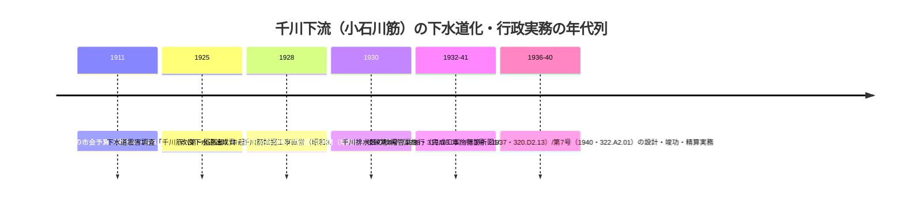

# 2026-11-27 第371回： 都公文書館403解除後の初の資料名単語掃引（千川516・谷端57・弦巻194・水窪38）＝千川排水区枝線工事群・千川筋下水道改修実測図群の新規特定（GOV-628・GOV-629）

## 概要

- 開始HEAD=f563ec2ad（第370回bot・並走なし・push前再照合）。**東京都公文書館（archives.metro.tokyo.lg.jp）が200に復旧**し、第363回以降回送され続けた資料名クロス掃引を初実施。
- 成果: [GOV-628](../sources/gov/GOV-628.md)（千川筋下水道行政実務群1911〜1941・31件クラスタ）＋[GOV-629](../sources/gov/GOV-629.md)（千川筋堀割×陸軍省1872・千川筋巡回1885・谷端公園開園告示1943＋甲集十七原本書誌）の新規2 source。総数1,935→1,937件・行政625→627件。

## 掃引の手法（GETレシピの確立）

- 詳細検索 `/search?cls=cross` のform解析: **c13=資料名/タイトル/件名（c13_a=1部分一致・c13_l=1AND）**、c12=フリーワード、c20=請求番号。`/list`へのGETは chkCls14種（collection_01,03〜07,09〜13,15〜17）＋secIdx=0&cls=cross&pn=&dispnum=100 で通る。
- 検出: pkey別の`【資料名称】`行抽出で516/57/194/38件を全頁走査（各頁fetch間5秒）。詳細頁は `/detail?cls=…&pkey=…` の `<th>ラベル</th><td>値</td>` 表を直接パース可能（JS不要）。**このレシピは次回以降の掃引（「排水区」「堀割」等の未掃引単語）に再利用可**。

## 解釈: 千川下流の下水道化の実務年代列（GOV-628の骨格）

- 1928試掘→1930.7.3認可申請→1932〜41施行の列は、[BLOG-077](../sources/blogs/BLOG-077.md)（着手1930→竣工1934）の着手年を行政実務側から裏付ける**初の一次記録列**。ただし枝線各号と千川改修（放流先変更）の区間対応は図面未見のため断定しない。
- 「千川排水区」という区名が1932年以降の完成工事図に明示＝[GOV-581](../sources/gov/GOV-581.md)（1938谷端川・音羽・谷田川排水区決定）と同じ区名体系の千川側の実在。

## 陰性・重複整理（掃引4語の仕分け）

- 「谷端」57件: 谷端川改修系（告示691/317/328号・矩形渠設計図・雑種財産引継・東上線橋梁・音羽流域排水区設計図）は[GOV-568](../sources/gov/GOV-568.md)/[GOV-571](../sources/gov/GOV-571.md)で既収録。字北谷端・南谷端の土地行政群は[GOV-592](../sources/gov/GOV-592.md)と重複中心。新規は谷端公園開園告示（1943・GOV-629）のみ。**未取得**: 戦災復興土地区画整理換地確定図（谷端組合地区①②・pkey 000458213）＝次回。
- 「弦巻」194件: 荏原郡弦巻村（世田谷）中心で四河川の弦巻川と無関係〔陰性〕。東京府志料第十八（DC-018/DC-043）の内容注記は巻之八十九〜九十一（荏原・麻布）と確認。
- 「水窪」38件: 大森区清水窪等の同名異地。雑司ヶ谷字水窪新田は[GOV-573](../sources/gov/GOV-573.md)既収録。
- 「千川」516件: 千川水道/水路/用水/上水系はGOV-572/580/586/587/588/591/618の既掃引と重複中心。千川橋（天保7年石橋）は[GOV-606](../sources/gov/GOV-606.md)橋々銘書と一致。千川文書上中下は[GOV-567](../sources/gov/GOV-567.md)。十八年度玉川神田両上水井賦金は[GOV-325](../sources/gov/GOV-325.md)系と判断し詳細未取得（次回候補）。千川善造・千川宿葛ヶ谷村養水・金井窪村縁土揚敷はGOV-591/615/618で既収録。

## 次回課題（第372回）

1. **開札2026-12-02（GOV-148）の入札結果確認＝開札後最初の実行で最優先**（12-16 GOV-582も・kensetsunews複数経路。本日は未開札を確認）。
2. **都公報第18678号（11-28発行）の初走査**: 本日はtokyo-koho.jpがDNS不通（000）で実施不能。
3. **都公文書館の未掃引単語**: 「排水区」（枝線第1/2/6号・谷端川・音羽流域の他区画の補完）・「堀割」（千川筋堀割1872の本文所在簿冊群）・「悪水」「用悪水路」（GOV-604水久保新田用悪水路の同系統）・戦災復興換地確定図（谷端組合地区）の詳細頁。GETレシピ確立済み。
4. **nabunken総覧のBOOK-338レコード特定・文京区No.118/No.49報告書書誌**（本日は不通000）。
5. 天祖神社「玉川上水分水」碑の碑文全文・建立年の特定（継続）。
6. 江戸川公園の大洗堰一部復元池の追加情報（継続）。
7. 監視系: 本日の観測=暗渠ハンター最新42514820不変・wanjin entry-677/678=404（fc2一時不通か）・kanzyou7 404・ro-da DNS不通・水徒然exblog i8/i6 403継続・jpsearch API頁404（旧endpoint不通・4語の前回値132/45/7/70維持扱い）・TOA top 200（result_s系は未確認）・都公報DNS不通・nabunken不通。
8. human判読系（増刊94号・板橋マニア2章・GOV-616全2コマ・GOV-624流下経路図・沢蔵司稲荷親柱採録）＝ユーザーPC到達不可（scheduled task実行）のためデスクトップ環境時に回送。

**この定期タスクは更新可否にかかわらず継続（停止しない）。**

## push方法の記録

- push①: GOV-628.md・GOV-629.md・本ノート（run_typescriptのtools.file_system.read_file→push_files連結・u8デコーダ通し）。
- push②: ヘルパー3点（.371-bullet.txt・.371-insert.py・.github/workflows/insert-371.yml＝.370系を3604628cからSHA指定raw取得して371へ置換踏襲）→botがREADME 138行目bullet挿入＋INDEX（GOV-627行の直後にGOV-628・GOV-629の2行・行政625→627件・総数1935→1937件）＋自己削除。
- READMEアンカー=第370回行・INDEXアンカー=GOV-627行。採番現況（第372回起点）: GOV-630・BLOG-360・BOOK-339・ORG-051・PAP-125・GAZ-198・MAP-242・LOST-006。
