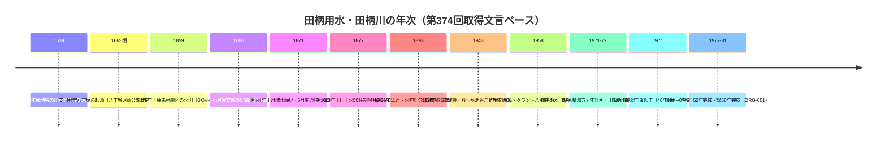

# 2026-11-27（第374回）・TGR光が丘今昔シリーズ全面資料化（ORG-051）とねりまの川田柄用水3本・現町名田柄（GOV-630・631）の新規収録

## 1. 実行概要

- 開始HEAD=1d23a01d88（第373回bot・ヘルパー自己削除コミット）。push前にlist_commitsで再照合し並走なしを確認。
- 第373回次回課題②（都公報18678号初走査）は**tokyo-koho.jpのDNSがNXDOMAIN（Cloudflare DoHでStatus 3）**のため不可＝11-28発行前でもあるため第375回回送。課題③（都公文書館403解除待ち掃引）も**archives.metro.tokyo.lg.jpのAレコードがNODATA（dns.google・Cloudflare DoHともAnswerなし・plalaゾーンのSOAのみ応答）**に悪化＝回送。
- 課題④（BLOG-360の明治26年増水年次の一次史料照合・碑名追加検索）からunified_searchで探索した結果、**練馬区公式系の田柄用水3資料（GOV-630・GOV-631）と都立田柄高校校長連載（ORG-051）**を発見し新規収録した。採番は第374回起点どおりGOV-630・GOV-631・ORG-051。総数1,938→1,941件・行政627→629件・企業・団体50→51件。

## 2. 新規3 sourceの要旨

- **ORG-051〔直接確認〕: 東京都立田柄高校「TGR光が丘今昔」水系関連8回（第十二代校長 加藤竜吾・2021-08〜11）**: 都立学校公式サイトの全86回地域史連載のうち田柄橋・光が丘地形・主なしの松・土支田八丁堀・お玉が池・田柄川その1/2・田柄水道の8頁本文全文を取得。**①田柄川幹線の区域別暗渠化年次（昭和46年9月起工→48年練馬駐屯地官舎裏着手→52年・錦地区56年完成）②狩野川台風（昭和33年）のグラントハイツ浸水 ③「厄介堀」の第2語源（維持負担由来＝BLOG-118の汚水氾濫由来と対立併記）④お玉が池の明細書上帳（明治9年・東西11間×南北21間）と東京府志料（明治7年・御玉ヶ池）の寸法文言 ⑤八丁堀児童公園案内文（寛文3年頃・約八丁900m由来・全文採録）⑥「田柄用水七つの謎」（練馬区教委2003・平田2004）⑦武蔵国土支田村小島家文書（練馬区教委1993編・万延元年1860記録）と明治2年完成説vs明治4年5月開通説の本文内対立 ⑧棚橋（平成15年まで欄干現存→環八でメモリアル化）・田柄橋の橋名群 ⑨「主なし」語源説 ⑩田柄水道（田柄町水道利用組合・初代理事長上野徳次郎・愛染院阿弥陀堂横顕彰碑昭和49年建立）**＝いずれもrepo grep 0件＝repo初出。
- **GOV-630〔直接確認: Wayback〕: 練馬わがまち資料館「ねりまの川」田柄用水3本（column/3632・3656・3688・北沢邦彦・昭和62年区報連載の2024年再録）**: 直はサイトメンテ中のためWaybackスナップショット（2026-05-17/2026-07-17/2025-04-28）で全文取得。**①土支田小島家文書（明治4年正月の増水計画文書・税収増の趣旨）②村別水田拡張面積リスト（田無25・上保谷25・下土支田9…町歩）と工事費1,350両 ③明治10年玉川上水引水50%制限・明治15年上/下練馬村との水利用協定 ④工場用水の水系連関（火薬製造所・王子製紙・印刷局抄紙部は初め千川上水や石神井川を利用したが足りず田柄用水増水を働きかけ＝千川上水水利史の隣接系統側裏付け）⑤明治26年11月の水神記念碑建立（現田柄四丁目天祖神社＝BLOG-360の碑の公的側裏付け）⑥天祖神社前の石橋の現存（令和4年写真） ⑦下練馬村絵図「溜井」（北町八丁目南西付近）＝遊歴雑記「練馬下田柄村の池」（1町四方・用水掘設）の符合 ⑧柳沢用水（明治8年武蔵国郡村誌）・安政6年上練馬村絵図・明治2年土支田村絵図・明治44年地形図の各所在**。
- **GOV-631〔直接確認: Wayback〕: 同「ねりまの地名今むかし 現町名12＜田柄＞」（column/1163・桑島新一・昭和60年3月11日区報の2021年再録）**: **①田柄の東西範囲（下田柄=北町自衛隊付近〜上田柄=光が丘・上/下練馬村跨り）②寛永16年1639検地帳の地名・由来不詳 ③四神地名録田柄条（「畑在所にて田方一分ばかり、風土すぐれず広きといふのみ」）の応用 ④「田柄用水記念碑」の区史跡表記 ⑤昭和7年板橋区練馬田柄町・昭和42年住居表示 ⑥「やっかい堀」の区公式用例＋「47年ごろから」暗渠化工事 ⑦練馬だいこんコース（練馬大根を流れで洗ったことにちなむ緑道愛称）⑧桑島新一「田柄川今昔」の著作存在**。

## 3. 対立記録・年次の多説性（断定しない項目）

| 項目 | 説の系統 | 断定回避の措置 |
|---|---|---|
| 田柄用水の開通 | 明治2年完成説（ORG-051今昔24・本文）vs 明治4年5月開通説（同脚注・小島家文書・GOV-630）vs 明治4年秋完成（GOV-098） | 3説併記 |
| 八丁堀の年次 | 寛文3年頃からの灌漑堀（案内文）vs 田柄用水開通で埋められた（伝承） | 対立として並記 |
| 「やっかい堀/厄介堀」の語源 | 汚水・氾濫由来（BLOG-118・GOV-631）vs 田柄用水維持負担由来（ORG-051今昔25） | 2語源併記 |
| 田柄川幹線の着手 | 46年9月起工（ORG-051）vs 47年度着工（GOV-075）vs 47年ごろ（GOV-631） | 対立として断定せず |
| 上野徳次郎 | 田柄水道初代理事長（ORG-051今昔26）vs 練馬区議会議長・昭和23年意見書提出者（GOV-075） | 同姓同名・別人物候補と記録 |

## 4. 田柄用水・田柄川系の年次整理（本回取得分）

## 5. 陰性・見送り

- nabunken（全国文化財総覧）は200復旧したが**検索頁・WebGISとも「アクセス集中」の案内頁・429**＝BOOK-338（小日向一・二丁目南遺跡報告書）レコード特定は回送。練馬区公式文化財頁b049（田柄用水記念碑）は404・Wayback未収蔵（内容はGOV-630/631で代替充足）。TGRシリーズの成増飛行場・グラントハイツ関連回（tgr_19/20/21/35/48〜60等）は水系文言の密度が低く本回は水系8頁に限定（校長執筆の空襲・軍事回で水路記述の追加がある可能性は次回課題）。やとじぃの江戸ノ背通信（jimdoweb）の「石神井川たんけん・谷戸たんけ」頁は404。ネリマンタイムスの土支田八丁堀天満宮（本覚寺隣）の社名は周辺記録としてノート記録のみ。kankeijinko.jpの宇田川記事（2026-10-14）は渋谷川系でスコープ外。kensetsunewsの千川検索は200だが開札系新着なし。
- 監視系: 開札12-02（GOV-148）・12-16（GOV-582）は未開札＝**第375回最優先**。都公報18678号=tokyo-koho DNS NXDOMAIN。都公文書館=AレコードNODATA。暗渠ハンター最新42514820不変。jpsearch旧endpoint 404不変。wanjin・ro-da DNS不通。kanzyou7 403。水徒然exblog主要カテゴリ掃引は第373回で完結済み。NDL SRUは本回未実施（前回値31/2/9/117維持扱い）。

## 6. push構成

- push①: GOV-630.md・GOV-631.md・ORG-051.md・本ノート（4ファイル）。
- push②: ヘルパー3点（.374-bullet.txt・.374-insert.py・.github/workflows/insert-374.yml＝README bullet挿入＋INDEX 3行挿入＋計数更新〔行政627→629・企業団体50→51・総数1938→1941〕＋自己削除）。
- 挿入位置: READMEは`- **第373回:`行（remote 140行目・push前に再確認）の直後。INDEXはGOV-629行の直後にGOV-630・GOV-631、ORG-050行の直後にORG-051。

## 7. 次回（第375回）課題（優先順）

1. **開札2026-12-02（GOV-148）の入札結果確認＝開札後最初の実行で最優先**（12-16 GOV-582も・複数経路）。
2. **都公報第18678号の初走査**（tokyo-koho DNS復旧後・11-28発行後）。
3. **都公文書館DNS（AレコードNODATA）復旧待ち**: 「排水区」「堀割」「悪水」「用悪水路」初クロス掃引＋戦災復興換地確定図（pkey 000458213）詳細頁。
4. **ORG-051/GOV-630由来の一次史料の所在特定**: 武蔵国土支田村小島家文書（練馬区教委1993編・書名特定）、安政6年上練馬村絵図・下練馬村絵図（石神井公園ふるさと文化館所蔵）・明治2年土支田村絵図の現物所在、「田柄用水七つの謎」（練馬区教委2003・平田2004の書誌＝練馬区立図書館・みどりと水の練馬第3章との関係）、遊歴雑記「練馬下田柄村の池」の原文、桑島新一「田柄川今昔」。
5. 天祖神社「上練馬村玉川上水分水紀念碑」の碑文全文採録（BLOG-360+GOV-630で碑側情報は揃ったため現地採録または区史跡指定調査報告の探索）。
6. nabunken総覧のBOOK-338レコード特定（アクセス集中の復旧後）。
7. TGR光が丘今昔の残り回（グラントハイツ黎明期・返還運動系）の水路・調整池記述の掃引。
8. human判読系（増刊94号・板橋マニア2章・GOV-616全2コマ・GOV-624流下経路図・沢蔵司稲荷親柱採録・秋の陽公園の「田柄川幹線埋設位置」石柱3本の採録）＝ユーザーPC到達不可（scheduled task実行）のためデスクトップ環境時に回送。**この定期タスクは更新可否にかかわらず継続（停止しない）**。
