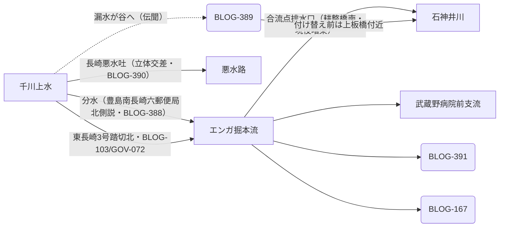

# 2026-11-28（第381回）・Natrium canal_lot未収録残頁（エンガ掘シリーズ・井草川上流・江古田川その2）の新規6 source（BLOG-388〜393）とwanjin東大下水カテゴリ完結の記録

## 1. 実行環境・開始状態

- 実行環境はupgrade済み（curl・python3・node可・git不可）。開始HEADは第380回bot自己削除コミット（8762d96）をcodeload tarballで確認し、INDEX総数1,970件・ブログ386件・README 147行目=第380回bulletであることを照合したうえで採番（BLOG-388〜393）。
- push前にlist_commitsで並走実行の有無を再照合すること（毎時運行のため必須）。

## 2. 成果＝Natrium canal_lot残り未収録頁の本文確認（第380回課題③）

- canal_lot上位目次頁（https://natrium.jp/canal_lot/）の全286リンクとrepo既収録URL群（57件）の差分から、四河川関連の未収録頁を一斉検出・本文全文取得（すべて200・直接確認）。
- **BLOG-388〜391＝エンガ掘シリーズ全未収録頁（engabori/enga01・enga02・enga03×2・komone）の全面資料化**。既収録のekoda（BLOG-167）を含めエンガ掘シリーズは完結。
  - 最大の新情報: ①**大谷口給水所の沿革年次列**（昭和6年給水塔完成→昭和47年まで現役→平成17年取壊→平成23年ポンプ棟・砧浄水場→荒玉水道→王子方面給水）②**「千川上水の漏水が谷に流れていた」伝聞**（漏水説=BLOG-104系の傍証候補）③**ねりまの文化財60号引用の千川上水立体交差**（明豊中付近）と**長崎悪水吐**（千川上水の下をくぐる・2024年開渠現況観察）④エンガ掘別称「エガ掘・江川」⑤小茂根地名合成由来（昭和40年住居表示）⑥大谷口氷川神社（延宝2年1674記録）。
- **BLOG-392＝igusa02その1〜その3の本文確認**（第380回の「本文未確認」課題を解消）。「井草川上流は千川上水と六ヶ村分水（井草分水）の双方から導水」という文言が千川上水分水系の新観察。
- **BLOG-393＝egota/egotaその2**（市杵島神社湧水伝承・「字弁天」＝弁天分水の由来側候補・下徳殿橋看板実物）。
- 陰性: imagawa（今川の支流）・shimizu-momoi（清水・桃井の支流）は四河川文言なし。kanda配下未収録17頁（aioi・benten・bunsuiro・daini・eifuku・fujimi・himawari・hnakano・hounan・inokashira・izumi01/02・kugayama・takaido・totsuka・tsukayama・yayoicho）は弦巻川・水窪川文言なし（全頁取得確認）。

## 3. wanjin「東大下水」カテゴリ掃引（第380回課題④）＝完結・陰性

- カテゴリ9（東大下水・7回）の全エントリを走査: entry-26/27（指ヶ谷支流・用語解説）・28〜31（六義園支流×3・後楽園・西片支流・菊坂支流）・49（訂正記事）は**すべてrepo既収録**（BLOG-183/210/236/237/238等）。新規なし。水窪川（5）・弦巻川（3）・千川上水（1）・田柄川（17）に続く5カテゴリ目の完結。

## 4. 回送・監視

- **開札2026-12-02（GOV-148環七調節池広域整備検討その2）は未開札＝第382回以降も最優先**（12-16 GOV-582も）。
- **都公報第18678号**: www.tokyoto-koho.metro.tokyo.lg.jpがDNS不通（curl exit 6・000）で未走査＝継続回送。
- **都公文書館**: DNSは解決したが全面403（2254B・UA+cookie jarでも同様）。「堀割」「悪水」「排水区」「用悪水路」掃引と換地確定図pkey 000458213は継続回送（第371回GETレシピで再試行済み）。
- PAP-093: CiNii系は202応答で本文未取得（継続）。
- kanzyou7: 200復帰。WHAT'S NEW最新2026/11/24（現場見学会募集）=既知内容と同一。暗渠ハンター: 最新42514820不変。jpsearch・NDL OpenSearch: 千川上水系の応答形式変更で件数抽出は次回再形式化要（監視継続）。
- human判読系（増刊94号・板橋マニア2章・GOV-616全2コマ・GOV-624流下経路図・沢蔵司稲荷親柱・沼辺地蔵・秋の陽公園石柱3本・田柄天祖神社碑・貞享2年/文政4年庚申塔異同）＝ユーザーPC到達不可（定期実行）のためデスクトップ環境時に回送。

## 5. 対照表・INDEX

- 対照表に「小茂根」行を追加（山崎／山崎田んぼ行の次・第381回追記）。
- INDEX: BLOG-388〜393の6行をBLOG-387行直後に挿入、計数をブログ386→392・総数1,970→1,976に更新。

## 6. Mermaid: エンガ掘資料体系の整理

- 第381回のエンガ掘5頁で、千川上水分水点から石神井川合流点までの本流・支流の観察がrepo内で初めて頁単位で揃った。分水点の「豊島南長崎六郵便局北側」説と「東長崎3号踏切北」説の異同は地図照合が次の一手。

## 7. この定期タスクの継続

- この定期タスクは更新可否にかかわらず継続（停止しない）。
