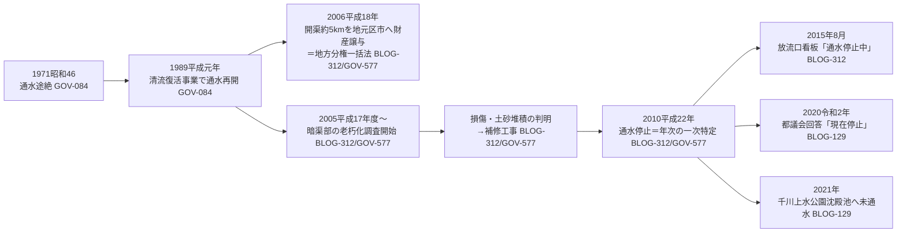

# [BLOG-312] kotakemol04「現在千川上水暗渠部に水は流れていません」（2015-08-23）— 千川上水通水停止の年次（平成22年）が都議会回答レベルで特定された記録〔repo初出〕

## 書誌・取得経緯〔確認〕

- FC2ブログ「越後屋たぬき（FC2版）」の**2015-08-23 22:34**記事（blog-entry-2042）。2026-11-24にFC2から直接取得（[BLOG-129](BLOG-129.md)取得時に遮断された閲覧制限は本記事では掛かっていなかった）。
- **石神井川への放流口の看板文言〔観察・2015年8月撮影〕**: 「**現在、管きょの老朽化に伴う調査を実施しているため、通水停止中**」＝[BLOG-059](BLOG-059.md)流末・板橋駅東側の終点看板の2015年時点の文言。
- **速記録原文の一次確認〔2026-11-24・第302回〕**: 引用の都議会問答（平成26年11月13日環境・建設委員会速記録第十三号）について、gikaiサイトの直接curlはWAF 403だが**r.jina.ai経由で全文86,954字を取得**し、本記事の引用文言と原文の**全文一致を検証した**（一次資料＝[GOV-577](../gov/GOV-577.md)）。引用に恣意的な改変なしと確認。

## 平成26年11月13日都議会環境・建設委員会問答の引用〔本文確認＋原文一次確認・年次はrepo初出〕

- **河野（ゆう）委員（河野ゆうき・板橋区選出都議・元板橋区議）の質問**〔確認: 記事の引用＋速記録原文〕:
  - 板橋区大山には千川上水が「**今はもうヒューム管が下に埋設されている、暗渠化された**」・「**これは昭和三年、四年のころに暗渠化されて**」〔河野委員の語りによる年代伝達＝委員個人の記憶に基づく発言なので**観察（発言）**として記録〕
  - 区議会時代に第四建設事務所で調べたところ「**大山の入り口のあたりまでは、一日当たり三千立米ぐらい水が流れていた**」が「**板橋区役所まで行って、ＪＲ板橋の方まで…その区間を流れている間に水が渇水してしまっている**」〔河野委員の照会内容としての数値伝達＝**観察（発言）**〕
  - 板橋区大山駅周辺のまちづくりマスタープランに千川上水が「可能性として」触れられている〔この言及の一次文言も原文で確認＝マスタープラン本文の所在特定はGOV-577・第302回ノート参照〕
- **中島河川部長の答弁**〔確認: 記事の引用＋速記録原文＝以下は都側一次文言〕:
  - 「千川上水は、河川法の適用のない**法定外公共物**であり、**練馬区の伊勢橋から下流の暗渠区間、約十五キロメートル**につきましては、地元区への移管が整うまでの間、都が使用許可、維持管理などを実施しております」〔**伊勢橋から下流約15km**＝[GOV-058](../gov/GOV-058.md)の都管理暗渠13.8kmと僅差の数値並記〕
  - 「**平成十七年度から老朽化等の調査を行いました**ところ、**損傷や土砂の堆積が判明した**ため、補修工事等を行ってきており、**これに伴い、平成二十二年に通水を停止しております**」＝**通水停止の年次（2010年）が都答弁文言として特定されたrepo初出の記録**（[BLOG-129](BLOG-129.md)の令和2年回答「現在停止」に繋がる年次の一次文言）
  - 「千川上水の**武蔵野市から練馬区までの開渠区間、約五キロメートル**につきましては、**地方分権一括法の施行に伴い、平成十八年に地元区市に財産を譲与**しておりまして、暗渠区間の移管につきましても、地元区と協議を継続しております」〔[GOV-084](../gov/GOV-084.md)の境橋〜吉祥寺橋約3.8km（武蔵野市区間・2006移譲）と整合する上位文言＝開渠全区間約5kmの譲与対象が「区市」＝武蔵野市＋練馬区〕
  - 「暗渠区間の大部分は、千川通りなど幹線道路の下に位置しておりまして、切り開いて水路として復活、復元することは困難な状況ではございますが、地元区が空間的に余裕のある場所などで**清流復活に取り組む場合には、都として支援してまいります**。また、**通水の可能性につきまして、堆積物の除去や補修などにあわせて、引き続き調査検討してまいります**」

## 千川上水の近代〜現代の通水・管理系譜（既存収録との統合）

## 入札・工事案件の列挙〔観察: 記事の筆者による入札公告の採録〕

- 千川上水暗渠部補修工事（26四の1-2）＝**板橋区大山町地内ほか5箇所**、千川上水暗渠部基本調査委託＝板橋区板橋一丁目地内から**練馬区関町北四丁目地内**まで（いずれも既完了）
- 千川上水暗渠部補修工事（27-1）＝**北区滝野川六丁目地内から練馬区関町一丁目地内**まで、**千川上水埋設物台帳作成測量＝千川上水全区間**＝暗渠全区間の台帳整備という管理系統の記録
- **千川上水善福寺川導水路調査委託＝導水管の内径600ミリ**（伊勢殿橋からの**日量10,000立米**は全量善福寺川へ導水の旨〔筆者観察〕）

## 制限・未解決

- ~~議事録原文の一次確認~~→**第302回（2026-11-24）で解消**（速記録第十三号をr.jina.ai経由で全文取得・引用文言の全文一致を検証＝[GOV-577](../gov/GOV-577.md)）。河野委員の昭和3-4年暗渠化・3,000立米/日・渇水区間の数値は発言ベースのため**断定しない**（委員の記憶・照会に基づく）。
- 看板文言の設置主体（都建設局か下水道局か）は記事に明記なし。

## 関連

- [GOV-577](../gov/GOV-577.md)（引用元の速記録第十三号・一次確認・229号線や広域調節池連結文言も同号収録）
- [BLOG-129](BLOG-129.md)（令和2年都議会回答・沈殿池未通水＝本記事の後日譚として相互参照）
- [BLOG-035](BLOG-035.md)以降の同筆者千川上水シリーズ・[GOV-058](../gov/GOV-058.md)（13.8km暗渠）・[GOV-084](../gov/GOV-084.md)（武蔵野市区間）・[GOV-065](../gov/GOV-065.md)（分配堰）
- [第301回ノート](../../2026-11-24（第301回）・生活と文化25〜34号目録の掃引と千川上水通水停止の年次特定・志村大観の所在確認.md)・[第302回ノート](../../2026-11-24（第302回）・都議会速記録13号の一次確認・環七白子川連結初期スペックの確定・大山マスタープラン頁の特定とWaybackレジューム技.md)
