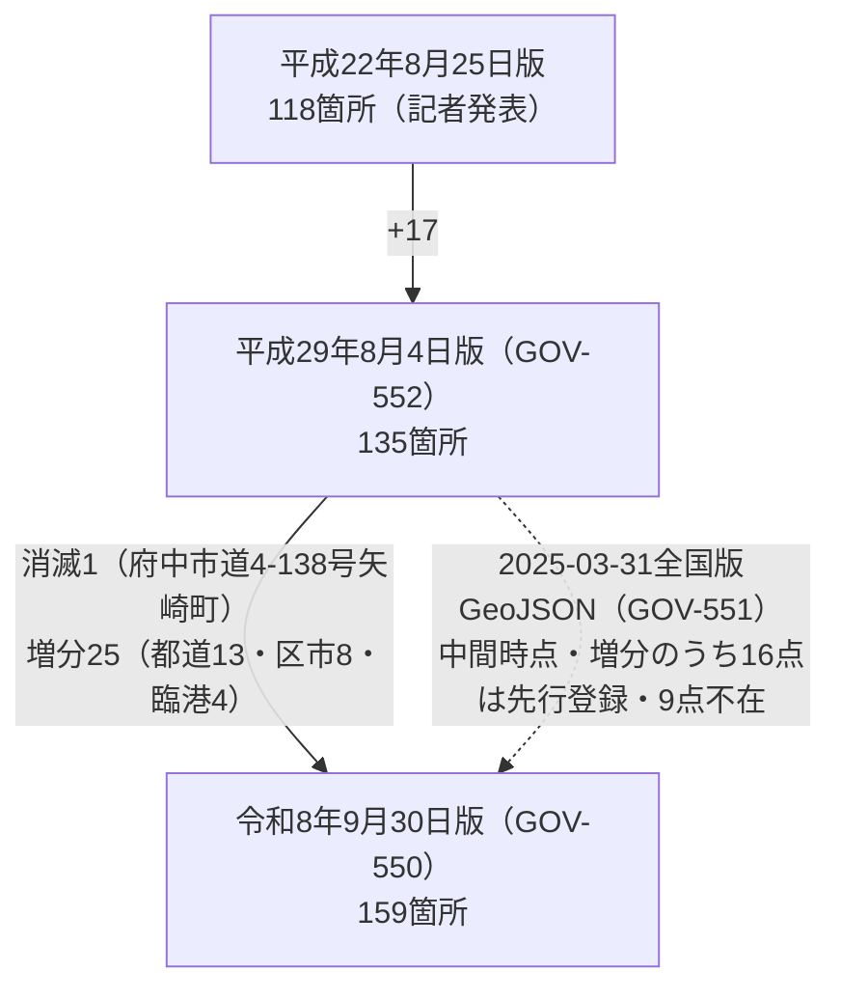

# [GOV-550] 関東地方整備局「道路冠水注意箇所マップ【東京都】」〔東京都内159箇所の全リスト一次取得・BLOG-299の二次引用の解消〕

- **書誌〔確認: PDF・r.jina.ai OCR経由・2026-11-23取得〕**: 国土交通省関東地方整備局「**アンダーパス部の道路冠水注意箇所マップ【東京都】**」（**令和8年9月30日時点・全159箇所**） https://www.ktr.mlit.go.jp/ktr_content/content/000752436.pdf （3,630,772バイト・3頁・画像PDF）。親ページ＝「関東甲信地域における道路冠水注意箇所マップ」 https://www.ktr.mlit.go.jp/road/bousai/road_bousai00000001.html （東京都版は**令和8年9月30日【更新】**の表示）。前史＝平成22年8月25日記者発表「東京都内アンダーパス部の冠水注意箇所は118箇所」 https://www.ktr.mlit.go.jp/ktr_content/content/000736788.pdf ・平成29年8月4日「135箇所」 https://www.ktr.mlit.go.jp/ktr_content/content/000725521.pdf 〔118（2010）→135（2017）→159（2026）の増加系列が3時点で追える〕。
- **全リストの内訳〔確認・OCR本文・対象河川系に近い区のみ拾い上げ〕**:
  - **豊島区＝No.118「区道12-680号線 南池袋1丁目（ビックリガード）」の1箇所のみ**〔[BLOG-299](../blogs/BLOG-299.md)の「豊島区は1か所＝ビックリガード」の指摘と完全一致＝弦巻川上流域の低地（南池袋）の構造物冠水対象が国の一覧でも2026年版時点で豊島区唯一であることの一次確定〕。
  - **板橋区＝7箇所（谷端川下流域・新河岸川流域）**: No.3 国道17号 仲宿アンダー／No.7 国道17号BP 大門アンダー／No.8 国道17号BP 馬坂アンダー／No.31 都道317号 中丸町地内（熊野町アンダーパス）／No.32 都道318号 南常盤台一丁目地内（南常盤台アンダーパス）／No.33 都道441号 向原二丁目地内（向原トンネル）／No.109 区道2943号線 赤塚8丁目22番地先＋**練馬区・板橋区跨ぎ＝No.4 国道17号BP 北町アンダー・No.5 赤塚アンダー・No.6 徳丸アンダー**〔「板橋区だけ7か所・両区跨ぎ3つ」という[BLOG-299](../blogs/BLOG-299.md)の区別集計と完全一致〕。
  - **練馬区のみ＝7箇所**: No.59 都道311号 貫井四丁目地内（練馬トンネル）／No.60 都道311号 春日町三丁目地内（練馬春日町トンネル）／No.61 都道441号 小竹町二丁目地内（小竹トンネル）／No.62 都道443号 高野台四丁目地内（谷原アンダーパス）／No.93 都道441号 平和台トンネル／No.119 区道 練馬主要区道35号線 南田中三丁目（長光寺橋アンダーパス）／No.120 区道 練馬主要区道39号線 東大泉五丁目（大泉学園駅前アンダーパス）〔BLOG-299の「練馬区だけの箇所は6か所」（2017年版135箇所時点）に対し現行版は7箇所＝2017→2026の増分候補〔No.93・119・120のいずれかが増分と推定されるが増分箇所の特定は全バージョン対照が必要のため断定しない〕〕。
  - **中野区＝1箇所**: No.58 都道318号 野方三丁目（野方アンダーパス）〔神田川沿いの野方＝[GOV-535](GOV-535.md)（中野区都市計画河川ページ）の神田川3,400m流域内〕。
  - **杉並区＝4箇所**: No.43 都道311号 今川一丁目地内（**井荻トンネル**）／No.44 都道311号 清水一丁目（**四面道アンダーパス**）／No.45 都道311号 上荻二丁目地内（**荻窪アンダーパス**）／No.46 都道318号 和泉4丁目（**方南八幡アンダーパス**）〔**四面道アンダーパス**＝千川上水系「四面道」の地名と共通表記の道路構造物が国の冠水注意対象として現存（青梅街道×環七付近の立体的交通の冠水対象）。荻窪・井荻は神田川・妙正寺川流域、方南八幡は善福寺川流域〕。
  - **西東京市＝2箇所**: No.98 都道（伏見通り）**東伏見トンネル**／No.99 都道（伏見通り）**下保谷トンネル**〔石神井川上流地下調節池の伏見通りトンネル構造（[GOV-548](GOV-548.md)/[GOV-549](GOV-549.md)）と同じ道路の既存アンダーパスが冠水注意対象〔新規の地下調節池と既存の冠水注意箇所の位置関係は図面判読待ち〕〕。
  - **武蔵野市＝1箇所**: No.152 市道第107号線 御殿山二丁目 **八丁地下道**〔武蔵野市域（千川上水〜玉川上水間）唯一の箇所〕。
  - なお管理主体の体系＝「東京国道事務所管理箇所（国道4・15・17・17BP・20・246・357号）/相武国道事務所管理箇所（国道16号・16号八王子BP・20号23区外）/東京都管理箇所（都道）/区・市管理箇所（区市町道）」＋都道府県名欄はすべて「東京都」。
- **意義〔観察〕**: ①[BLOG-299](../blogs/BLOG-299.md)の制限②「**国交省「道路冠水注意箇所」の東京都一覧の直接取得は今回未実施**」を解決＝2017年版135箇所由来の二次叙述に対し、**令和8年9月30日時点の159箇所版（一次）**を取得。②**「豊島区=ビックリガード1箇所のみ」という構図が2026年版でも不変**＝弦巻川上流域・谷端川・千川低地（豊島区）のアンダーパス冠水対象が国の一覧で1か所だけという体系的陰性の一次確定〔豊島区の他の低地構造物（ビックリガード以外）は道路管理者（国・都）の冠水注意対象に掲載されていない＝浸水対策の主体が下水道幹線系（第二千川幹線・谷端川一号幹線等〔BLOG-299〕）にあり、アンダーパス構造物としては1か所のみという構造の観察〕。③**板橋区の区別集計7箇所＋跨ぎ3＝BLOG-299の数値と完全一致**の一次検証。④谷端川下流域（板橋区）・神田川系（中野・杉並）・千川上水系の西側面（西東京・武蔵野）の冠水注意箇所の分布が一覧で固定されたことで、対象4河川流域の「低地の道路構造物の現在の冠水リスク地図」の行政側基礎資料が確保された。
- **制限・未解決**: ①PDFは画像PDF＝本文はr.jina.ai OCR由来のため、**箇所番号の正確な対応（地図面の番号配置）・表の全行の一字一句はhuman目視が望ましい**（OCR上は全159行が読めるが、地図面の番号座標は読み取れない）。②2017年版135箇所との差分（増加24箇所の特定）は今回未実施〔平成29年版PDFとの全行対照が必要〕。③「増分箇所の推定（練馬区のみ7箇所のうちの増分）」は断定しない。④ビックリガードの名称由来（由来の一次史料）は本資料の範囲外。

## 第281回追記（2026-11-23）・全国版GeoJSON（GOV-551）との対照

- **2025-03-31時点の全国版GeoJSON〔[GOV-551](GOV-551.md)〕との対照**: [GOV-551](GOV-551.md)（国交省「全国のアンダーパス箇所マップ」関東分83knt.geojson・2025年3月31日時点・966 features）と全行突合した結果: ①**本資料（2026-09-30版159箇所）の対象流域の箇所はすべて2025-03-31版にも登録済み**＝ビックリガード（139.709911, 35.727196）・赤塚8丁目22番地先（板橋区区道）・長光寺橋（練馬区）・大泉学園駅前（練馬区）・野方・井荻・四面道・荻窪・方南八幡の各都道分・谷原・平和台・練馬・練馬春日町・小竹・熊野町・南常盤台・向原の全座標が確定。②**例外＝西東京市の東伏見トンネル・下保谷トンネル（No.98・99）の2点のみ2025-03-31版GeoJSONに不在**〔feature全件走査で「東伏見」「下保谷」0件〕＝**本資料と2025年3月の間の追加登録候補の実例**〔ただし全国版は「アンダーパス箇所」全般、本資料は「冠水注意箇所」に絞る収集範囲差があり、追加点とは断定しない〕。③**練馬区のみ7箇所のうち区道分2点（長光寺橋・大泉学園駅前）は2025-03-31時点で既に存在**＝2017→2026増分候補（No.93・119・120）の推定に2025年3月の中間時点を追加〔増分特定問題は依然未解決〕。④**都道248号「貫井立体」（139.497775, 35.700976・東京都管理）は全国版に登録されているが本資料159箇所には非掲載**＝千川上水系貫井の立体交差点〔冠水注意リストの外側のアンダーパス点として[GOV-551](GOV-551.md)に記録〕。
- 2017年版（h29kansui.pdf・135箇所）との全行対照は本回も未実施〔平成29年版実リストPDFはWayback snapshot 20180413014908id_で取得したが、箇所名本文がサブセットCIDフォントで未解読のため。2017年版記者発表資料000725521.pdf（5頁・本文取得済み）の実データURLは旧URL `http://www.ktr.mlit.go.jp/toukoku/kisei/pdf/h29kansui.pdf`（現行は404リダイレクト）と判明した点は追記する。全行対照の残課題は変らず継続〕。

## 第282回追記（2026-11-23）・2017年版135箇所（GOV-552）との全行対照＝増分25・消滅1の特定・貫井立体「非掲載」記録の訂正

- **訂正〔重要〕**: 第281回追記④「**都道248号貫井立体は本資料159箇所には非掲載**」の記録は**誤り**。本回のr.jina.ai OCR再取得（2026-11-23）で本資料の全159行を読み取り、**No.74「東京都 小金井市 都道248号 貫井立体」・No.76「東京都 小平市 都道248号 小平グリーンロード立体」の掲載を確認**〔第281回の判定はOCR本文の部分読みに由来した誤読とみられるが、誤読の発生機序は特定できず記録のみ〕。よって貫井立体・小平グリーンロード立体は**2017年版（[GOV-552](GOV-552.md) No.75・77）→2025-03-31全国版GeoJSON（[GOV-551](GOV-551.md)）→本資料（2026年9月版）の3時点すべてに登録継続**が正しい。第281回「収集範囲の差の実例」叙述は撤回し、この訂正を明記する。
- **全行対照〔確認・2026-11-23・[GOV-552](GOV-552.md)の2017年版135行（PDFテキスト層完全復号）と本資料159行（OCR）の全行突合〕**:
  - **No.1〜24（直轄国道18＋相武6）は両版で同一 内容・同一順序**。
  - **移動2行**: 2017年版No.42（臨港道路東京湾岸アンダー線湾岸アンダー）は本資料では末尾の臨港道路グループ（**No.155**）に再配置〔2026年版で臨港道路がリスト末尾に独立グループ化〕。2017年版No.110（港区区道241号線高輪二丁目）は品川区グループ内で八ッ山アンダーパスの後ろ（**No.126**）に再配置。
  - **増分25箇所の全特定〔repo初出〕**: 都道系13＝**No.88桜木トンネル（世田谷区・補助128号線・桜1丁目）・No.89豊トンネル（品川区・420号）・No.90ふたばトンネル（品川区・420号）・No.91千駄ヶ谷ぎょえんトンネル（渋谷区・明治通り）・No.92打越町土入立体（八王子市・173号）・No.93平和台トンネル（練馬区・特例都道441号）・No.94諏訪通りトンネル（新宿区・主要地方道25号）・No.95国領立体（調布市・主要地方道11号）・No.96諏訪通りトンネル上り線側道・No.97同下り線側道（新宿区）・No.98東伏見トンネル・No.99下保谷トンネル（西東京市・伏見通り）・No.100清水ヶ丘立体（府中市・新小金井街道）**。区市系8＝**No.127中十条4丁目（北区・特別区道北2010号線・仲原ガード下）・No.128王子1丁目（北区・特別区道北1154号線・権現坂ガード）・No.129小島町3丁目地先（調布市・市道S218号線）・No.130瀬田アートトンネル（世田谷区・区道34C199）・No.131国士舘坂トンネル（世田谷区・区道21C172）・No.133毘沙門架道橋（八王子市・幹線1級46号線・みなみ野2-19-1）・No.153矢崎町1丁目（府中市・市道4-507号）・No.154矢崎町1丁目（府中市・市道4-198号）**。臨港4＝**No.156臨海トンネル（大田区・東京港臨海道路）・No.157第二航路海底トンネル（江東区・青海縦貫線）・No.158青海トンネル（江東区・青海トンネル線）・No.159東京港海の森トンネル（江東区・南北線）**。
  - **消滅1行**: 2017年版No.131「府中市 市道4-138号 矢崎町1丁目」は本資料にない〔代わりに末尾に「市道4-507号 矢崎町1丁目」「市道4-198号 矢崎町1丁目」の2行が追加〕＝**同一地先で路線番号が置き換わっており、府中市の路線改番（統合・分化を含む）の可能性と別構造物追加の可能性の両方があり断定しない**。なお[GOV-551](GOV-551.md)（2025-03-31）の矢崎町2 featuresは**ともに「市道4-138号」**＝2025年3月時点では4-138のまま＝本資料（2026年9月版）の4-507/4-198への変化は**2025-03〜2026-09の間の変化と整合**〔改番説を支持する方向だが断定しない〕。
  - **計数の一致〔確認〕**: 継続134−移動2を含め、135 − 1（消滅） ＋ 25（増分） ＝ 159。差し引き＋24＝118（2010）→135（2017）→159（2026）の増加系列と整合。
  - **個所番号対応〔確認・2017年版→本資料〕**: No.1-24＝同一／No.25-41＝同一／No.42→155／No.43-88→42-87／No.89-109→101-121／No.110→126／No.111-114→122-125／No.115→132／No.116-130→134-148／No.131→消滅／No.132-135→149-152。
- **[GOV-551](GOV-551.md)との三方対照（増分25行の2025-03-31時点での先行登録の有無）〔確認・GeoJSON全feature走査〕**: 増分25行のうち**16行は2025-03-31 GeoJSONに既登録**（桜木トンネル139.642158, 35.645688・豊トンネル139.721589, 35.609746・ふたばトンネル139.72573, 35.608455・千駄ヶ谷ぎょえんトンネル139.704423, 35.686956・打越町土入立体139.347743, 35.64408・平和台トンネル139.653021, 35.758571・諏訪通りトンネル139.703511, 35.709244・国領立体139.562175, 35.651957・仲原ガード下139.722147, 35.768983・権現坂ガード139.736363, 35.754471・小島町3丁目139.538561, 35.647462・毘沙門架道橋139.328989, 35.626304・臨海トンネル139.788687, 35.588975・第二航路海底トンネル139.792163, 35.604696・青海トンネル139.77931, 35.621599・東京港海の森トンネル139.796605, 35.610837）＝**冠水注意リストへの追加の大半は全国版に先行登録済みだった構造物**。**GeoJSON不在は9行**＝東伏見・下保谷（第281回追記②既出）に加え**清水ヶ丘立体・諏訪通りトンネル上下り線側道×2・瀬田アートトンネル・国士舘坂トンネル・矢崎町4-507・矢崎町4-198**〔第281回追記②の「GeoJSON不在2点」から9点に拡大。側道2行は本トンネルの付帯構造で全国版の登録単位外の可能性、矢崎町2行は4-138（GeoJSON登録済み）からの番号置換と整合〕。
- **制限③の解消（練馬区増分の特定）〔確認〕**: 練馬区のみの7箇所のうち、**2017年版から継続する6箇所（練馬・練馬春日町・小竹・谷原の各都道＋長光寺橋・大泉学園駅前の各区道＝[GOV-552](GOV-552.md) No.60-63・107・108）に対し、増分はNo.93平和台トンネルの1箇所のみ**〔第281回追記③の「長光寺橋・大泉学園駅前は2025-03-31時点で既に存在＝増分候補」という推定を本回の2017年版全行対照で解消＝両点は2017年版掲載済みで増分ではなく、増分は平和台トンネルと特定〕。[BLOG-299](../blogs/BLOG-299.md)の2017年版時点集計「練馬区だけの箇所は6か所」が原表（GOV-552）で一次確定したことも併せて記録。
- **増減の全体像〔観察・Mermaid〕**:

- 残る制限: ①地図面の番号配置の対応はhuman目視が望ましい（リスト本文は159行全行読み取り済み）。②府中市4-138→4-507/4-198の変化の性質（改番か別構造物か）は本資料群からは断定できない〔府中市への照会が一手〕。③OCR由来のため、個所名の細部（半角カナ等）は文献引用時に原PDF照合が望ましい。

## 関連

- [BLOG-299](../blogs/BLOG-299.md)（豊島区の冠水解説・135か所二次引用＝本資料で一次解消）・[BLOG-115](../blogs/BLOG-115.md)（板橋区版）・[BLOG-185](../blogs/BLOG-185.md)（ビックリガード）・[GOV-548](GOV-548.md)/[GOV-549](GOV-549.md)（伏見通りの石神井川上流地下調節池）・[GOV-035](GOV-035.md)（四面道系既存資料）・[GOV-551](GOV-551.md)（2025-03-31全国版GeoJSON・本資料の前段時点）・[GOV-552](GOV-552.md)（2017年版135行全行転写＝増分25・消滅1の対照基礎）
