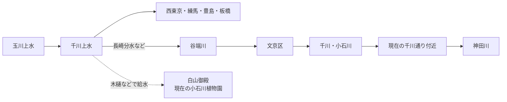

# 千川用水と文京区解説 - ChatGPTリサーチセッション

---

[user] 千川用水 文京区
---
[assistant] 文京区にある「千川用水」の痕跡・流路を知りたい感じだと思うので、現在の地図と歴史資料を突き合わせて確認します。暗渠化されている区間が多いので、「今どこを通っていたか」がポイントです。
---
[assistant] 「千川用水」と「文京区」の関係、少しややこしいです。**文京区を流れていた「千川」と、本流の「千川上水」は厳密には同じものではありません。** ここを分けるとかなり分かりやすいです。

文京区の公式資料でも、千川は現在暗渠になった河川として扱われています。citeturn572545search3turn572545search8

genui{"map_widget":{"points":[{"address":"千石三丁目交差点, 文京区千石, 東京都","name":"千石三丁目交差点","category":"旧千川流路"},{"address":"東京都文京区千石2-10-10","name":"簸川神社","category":"千川の痕跡"},{"address":"小石川植物園, 文京区白山, 東京都","name":"小石川植物園（旧白山御殿）","category":"千川上水給水先"},{"address":"富坂下交差点, 文京区, 東京都","name":"富坂下交差点","category":"千川通り"},{"address":"後楽園, 文京区, 東京都","name":"後楽園付近","category":"旧千川下流"}],"answer":"文京区内の旧「千川」の流路は、おおむね千石から小石川の谷底を南東へ進み、現在の千川通り付近を通って後楽園方面へ続いていました。"}}

### ① 本来の「千川上水」

千川上水は1696年、玉川上水から分水して造られた約30kmの上水です。現在の西東京市付近から練馬・豊島・板橋方面へ進み、江戸北部へ水を供給しました。目的には**小石川御殿（白山御殿）・湯島聖堂などへの給水**も含まれていました。citeturn762251search0turn762251search9

ただし、本流がそのまま開水路として文京区の小石川まで流れてきたわけではありません。西巣鴨方面から先では、木樋などを使って各給水先へ送られていました。白山御殿、現在の**小石川植物園**にも千川上水が引かれていたことが確認されています。citeturn762251search35

### ② 文京区を流れていた「千川」

こっちが現在の**千川通り**の由来です。

大まかには、

**豊島区方面の谷端川  
→ 文京区千石  
→ 簸川神社の下  
→ 小石川植物園東側  
→ 播磨坂の下  
→ 共同印刷付近  
→ 小石川一丁目  
→ 後楽園方面  
→ 神田川**

という谷底を流れていました。

この川は上流では「谷端川」、文京区に入るあたりから「千川」あるいは「小石川」と呼ばれていました。昭和期の『小石川区史』でも、豊島区長崎方面から南大塚までを谷端川、文京区内を千川とする説明があります。citeturn572545search4

では、なぜ「千川」なのか。

**千川上水から分けた水が谷端川へ流れ込んでいた**ため、下流側まで「千川」という名前が広がったと考えると分かりやすいです。研究資料でも、文京区の千川通りは「千川上水長崎分水から導水された谷端川下流部の小石川」を暗渠化したもの、と整理されています。citeturn762251search12

そしてこの川は洪水も多かったため、**1930年（昭和5年）に改修工事が始まり、1934年（昭和9年）に暗渠化が完成**。その上が現在の千川通りになりました。文京区の氷川下町会の記録にもこの経緯が残っています。citeturn572545search8

今でも痕跡はかなりあります。特に**簸川神社付近の「千川改修記念碑」→千川通り→小石川植物園→共同印刷→こんにゃく閻魔（源覚寺）付近**を歩くと、「道路というより谷底だな」という地形がかなり露骨に分かります。千川通りの小石川一丁目周辺が現在も浸水想定区域になっているのも、旧河道という地形と無関係ではありません。citeturn572545search30

つまり一言でいうと、**「文京区の千川＝千川上水本流」ではなく、「千川上水の水も入っていた谷端川・小石川の下流部」**です。ここ、名前が同じなので初見殺しです。

