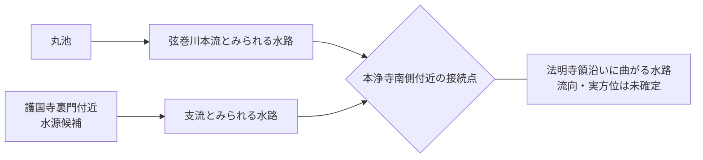

# 弦巻川

## 2022年景観計画の三河川比較図（2026年10月31日追記）

豊島区『**豊島区景観計画**』（**2022年6月改定**）の「池袋西地域」印刷**p.78・図表5-49**は、国土地理院の数値標高モデルに基づく等高線図に**水窪川・弦巻川・谷端川**の名称を併記する。印刷**p.81**の「明治42（1909）年の市街地の様子」は、三河川のほか**千川上水本流・長崎分水**を表示し、河川・水田・畑／雑木林・集落・街道・鉄道を区別する。〔**確認：原PDFの図題・凡例・文字**〕 **1909年図は2011年の『豊島区地域地図第四集』などに基づく後年の編集図**で、原測量図ではない。地形・土地利用の比較資料にはなるが、旧河道の正確な中心線、三河川の合流、千川上水との直接接続を証明しない。〔**観察・留保／未解決：図形の精密判読・旧地籍との位置合わせ**〕 出典：[GOV-024](sources/gov/GOV-024.md)／[豊島区公開PDF](https://www.city.toshima.lg.jp/documents/22568/kaitei_keikankeikaku_5-06.pdf)。

弦巻川について、現在までに確認できた主要事項をまとめる。主要出典は各記述の直後に示し、一覧は [出典一覧](出典一覧.md) にまとめる。

## 名称と水源

『失われた川を歩く 東京「暗渠」散歩 改訂版』では、弦巻川上流部は「布引川」とも呼ばれたとされる。〔書籍資料〕  
出典：本田創編著『失われた川を歩く 東京「暗渠」散歩 改訂版』実業之日本社、2021年。[出版社書誌](https://www.j-n.co.jp/books/978-4-408-33965-8/) / [BOOK-001](sources/books/BOOK-001.md)(出典一覧.md)

豊島区公式「元池袋史跡公園」は、西池袋にあった丸池について、**「弦巻川の源流として清らかな水が湧き出していました」**と明記している。また、丸池は「池袋」の地名由来とも関係づけられている。〔確認〕  
出典：豊島区公式 [「元池袋史跡公園」](https://www.city.toshima.lg.jp/340/shisetsu/koen/030.html) / [GOV-002](sources/gov/GOV-002.md)(出典一覧.md)

  

元池袋史跡公園（2010年撮影）。現在の公園そのものを丸池の現存遺構とみなすのではなく、丸池の記憶を継承する史跡公園として掲載する。

雑司ヶ谷霊園西側から本流へ注ぐ支谷や、現在に残る水路敷については、Natrium.jp の現地調査が地図・公図境界・現地写真を比較している。これは一次史料ではなく、現地観察の補助資料として扱う。  
参考：Natrium.jp [「神田川周辺の水路敷群（弦巻川）」](https://natrium.jp/canal_lot/kanda/tsurumaki/index.html) / [BLOG-002](sources/blogs/BLOG-002.md)(出典一覧.md)

## 1772年の雑司谷村絵図

明和9年（1772）の『武蔵国豊島郡雑司谷村絵図』が現存し、豊島区立郷土資料館編『豊島区地域地図 第5集（近世・村絵図I編）』に複製・読みおこし参考図が収録されていることは、公的な刊行物案内と国立国会図書館書誌から確認できる。〔史料所在確認〕  
出典：豊島区公式 [「豊島区地域地図集（複製）」](https://www.city.toshima.lg.jp/129/bunka/bunka/shiryokan/kankobutu/005951.html)、[NDLサーチ](https://ndlsearch.ndl.go.jp/books/R100000002-I000009123633) / [MAP-003](sources/maps/MAP-003.md)(出典一覧.md)

東京都建設局の雑司ケ谷霊園関連資料でも、図表の出典として豊島区立郷土資料館「柳下家文書、武蔵国豊島郡雑司谷村（読みおこし参考図）」（1772年）が用いられている。  
出典：東京都建設局 [雑司ケ谷霊園関連資料](https://www.kensetsu.metro.tokyo.lg.jp/documents/d/kensetsu/000050293) / [GOV-011](sources/gov/GOV-011.md)(出典一覧.md)

オンラインで確認できる柳下家図の複製画像もあり、2026年9月に本調査で画像を直接比較した。  
- **画像直接URL**：https://zoushigaya.up.seesaa.net/image/zousigayamura120E381AEE382B3E38394E383BC.jpg
- **画像掲載元URL**：[雑司が谷 日乗「古地図を片手に、雑司が谷の坂道を歩こう」](https://zoushigaya.seesaa.net/article/189594335.html)
- **別掲載資料**：[としま遺跡調査会「雑司が谷まちかど遺跡ミュージアム」PDF](https://toshima-iseki.org/img/zoushigaya-tenji201103.pdf)

### 本浄寺南側の接続点

絵図上では、**本浄寺の南側付近で、丸池方面から来る弦巻川本流とみられる水路に、護国寺裏門方向から来る別の水路が接続している**ように読める。〔本調査による画像観察〕

また、接続点の西側には「法明寺領」の表示が広がり、接続後の水路はその縁を回り込むように大きく曲がって描かれている。図面上では西向きに曲がるように見えるが、村絵図は実測図ではなく方位・縮尺の歪みもあるため、**実際の流向・真方位をこの描写だけから固定しない**。

### 護国寺裏門付近の上流端は水源表現の可能性

護国寺裏門方向の水路は、図郭・村境で機械的に切れるのではなく、**絵図内部で黒い水路の先端が丸く膨らんだ形で終わる**。同じ絵図の丸池も、弦巻川流出部につながる黒い水面が大きく膨らむ類似表現で描かれている。〔本調査による絵図内比較〕

このため、護国寺裏門付近の終端は、単なる描画上の省略よりも、**小池・湧水・水源となる溜まりを表した可能性が高い**とみる。ただし、「丸い終端＝必ず湧水」という凡例が明記されているわけではないため、他の水路端の表現や読みおこし参考図との比較を続ける。

この読みが正しければ、1772年時点の弦巻川系は、単純な「丸池から来る一本の川」ではなく、**丸池系の本流と護国寺裏門付近の独立した水源・支流が本浄寺南側付近で接続する水系**だった可能性がある。これは、後世の音羽谷西側河道が既存の小支谷・湧水路を接続・再編して成立したという仮説と整合的である。

### 橋状の描写

護国寺裏門側の支流が道路と交差する地点と、接続後の水路が別の道路と交差する地点には、それぞれ**梯子状の短線**が描かれており、橋と読むのが自然である。さらに丸池から出る弦巻川が道路を横切る地点にも同様の梯子状表現があるため、絵図内比較から「橋の記号」である可能性が高い。〔本調査による画像観察〕

ただし、色合いだけから木橋と断定することはしない。今後、橋名史料に出る卒塔婆橋・鎌倉橋・木村橋・南坂橋・弦巻橋・松屋橋・境橋などと、**1772年図の橋の位置を対応させることが位置比定の重要課題**となる。

1772年図から現在かなり具体的に追えるのは雑司ヶ谷村内の水系までであり、護国寺・音羽側へ出た後の全流路は図の範囲外となる。したがって、この絵図だけで音羽谷西側下流の全線や神田川までの接続を確定しない。

## 1851年の護国寺南西端

近吾堂板『音羽目白雑司ケ谷辺絵図』（嘉永4年・1851）は、東京都立図書館 TOKYOアーカイブで高精細画像を確認できる。〔一次史料〕  
原資料：[東京都立図書館 TOKYOアーカイブ](https://archive.library.metro.tokyo.lg.jp/da/detail?tilcod=0000000013-00042337)、[CiNii Books](https://ci.nii.ac.jp/ncid/BA59680420) / [MAP-005](sources/maps/MAP-005.md)(出典一覧.md)

本調査では、西側から来た青い水路が護国寺南西端へ達し、道路との交差部を越えて寺域外へ短く続くように読み取っている。これは**地図画像からの観察**であり、東京都立図書館の書誌解説そのものが合流関係を説明しているわけではない。

一方、『江戸切絵図と東京名所絵』の「雑司が谷音羽絵図」のページにある簡略図では、弦巻川とみられる水路が**護国寺境内へ入り、境内中央付近まで続くように描かれている**。〔簡略図の観察〕  
ただし、比較対象となる原切絵図では、該当箇所が**護国寺の塀・境内境界のような太い描写と重なり、水路がその先へ続くのか判然としない**。したがって、簡略図が原図の不明瞭部分を解釈して補ったのか、別資料を参照したのか、単純な誤読なのかは現時点で判断できない。**原図で「水路が途切れる」とは扱わず、「描写の重なりにより判定不能」とする。**〔観察／要検証〕

したがって、「幕末まで弦巻川は護国寺境内で完全に終わっていた」とする単純な案は弱い。ただし、この短い水路がそのまま音羽町西側を神田川まで連続していたのか、護国寺境内の水系へ接続したのか、途中で水窪川へ接続したのかは、この切絵図だけでは決められない。

比較対象として、尾張屋板『嘉永新鐫雑司ケ谷音羽絵図』安政4年（1857）改も東京都立図書館で公開されている。版によって細い水路の描写に差があるため、**「描かれていない＝不存在」と単純化しない**。  
原資料：[1857年尾張屋板](https://archive.library.metro.tokyo.lg.jp/da/detail?tilcod=0000000013-00042340) / [MAP-006](sources/maps/MAP-006.md)(出典一覧.md)

この区間の比較は、[未解決問題：水窪川と弦巻川は合流していたのか](open-questions/水窪川と弦巻川の合流・接続問題.md) にまとめている。

### 橋梁資料の史料同定は未完了

弦巻川の橋として卒塔婆橋・鎌倉橋・木村橋・南坂橋・弦巻橋・松屋橋・境橋などが紹介される資料があるが、現時点では、これを**「嘉永6年（1853）の特定史料」として正式名称・成立年まで固定できていない**。

豊島区の2000年講演会プレス資料は、江戸時代の地誌・橋名等を参照した講演が行われたことを示すが、原史料名までは確定できない。候補として旧幕府引継書『町方書上（145） 高田・雑司ヶ谷町方書上 全』があるものの、同一史料とは未確認である。  
豊島区資料：https://adeac.jp/toshima-history/viewer/mp408233/pressH120213/  
候補資料：https://dl.ndl.go.jp/pid/2571626

したがって「1853年にはこれらの橋が存在した」と年まで固定するのは、原史料の同定後とする。

## 1912年地籍図540コマ：護国寺西側の弦巻川と着色の不整合

『東京市及接続郡部地籍地図』上巻**540コマ**では護国寺全体が描かれ、**寺の西側に弦巻川とみられる水路の描写**があるという原図観察が寄せられた。ただし**水路の着色位置は線形に対して不規則・不正確に見え、実際の流路を着色から特定できない**。同コマ東側（35.722450, 139.730027付近）では水窪川らしい二股状の描写と南側着色に対し、北側が実流路候補ではないかとの指摘もある。〔利用者による原図観察／各流路の確定前〕

本研究の核心である**護国寺創建前後の弦巻川流路の成立・整備時期**を、この1912年の色塗りだけで論じるのは不適切。線描・筆界・隣接539/541コマと1851/1857年切絵図、他年代の実測図等を照合して西側河道の位置を確定する必要がある。原資料：[地籍図540コマ](https://dl.ndl.go.jp/pid/966079/1/540)／[水窪川側の記録](水窪川.md)。

## 1912年地籍図566コマ：護国寺南側に並走する二河川

『東京市及接続郡部地籍地図』上巻**566コマ（東青柳町・西青柳町・音羽町一丁目付近）**に、護国寺南側の**弦巻川と水窪川が並走するように描かれる**との利用者による原図観察があった。**1921年の1万分1地形図にも同様の東西二流の位置関係が見える**という比較報告である。〔利用者による二地図の読図報告／厳密な図郭位置合わせは未実施〕

護国寺西側を流れる弦巻川と東側を流れる水窪川が**1912年の図でも別の水路として描かれる**点は、近代の流路復元に有力である。ただし同地籍図538～541コマでは、無着色の流路や彩色の位置ずれなどの問題が報告されている。よって河道の正確な位置・水路幅・合流先は線描・地番や567コマ以降と照合し、着色だけから確定しない。**1912年・1921年の流路配置は17世紀の護国寺創建当時の河道を直接示さない**。

原図：[566コマ](https://dl.ndl.go.jp/pid/966079/1/566)／[水窪川側の記録](水窪川.md)／[コマ別一覧](谷端川.md)。

## 1912年地籍図567コマ：音羽二・三丁目での水窪川との並走

1912年『東京市及接続郡部地籍地図』上巻の**567コマ（音羽町二・三丁目）**では、利用者の原図読図によると**西側の弦巻川と東側の水窪川の双方が描かれている**。566コマの護国寺南側で確認した二流は、少なくとも隣接する567コマでも継続して図示されるという重要な比較材料。〔利用者による直接観察／線形と接続先の厳密な照合は未実施〕

利用者はまた、水窪川を横断する現在の「附属横坂」付近の橋が描かれないこと、現講談社付近に「佐藤○○邸」と読める屋敷名がある一方で講談社の表示はなく、以前確認した池状地物もこの図では見えないことを報告した。**橋・池の不掲載は不存在の証明ではなく、屋敷名の正確な文字と敷地境界も再照合する。** 講談社が音羽の旧山田顕義伯爵邸を取得したのは1921年（[講談社野間記念館](https://noma-museum.note.jp/n/n0dfb8dec8e46)）であり、地図の「佐藤某邸」がその旧山田邸と同一敷地かは未確定。

原図：[567コマ](https://dl.ndl.go.jp/pid/966079/1/567)／[水窪川の記録](水窪川.md)。1912年に二流が図示されることから17世紀の開削・分流成立時期までは確定できない。

## 1912年地籍図568・569・570コマ：音羽四～七丁目

利用者は、1912年『東京市及接続郡部地籍地図』[568コマ](https://dl.ndl.go.jp/pid/966079/1/568)（音羽4・5丁目）および[569コマ](https://dl.ndl.go.jp/pid/966079/1/569)（音羽6・7丁目）にも弦巻川と水窪川の双方が描かれていると報告した。569には川とわかる描線に対応した着色が不十分な箇所があるという。[570コマ](https://dl.ndl.go.jp/pid/966079/1/570)は569より明るい版のように見えるが理由は未確定。〔利用者の原図観察／河道の位置合わせ・色の印刷状態は未検証〕

566・567コマから続く東西二流の近代流路を追う材料とする。ただし着色だけで線形を確定せず、17世紀の流路整備年代をこの図から逆算しない。

## 1912年地籍図571コマ：今宮神社前の橋・下流の西向き屈曲と旧神田上水

『東京市及接続郡部地籍地図』上巻の**571コマ（音羽町八・九丁目・桜木町周辺）**について、利用者は**今宮神社前の橋が描かれること**、**弦巻川とみられる最下流の水路線が西方向に急に曲がること**を確認した。〔利用者による直接読図／本ノートで図郭の方向・合流点は未再照合〕 今宮神社前の石橋は後世の現地踏査にも記録されている（[暗渠ハンター・今宮神社橋跡](https://lotus62ankyo.blog.jp/archives/7711808.html)）。東側水窪川の橋と西側弦巻川の屈曲は、別の地物として整理する。

**旧神田上水への流入・接続**を第一の照合候補とするが、**西向き屈曲の線そのものが旧神田上水であるとは断定できない**。Natrium.jpは大正期の地図には弦巻川が江戸川橋西側の旧神田上水へ流れ出るように見える図があると記録する一方、[東京の水「弦巻川断章」](https://tokyoriver.exblog.jp/13903570/)は1883年五千分一図では弦巻川と水窪川が神田上水を伏樋でくぐって神田川へ流れていたと解釈する。図式・時代による経路変化か解釈の差か未確認。**護国寺創建期の流路への外挿は不可**。川筋・神田上水・神田川の線を別々にトレースし、558コマ、571コマ、572コマ以降と接続、地図の方位・流向・図郭境界を比較する。

原図：[571コマ](https://dl.ndl.go.jp/pid/966079/1/571)／[Natrium.jp](https://natrium.jp/canal_lot/kanda/tsurumaki/index.html)／[コマ別観察一覧](谷端川.md)。

## 1912年地籍図575コマ：音羽五・六丁目西側の目白台

利用者は、1912年『東京市及接続郡部地籍地図』上巻の**575コマ**で、**音羽町五・六丁目の西側にあたる目白台方面に弦巻川とみられる流路が描かれている**と報告した。報告時の表記は「鶴巻川」で、本ノートでは他の記録と合わせて「弦巻川」と記す。〔利用者による原図観察／具体的な河道・隣接コマとの接続は未照合〕

音羽谷側の566〜569コマと目白台側の575コマを地番・図郭境界で重ね、弦巻川の西側谷筋と下流部の正確な位置関係を確認することが次の課題。574コマは明るい図像の版との観察があるが、印刷・撮影など原因は未確認。水路の描線と彩色は別々に読図する。

原図：[575コマ](https://dl.ndl.go.jp/pid/966079/1/575)／[574コマ](https://dl.ndl.go.jp/pid/966079/1/574)／[コマ別観察一覧](谷端川.md)。

## 1912年地籍図581コマ：東京盲学校・腰掛稲荷付近の弦巻川と弦巻稲荷

利用者は1912年『東京市及接続郡部地籍地図』上巻の[581コマ](https://dl.ndl.go.jp/pid/966079/1/581)（旧東京盲学校・腰掛稲荷神社付近）で**弦巻川を明瞭に確認**した。また現代地図上で、すぐ近くに**弦巻稲荷神社**があることを発見した。〔利用者の原図・現代地図直接観察〕

弦巻稲荷神社は文京区目白台3丁目の護国寺西交差点近く、不忍通り沿いの建物の階段踊り場に祀られ、台地上の腰掛稲荷神社と近接する（[散歩日記・2019年現地写真](https://sanpo-nikki.com/shrine/tsurumakiinarijinja/)）。[Natrium.jpの弦巻川踏査](https://natrium.jp/canal_lot/kanda/tsurumaki/index.html)も、**弦巻川が付近の谷を流れていたことと、崖下に弦巻稲荷があることを併記**している。**社名が旧河道の記憶に由来するかは興味深いが、創建・命名年代は不明で、1912年当時に社がその場所にあった証明はない**。また腰掛稲荷（台地上）と弦巻稲荷（崖下）の関係も未詳で、同じ稲荷社や勧請元と決めつけない。

旧東京盲学校は明治43年（1910）の校舎の車寄が[博物館明治村](https://www.meijimura.com/sight/%E6%9D%B1%E4%BA%AC%E7%9B%B2%E5%AD%A6%E6%A0%A1%E8%BB%8A%E5%AF%84/)に移築保存されている。581コマの学校表示との年代は一致するが、建物と旧水路の敷地境界は別途照合する。575コマ（目白台側）と581コマ、および566〜571コマ（音羽谷側）の接続を確認する。〔歴史地形の検証課題〕

## 1912年地籍図582コマ：日本女子大学北側の上流区間

利用者は1912年『東京市及接続郡部地籍地図』上巻の[582コマ](https://dl.ndl.go.jp/pid/966079/1/582)について、**日本女子大学の北側付近に、581コマで確認した位置からさらに少し上流側の弦巻川が描かれている**と報告した。〔利用者による原図直接観察／隣接図郭同士の厳密な位置合わせは未実施〕

**581コマ（東京盲学校・腰掛稲荷付近）から582コマ（日本女子大学北側）へ弦巻川の上流側の描写を追跡できる**という手掛かりとして記録する。特定の橋・分岐・水源や河道幅、着色状態はこの報告からは判断せず、今後の図郭照合事項とする。目白台側の575コマとの対応や、上流の雑司ヶ谷方面との連続性を検討する。

## 1912年地籍図558コマ：弦巻川の下流と旧神田上水への接続候補

『東京市及接続郡部地籍地図』上巻**558コマ（小日向水道町西部、久世山付近）**を見た利用者から、神田川と旧神田上水とみられる別の水路が並んで描かれ、**旧神田上水の線も弦巻川とみられる線も同じ付近で途切れる**との観察が寄せられた。そこで**弦巻川が神田上水旧水路へ注いでいたのではないか**という仮説が立った。〔利用者による原図観察／合流点同定は未確定〕

独立の現地調査Natrium.jp「神田川周辺の水路敷群（弦巻川）」も、**大正期の一部の地図では、弦巻川が江戸川橋西側の旧神田上水（当時の神田川よりやや北側に位置）へ流入するように描かれる**と記録している。これは今回の解釈と整合するが、出典地図の同一性・正確な合流位置は未照合。**同じ地点で水路が描き終わることは合流の直接証明にはならず、図郭による切断、線描の省略、既に使用を終えた旧水路の表記、別の下水路への接続を区別する。**

また、**神田上水は1901年に東京市内への飲料水供給を廃止したが、旧水路が全区間で直ちに消滅したわけではない**。東京都水道歴史館が公開する「小石川区砲兵工廠（上水樋線之図）」の説明によれば、**巻石白堀の水路は1901年以後も小石川砲兵工廠へ通じる工業用水の施設として維持され、1935年頃の移転に伴い廃止**された。また1911年の「神田玉川上水水料徴収原簿」も、市内給水廃止後の工業用水等の継続使用を示す。〔東京都水道歴史館の資料解説による確認〕 したがって、**1912年の地籍図に残る旧神田上水を単なる廃線跡と断定することも、当時飲用上水だったとみなすこともできない**。本地点の区間で実際に通水し弦巻川を受け入れていたかは別途確認が必要。出典：[東京都水道歴史館「小石川区砲兵工廠（上水樋線之図）」](https://www.ro-da.jp/suidorekishida/content/detail/K0224)・[「神田玉川上水水料徴収原簿」](https://www.ro-da.jp/suidorekishida/content/detail/K0334)／[GOV-010](sources/gov/GOV-010.md)(出典一覧.md)。 556コマ（小日向水道町東部）の35.709928, 139.735237 付近にも旧神田上水らしい着色があるとの報告があり、神田川との位置関係を比較する。さらに557・559コマは対応する556・558より明るい表示の可能性があり、**同じ地図の別刷り・図郭・撮影上の差か未確認**である。

原図：[556](https://dl.ndl.go.jp/pid/966079/1/556)・[557](https://dl.ndl.go.jp/pid/966079/1/557)・[558](https://dl.ndl.go.jp/pid/966079/1/558)・[559](https://dl.ndl.go.jp/pid/966079/1/559)。参考：[Natrium.jp「神田川周辺の水路敷群（弦巻川）」](https://natrium.jp/canal_lot/kanda/tsurumaki/index.html)／[東京都水道局「東京近代水道ギャラリー」](https://www.waterworks.metro.tokyo.lg.jp/suidojigyo/gaiyou/rekishigallery)。

## 暗渠化と流路変更

弦巻川の下水道・暗渠化は、**「1932年に全線が一斉に暗渠化された」とは扱わない。** 現在確認できる資料を合わせると、1931年頃に下水道工事が始まり、1932年には大鳥神社脇など主要区間で暗渠化・道路化が進んでいた一方、全流路の工事完了時期は未確定である。Natrium.jp は旧版地図・公図境界・現地水路敷を比較し、暗渠化に伴う一部区間の流路付け替えを整理している。〔二次資料／現地調査＋年代整理〕  
参考：Natrium.jp [「神田川周辺の水路敷群（弦巻川）」](https://natrium.jp/canal_lot/kanda/tsurumaki/index.html) / [BLOG-002](sources/blogs/BLOG-002.md)(出典一覧.md) / 「としまの記憶」をつなぐ会 [「記憶の遺産ツアー：消えた『としまの川』を訪ねる　弦巻川編」](https://movie.toshima-kioku.jp/archives/tsurumakigawa/)

暗渠化直前を追う資料として、豊島区資料は、高田町が1929年に下水道調査費を計上し、1930年に実地調査・設計を終えて東京府へ申請したこと、郷土資料館に**「高田町下水道設計平面図」**が所蔵されることを紹介している。〔史料所在確認〕  
出典：豊島区資料 [PDF](https://adeac.jp/viewitem/toshima-history/viewer/viewer/pressH261016_2/data/pressH261016_2.pdf)

大鳥神社（雑司が谷3-20-14）に残る**「高田町下水道築造記念碑」**の碑文（2012年と2022年の独立した写真・翻刻記録が [未反映分メモ](2026-10-11・音羽暗渠調査・未反映分.md) で照合されている）からは、事業の経過が日付まで具体的に読み取れる：1929年6月に下水道施設の計画、1930年1月以降に実地調査、同年10月14日に高田町会が事業案を可決、12月29日に内務省告示、1931年5月23日に認可・許可が完了し、**1931年6月17日に起工式**、碑の年記は1932年9月。計画総工費は190余万円、事業期間は6か年と記され、碑文には「鶴巻道路」「日出道路」「根津道路」も登場し、下水道整備と道路網形成が一体の事業として構想されていたことを示す。〔碑文の二次記録／碑文自体の直接確認は今後の課題〕  
**注意：** 1931年6月17日は高田町事業全体の起工式であり、弦巻川の個別区間の着工日ではない。

この図は1931～32年の本格的な下水道工事の直前・施工期に、既存河川・計画下水道・道路・町界がどう認識されていたかを調べる重要資料である。ただし、**図中の赤線・青線の意味は凡例を確認するまで断定しない。**

2026年6月8日の文春オンライン記事では、豊島区立郷土資料館の横山恵美学芸員が弦巻川暗渠化について、**下水道は「なるべく短い距離」を通すよう施工されたため、現在の下水道の通りに暗渠化前の川が流れていたわけではない**と説明している。さらに、暗渠上を道路として整備したことも述べる。〔専門家への報道取材／既存仮説を強める根拠〕  
これは、旧版地図・公図・現地水路敷の比較から推定されていた**旧河道と雑司ヶ谷幹線・弦巻通りの不一致が、1931～32年の下水道事業で意図的に生じた区間を含む**ことを独立に補強する。ただし、記事だけでは付替え区間の起終点・短縮量・個別工区を確定できないため、「全線を直線化した」「現在の幹線は全区間で旧河道と異なる」とはしない。高田町下水道設計平面図・工事台帳・竣工図で地点別に照合する。〔観察／注意／要原図照合〕  
出典：葉上太郎「[かつて池袋には“大洪水を招く川”が流れていた…戦前に封印された『弦巻川』が“再び猛威をふるう”衝撃の未来とは](https://bunshun.jp/articles/-/88508?page=2)」文春オンライン（2026年6月8日、豊島区立郷土資料館・横山恵美学芸員への取材）

さらに、1933年刊『高田町史』p.200 の二次転記では、弦巻川が汚濁した「河／下水」として現在形で描写され、その後に鉄筋コンクリート管へ置き換わって川の姿を失うことが将来の見通しとして書かれているとされる。この文面が刊行時の現況を反映するなら、**1932年以後にも地表に開いた区間が残っていた可能性**がある。したがって1932年は「主要な暗渠化時期・高田町事業の時期」として扱い、全線同時竣工年とは固定しない。〔本文は二次転記／要原文照合〕  
参考：[「池袋地名の由来『丸池』」](https://note.com/toshima_lab/n/n3d4eeeecbbb1)

このため、現在の弦巻通りや下水道幹線を、そのまま暗渠化前の自然河道とみなさない。暗渠化年・付け替え工事の詳細は、当時の下水道設計図や行政資料で一次史料確認を進める。

## 湧水・生活利用の痕跡

豊島区広報課の2000年10月7日付資料は、豊島区立郷土資料館の地域史講座「失われた水辺を探る―豊島区の湧き水をたずねて―」のフィールドワークについて、高田から雑司が谷・南池袋へ進み、**「暗渠化された弦巻川の川筋に沿って、屋敷庭園の池や崖下の湧水、大根洗い場などの跡を辿った」**と記録している。〔公的資料に記録された地域史フィールドワーク〕  
出典：豊島区広報課「[豊島区の湧き水をたずねて　地域史講座でフィールドワーク](https://adeac.jp/viewitem/toshima-history/viewer/viewer/pressH121007/data/pressH121007.pdf)」（2000年10月7日） / 豊島区立郷土資料館『[かたりべ』60号](https://www.city.toshima.lg.jp/documents/2548/kataribe60.pdf)（2000年11月30日、「地域史講座『失われた水辺を探る―豊島区の湧き水をたずねて―』を終えて」掲載）

近世の図像では、『江戸名所図会』に弦巻川付近で大根を洗う農民の姿が描かれる。豊島区立郷土資料館だより『かたりべ』23号（1991年）は同図の場所を現在の宝城寺・清立院前の道の交差点付近に比定し、大根洗い場は御嶽坂の下の平坦地にあったとして、川の南岸の水田への用水利用とあわせて解説している。〔郷土資料館の解説／位置比定は同誌による〕  
出典：豊島区立郷土資料館『かたりべ』23号 [GOV-017](sources/gov/GOV-017.md)

これは、弦巻川低地の水利用・景観を、村落灌漑だけでなく、**台地崖下の湧水、屋敷庭園の池、農産物を洗う場という複数の生活・生産利用**から検討できる手掛かりになる。一方、この広報資料は各池・湧水・大根洗い場の住所、利用年代、弦巻川本流との水理的な接続を示していない。2000年時点に踏査された「跡」を暗渠化前の施設位置として無補正に確定せず、講座原資料、横山恵美「豊島区の湧き水をたずねて」、旧地籍・火災保険特殊地図等で地点を特定する。〔観察／要地点特定・原調査資料照合〕

## 関連する未解決問題

**護国寺南西端より下流で水窪川へ合流した時期があるのか、それとも音羽谷西側を独立して南下していたのか**は、この川の成立史を考える中心課題である。

→ [未解決問題：水窪川と弦巻川は合流していたのか](open-questions/水窪川と弦巻川の合流・接続問題.md)  
→ [未解決問題：音羽谷西側の弦巻川下流はいつ成立したのか](open-questions/音羽谷西側の弦巻川下流の成立年代.md)

## 未解決

- 音羽通り西側の下流河道は1681年前後の造成時に成立したのか、それとも1696～1697年の門前・寺域再編、さらに後の水田開発・灌漑再編で成立したのか。
- **1772年絵図の本浄寺南側付近の接続点を、後世の地図上のどこへ比定できるか。**
- **1772年絵図の護国寺裏門付近の上流端が、実際の湧水・池・水源施設のどれに相当するか。**
- **1772年絵図に描かれた橋を、後世の橋名（卒塔婆橋・鎌倉橋・木村橋・南坂橋・弦巻橋・松屋橋・境橋など）と対応させられるか。**
- 1851年切絵図の護国寺南西端より下流を、同時期の別史料で連続して確認できるか。
- 橋梁資料の原史料名・成立年・各橋位置を確定できるか。
- 自然河道・近世の整備河道・1932年の暗渠管・戦後の下水道幹線を年代別に分離して地図化できるか。

## 主な出典

- [出典一覧](出典一覧.md)
- [分割前README全文](分割前README全文.md) — 調査経緯・旧出典番号の保存版。本文の出典代わりにはしない。

## 地図による時系列（地図一覧から移設・手書き管理）

1643頃 ? → 1682 × → 1683–84頃 ? → 1687 × → 1716 △ → 1744–1748頃 ? → 1772 ○ → 1772–89写 ? → 1764–1801頃 ? → 1801 — → 1801頃 — → **1817 ▲** → 1849 — → 1851 ○ → 1852 — → 1853 △ → 1854 — → 1854 ? → 1857 △ → 1873 ? → 1880–86 ? → 1883–84 △ → 1880年代後半 ? → 1896 — → **1909 ◎** → 1911 ? → 1912 ○ → 1916 ? → 1920 — → 1921 ? → 1926 △ → 1926 ? → 1926–27 ? → 1929 ? → 1930 ? → 1931 — → 1947 ? → 1970 ?

1772年村絵図と1851年切絵図の間に1817年『江戸府内実測図』が入る。ここは、**デジタル画像では淡線が見えるのに復刻印刷では見えにくい**という複製差があるため、今後の重点確認対象とする。

## 鬼子母神大門の並木と下水道整備

東京都の文化財案内は、鬼子母神前から鬼子母神堂へ向かう約100mの参道にあったケヤキの大径木について、昭和10年代に19本あったものが**下水本管敷設・道路整備に伴って伐採**されたと記す。豊島区の文化財案内は、1937年（昭和12年）の大径木を18本、2022年更新時点の大径木を4本と記す。〔確認：公式文化財解説の記述／観察：18本と19本の違いは調査時点・数え方の差か未解決〕  
出典：[東京都文化財めぐり](https://www.syougai.metro.tokyo.lg.jp/bunkazai/week/koishikawa/)／[GOV-021](sources/gov/GOV-021.md)、[豊島区「鬼子母神大門ケヤキ並木」](https://www.city.toshima.lg.jp/349/bunka/bunka/bunkazai/naturalmonument/2209260935.html)／[GOV-022](sources/gov/GOV-022.md)。

参道の景観変化を弦巻川流域の都市基盤整備と比較するための手掛かりとなるが、**ここでいう「下水本管」が1931～1932年の弦巻川暗渠化に伴う雑司ヶ谷幹線と同じ管であるかは未確認**。伐採年、管路の位置、個別の伐採箇所を特定するには、工事図と当時の樹木調査記録の照合が必要である。〔推定／未解決〕
