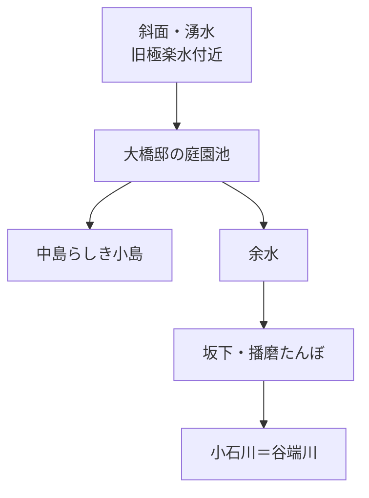

# 極楽水と谷端川比較 - ChatGPTリサーチセッション

---

[user] 極楽水は谷端川に注いでいた？
---
[assistant] 「極楽水」がどの水系に落ちていたか、地形と古地図の両方から確かめます。名前だけだと別地点の「極楽水」もありうるので、小石川・谷端川周辺のものとして調べます。
---
[assistant] うん、**水系としては「極楽水 → 谷端川（この辺では小石川）」と考えてかなりよさそう**です。  
ただし、「極楽水から谷端川まで一本の小川が描かれている」という決定的な古地図は、今のところ確認できていません。なので、少しだけ留保は必要です。

根拠がかなり揃っています。江戸後期の『御府内備考』では、松平播磨守屋敷内に**極楽水＝吹上水という湧水**があったとされています。現在の小石川パークタワー付近ですね。明治16年の地図では、その場所に池があり、湧水をためた庭園池だったらしいことも読み取れます。citeturn495402search0turn495402search2

そして、この場所から吹上坂を下った先が「**播磨たんぼ**」と呼ばれた低湿地で、その底を**小石川＝谷端川**が流れていました。文京区教育委員会の吹上坂説明でも、「坂下は播磨たんぼといわれた水田であり、しかも小石川が流れていた」とされています。citeturn495402search13

さらに面白いのが、石川悌二『生きている江戸の歴史 東京の坂道』の記述です。極楽水の説明に続けて、この一帯の**大名屋敷内の湧水・池水が「小石川低地の下水流」となって流れた**としています。つまり地形的にも、

**小日向台側の斜面の湧水（極楽水）  
→ 屋敷内の池・排水  
→ 播磨たんぼの低地  
→ 小石川（谷端川）**

という流れだった可能性が高い。citeturn304455view0

実際、暗渠・河川を扱った現地記事には極楽水について明記して**「小石川に注いでいた」**とするものもあります。これは一次史料ではないので補助証拠扱いがよいですが、上の地形・史料関係とはきれいに一致します。citeturn495402search1

ただ、ここでややこしい。**「極楽水」が時代によって同じ一点を指していない**んですよね。松平播磨守屋敷内の本来の湧水があり、その水を宗慶寺境内へ引いて「極楽水」の井戸にしたという記録があります。『江戸名所図会』に描かれる宗慶寺の極楽水は井戸です。現在小石川パークタワーにあるものも、平成期に整備・再現されたものです。citeturn495402search0turn495402search2

なので、いちばん正確に言うなら、

> **松平播磨守屋敷内にあった本来の極楽水の湧水は、最終的には坂下の谷端川（小石川）水系へ排水されていた可能性が非常に高い。ただし、極楽水から谷端川へ至る固有の「支流」が常時開渠で存在した、とまではまだ断定できない。**

という感じです。

これ、谷端川を調べる上ではけっこう面白い発見で、**小石川植物園側などと同じく、谷端川下流部は周囲の台地縁の湧水を拾いながら流れる川だった**と見ると、あの低地の性格がかなり分かりやすくなります。極楽水はその「谷端川へ落ちる斜面湧水」の一つだった、と考えるのが自然そうです。
---
[user] repoに書いておいて
---
[user] 別に画像は載せなくてもいいよ
---
[assistant] 書いておいた。画像自体は載せず、`docs/谷端川.md` に **「極楽水と谷端川（小石川）」** の節を追加した。

内容は、「極楽水の余水は地形上、播磨たんぼ側へ落ちて最終的に谷端川＝小石川へ排水された可能性が高い。ただし、極楽水から谷端川まで一本の恒常的な支流があったことまでは未確認」という整理。今回の写真についても、**2026年9月25日時点で現地の再現施設に水面と『極楽水（この下）』表示を確認した**ことだけ文章で記録してある。

コミットは `3235d6b`。
---
[user] これ見ると中に島みたいなのあるけど
---
[assistant] そう。**その白抜きの楕円、かなり素直に読むと「池の中の島」っぽい**です。

この「昭和戦前・戦中期」レイヤーは、都心部では主に1928～1939年ごろの1万分1地形図を使っています。citeturn702676search0turn702676search5 画像を見ると、大橋邸の池は青い横線で水面を表し、その中央だけが輪郭をもって白抜きになっています。湧水点の記号というより、**水面に囲まれた陸地＝中島**と読むのが自然です。

しかも、これがかなり面白い。別資料では、現在の極楽水付近について**明治16年（1883）の地図から「庭園の池の湧水だったことを窺わせる」**とされています。つまりこの池は昭和になって突然できたものではなく、旧松平播磨守邸以来の湧水を取り込んだ庭園池だった可能性がある。citeturn822284search1

なので、昭和初期の景観はざっくり、

みたいな構造だった可能性が出てきます。

そして重要なのが、**今ある「極楽水」の小さな石組みの水面と、昭和初期の地図にあるこの池は、規模が全然違う**こと。今のものは再現施設ですが、当時は邸宅庭園の中にかなり大きな池があり、しかも中島まで設けていたように見える。現在の極楽水は、この大きな水景のごく一部の記憶を残している、と考えた方がよさそうです。現在地が旧松平播磨守屋敷内にあたり、のちに大橋邸となったこととも整合します。citeturn822284search0turn822284search2

ただし一つ残る問題があります。**この池の水面そのものが湧水池だったのか、湧水を引き込んで造った人工の庭園池なのか**。ここは地図だけでは決まりません。明治16年図→大正期→この昭和初期図を順番に比較すると、池の形が変わっているかどうかでかなり絞れそうです。

これ、極楽水については結構でかい材料だと思う。repoにも「昭和初期の大橋邸庭園池には中島らしき白抜き表現がある」と追記する価値ありそう。

