# 護国寺内の川資料調査 - ChatGPTリサーチセッション

このファイルは、ChatGPTでの調査セッションで得られた調査結果を保存したものです。

---

[user] 護国寺内の川についての資料など教えて
---
[assistant] 護国寺境内の水路は、今の地形だけ見るとかなり痕跡が薄いですが、古地図・寺誌・地形図を重ねると追える可能性があります。まず「境内を通った自然流路なのか、池・排水用の人工水路なのか」を分けて、史料を拾います。
---
[assistant] あります。しかも調べてみると、**「護国寺の境内には実際に小川が流れていた」こと自体は、かなり強く裏付けられます**。

ただし少し重要な点があります。水窪川の本流そのものが現在の護国寺境内中央を貫いていた、というより、現時点では

**豊島岡墓地側の谷・湧水 → 護国寺境内の池 → 境内の小川 → 水窪川**

という**水窪川の小支流・湧水系**があった、と考えるのがいちばん自然です。現在知られている復元では、豊島岡墓地の「蛇池」から流れ出た水が、護国寺境内にあった2つの湧水池を経て水窪川へ注いでいた、とされています。流れに架かっていた石橋も、音羽富士の麓に移されて残っているとのことです。citeturn575797search0turn575797search4

江戸期の護国寺を描いた『江戸名所図会』です。池や谷を含む、現在とはかなり違う境内景観が見えます。

image_group{"layout":"carousel","aspect_ratio":"1:1","image_refs":["turn575797image0","turn575797image1"]}

### 特に重要そうな史料

| 史料 | 年代 | 川について何が分かるか | 重要度 |
|---|---:|---|---:|
| **『斃休録』天野八郎** | 1868年の出来事 | 実際に護国寺へ逃れた天野八郎が**「境内の小川」**で泥を洗ったと記録。小川の実在を直接示す | ★★★★★ |
| **『江戸名所図会』** | 天保年間 | 惣門付近に池・橋・流れが描かれ、境内全体の地形もかなり詳しい | ★★★★★ |
| **『礫川要覧』** | 1910年 | 音羽富士の山下に池があり、**東門＝惣門側の池と通じていた**と記す | ★★★★★ |
| **『東京市史稿 御墓地篇』** | 編纂史料 | 「護国寺護持院院内図」「御府内沿革図書」など、さらに古い原史料への入口になる | ★★★★★ |
| **『御府内沿革図書』** | 江戸幕府作成図を後世刊行 | 護国寺周辺の土地利用・境界・地形を時期別に比較できる | ★★★★☆ |
| **『護国寺日記』** | 1697～1757年 | 池・橋・水路の造営や修理の記事が埋まっている可能性がある | ★★★★☆ |
| **宮内庁・豊島岡墓地発掘調査報告** | 現代の調査 | 豊島岡墓地の谷地形が**そのまま護国寺境内へ続く**ことを地形・考古学的に確認 | ★★★★☆ |

中でも面白いのが『斃休録』です。彰義隊副長の天野八郎が上野戦争後の1868年に護国寺へ入り、そこで「境内の小川」で朝から付いた泥を洗った、と記しています。絵図からの推定ではなく、**その水を実際に使った人物の記録**です。citeturn575797search24

これはかなり強い。

### 『江戸名所図会』を見ると、流路らしきものがさらに具体的になる

東京都立図書館が公開している『江戸名所図会』では、護国寺関係だけでも「大塚 護持院」「護国寺 其二」「其三」「護国寺境内 西国札所写三十三所観音之図」など、何枚も連続して収録されています。東京都立図書館のデジタル資料なので、画像自体もパブリックドメインです。citeturn575797search2

絵図を現地と照合した調査では、**惣門を入った左側に小池があり、そこから右手へ流れる川を橋で渡っていた**と読み取られています。citeturn137399search0

そして1910年の『礫川要覧』には、音羽富士について、

> 「山下に池あり、東門（惣門）の池も通ず」

とあります。つまり少なくとも明治末の記録では、**音羽富士下の池と、惣門付近の池が水でつながっていた**わけです。citeturn331868search1

ここがかなり気になります。

本田創による現在の復元では「蛇池 → 護国寺境内の2つの湧水池 → 水窪川」。一方、『礫川要覧』では「音羽富士下の池 ↔ 惣門の池」。この**「2つの池」が同じものを指している可能性はかなり高そう**です。ただし、これはまだ私なら断定しません。一次史料の絵図上で流路を連続して追えれば、ほぼ決着します。citeturn575797search0turn331868search1

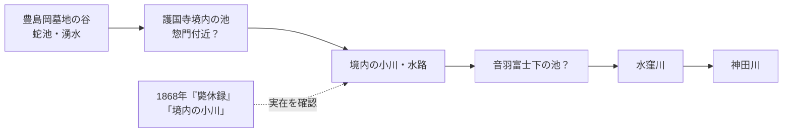

※池の順序や接続位置は**まだ仮説を含む**模式図です。特に惣門池と音羽富士下池のどちらが上流側だったかは、古図を精密に合わせる必要があります。

### さらに掘るなら『東京市史稿』がかなり重要

東京都公文書館の『東京市史稿 御墓地篇』の目次を調べると、「小石川村雑司ヶ谷村」の項に、典拠としてなんと**「護国寺護持院院内図」**が挙げられています。また「護国寺及護持院」の項では『諸宗作事図帳』『御府内沿革図書』などが原史料に使われています。さらに「豊島岡御墓地設定」には**「豊島岡御墓地図」**も収録されています。citeturn331868search0

この**「護国寺護持院院内図」**、かなり本命だと思います。

名称からして建物配置だけでなく、境内区画をかなり詳しく描いた可能性があります。もし池・溝・橋が描かれていれば、「蛇池から来た水がどこを通ったか」を一次史料に近いところまで詰められます。

さらに『御府内沿革図書』は、もともと徳川幕府が編纂した江戸市街の変遷図をもとにした資料で、現在は国会図書館でも公開されています。東京市史稿自身が護国寺の典拠としてこれを挙げています。citeturn331868search0turn331868search2turn331868search4

url『御府内沿革図書 第三篇上』国立国会図書館turn331868search2

### 『護国寺日記』にも何か埋まっているかもしれない

これも見逃せません。護国寺には、寺の役人が日々書いた公用日記が**元禄10年（1697）から宝暦期まで253冊**残っています。現在は一部が『史料纂集 護国寺日記』として翻刻されています。citeturn482842search0turn482842search2

護国寺が創建されたのは1681年で、現在の観音堂が完成したのが1697年ですから、この日記はまさに**境内が大規模に整備されていた時代**から始まります。citeturn575797search3

ここで、

「池」「堀」「溝」「川」「清水」「湧水」「樋」「橋」「石橋」「普請」「浚」「水抜」

あたりを拾っていくと、境内水系を誰が・いつ整備したかまで出てくる可能性があります。特に「自然の谷川をそのまま利用した」のか「護国寺造営時に池と水路として改修した」のかは、まだ面白い未解決点です。

### 地形から見ても筋が通る

宮内庁書陵部による豊島岡墓地の発掘調査報告も重要です。現在の豊島岡墓地は、台地面だけではなく**東西から斜面が落ち込む谷地形と谷底の平坦面**から構成され、その地形が西隣の護国寺境内へ続いている、と明記されています。citeturn482842search33

つまり、

**史料に小川がある → 古図に池と橋がある → 明治の資料でも池同士がつながる → 現代の地形調査でも豊島岡から護国寺へ谷が続く**

と、別系統の証拠がかなりきれいにつながります。

一方で、「この川の正式名称」は今のところ見当たりません。本田創の記事などでは水窪川の支流として扱われていますが、江戸時代から「水窪川支流○○川」と呼ばれていた証拠は未確認です。なのでGitHubなどへ書くなら、当面は**「護国寺境内の小川（水窪川支流）」のような便宜的表記**にして、固有名詞扱いしない方が安全です。

個人的には、この水系は水窪川調査の中でもかなり面白い枝です。特に**「蛇池―惣門池―音羽富士下池―水窪川」の正確な接続関係と年代変化**は、まだ詰める余地があります。『護国寺護持院院内図』『御府内沿革図書』、明治初期の境内図を実際に画像で突き合わせれば、流路をかなりの精度で復元できそうです。
---
[user] もっと調べてGitHubに追記しといて
---
[assistant] 護国寺境内の小川について、一次史料寄りの情報をさらに掘って、流路・池・橋・豊島岡側との関係を整理したうえでGitHubに追記します。既存の構成を壊さないよう、まずリポジトリ内の記述と史料一覧を確認してから加筆します。
---
[assistant] いま出てきた中で効きそうなのは、単なる暗渠記事よりも、①江戸名所図会の池・橋、②明治43年『礫川要覧』の「音羽富士下の池と惣門側の池が通じる」という記述、③豊島岡墓地の発掘報告で確認できる谷地形です。ここに幕末の実見記録と明治初期の境内図を足せるかを詰めています。
---
[assistant] 史料の強弱も整理できました。特に「蛇池→境内2池→水窪川」は有力な復元ですが、本田創の記事による二次記述です。一方、**1830年代の絵図に池・橋、1910年資料に池同士の接続、宮内庁の発掘報告に豊島岡から護国寺へ続く谷地形**が別々に確認できるので、水系の存在そのものはかなり固くできます。
---
[assistant] 追記しておいた。今回は護国寺の水系だけで独立して追えるよう、READMEに詰め込まず `docs/` に2本追加した。

- [護国寺境内の旧水系調査](https://github.com/yuubinnkyoku/otowa-ankyoscape/blob/main/docs/gokokuji-water-system.md)
  - commit: `ff2a577484715966479b669e2f603edb4a8fbb93`
- [護国寺西側・星谷の井と旧水系](https://github.com/yuubinnkyoku/otowa-ankyoscape/blob/main/docs/gokokuji-hoshiyato-water-system.md)
  - commit: `b77e4311cebc65be0eb53c52f1bf9c7f19b66977`

今回かなり面白いところまで出た。

**まず、護国寺境内に「池＋流れる水＋橋」があったことは、かなり強くなった。** 『江戸名所図会』第12冊には「大塚 護持院」から「護国寺 其二～其六」まで境内図が連続して収録されている。東京都立図書館でも護国寺関係の挿図を90ウ～96オとして確認できる。citeturn775859search2turn792311view0

さらに『江戸名所図会』を詳細に読んだ資料では、**惣門を入った左側に小池があり、そこから右へ流れる川を橋で渡った**とされる。加えて1910年『礫川要覧』には、音羽富士について「山下に池あり、東門（惣門）の池も通ず」とあると引用されている。つまり「池が2個あった」だけではなく、**惣門側の池と音羽富士下の池が水系としてつながっていた**可能性が高い。citeturn161704search0turn399482search0

ただし、ここは証拠の強さをかなり細かく分けた。今までREADMEでは、本田創による

**蛇池 → 護国寺境内の2湧水池 → 水窪川**

をほぼ〔確認〕扱いしていたけど、これは厳密には近年の復元。なので新しい調査ノートでは、

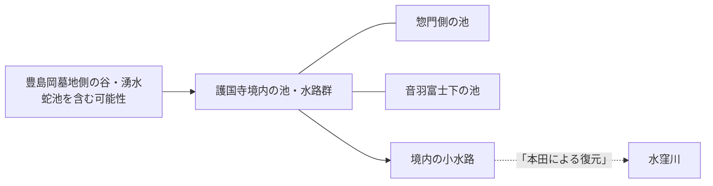

として、**「水系があった」ことと「正確な流向」を分離**した。

そして、かなりデカい追加情報が西側から出た。

### 「星谷の井」という別の湧水系があった

『江戸名所図会』の並びを直接追うと、

- 4-12-39　大塚 護持院
- 4-12-40　其二 護国寺
- 4-12-41　其三 本浄寺
- 4-12-42～44　護国寺境内
- **4-12-45　星谷の井旧地**

となっている。つまり「星谷の井」は護国寺・本浄寺に続く独立した地誌項目として載っている。citeturn792311view0

しかも記述を追うと、護国寺西側、現在の首都高が通る谷が「星谷」で、本浄寺裏には**旱魃でも枯れないとされた湧水「星谷の井」**があった。さらに重要なのが、その**下流には「星谷橋」があった**こと。単なる井戸ではなく、


という水路だった可能性が出てきた。citeturn399482search0

Wayback Machineでも、この地域史ページの**2021年9月27日保存版**まで回収して、現在のページだけに依存しない形にしてある。

これが面白い理由は、護国寺周辺をこう捉えられるようになったから。


つまり、**「音羽谷に水窪川と弦巻川という人工的な二本の水路を突然作った」だけではないかもしれない。**

もともと、

**東の小日向台・豊島岡側にも湧水・支谷があり、西の目白台側にも星谷の井などの湧水・支谷があった**

→ それらを利用しながら近世の護国寺・音羽町造成で水路を整理した、

というモデルがかなり気になってきた。

さらに東京都公文書館の『東京市史稿 御墓地篇』から、原史料として**『護国寺護持院院内図』**が実在することも確認した。「護国寺及護持院」の典拠には『御府内沿革図書』、1873年の豊島岡墓地設定には**「豊島岡御墓地図」**も挙げられている。citeturn161704search2

ここは次の本命。**『護国寺護持院院内図』に池・橋・溝が描かれていたら、一気に流路復元が進む。**

なお一つ訂正も入れた。前に挙げた『斃休録』の「天野八郎が護国寺境内の小川で泥を洗った」という話は、『斃休録』そのものの存在と天野が護国寺へ逃れたところまでは確認できたものの、**肝心の「境内の小川」の原文を今回直接確認できなかった**。なので新ノートでは証拠からいったん外し、再確認待ちにしてある。ここは怪しいまま積み上げない方がよさそう。

次に狙うべきは、**『護国寺護持院院内図』→1873年「豊島岡御墓地図」→1910年『礫川要覧』原頁→1922年「護國寺境内地實測圖」**の順だと思う。この4枚を揃えて位置合わせできると、池がいつまで残り、どこを通って水窪川へ落ちたか、かなり具体的に復元できそう。memcite
---
[user] 池があった場所って今も入れる?
---
[assistant] だいたいは入れそうですが、**「どの池か」で事情が分かれます**。惣門側・音羽富士下・豊島岡側を分けて、今の立入可否と現地で痕跡を見られるかを確認します。
---
[assistant] うん、**一部は今でもかなり近くまで行ける**。ただし、池ごとに差がある。

image_group{"layout":"carousel","aspect_ratio":"1:1","image_refs":["turn446225image1","turn446225image0"]}

いちばん行きやすいのは、**音羽富士の麓にあった池の跡**。1910年の『礫川要覧』で「山下に池あり」とされる場所で、音羽富士自体は現在も護国寺境内にあり、2024年の訪問記録でも実際に登れる状態なのが確認できる。しかも富士塚の入口には、かつて境内の流れに架かっていたとされる**石橋が現存**している。つまり「池そのもの」は消えていても、現場に立って、水路の遺物を見ることができる。citeturn833376search2turn833376search7

一方、**惣門側の池跡**はちょっと厄介。『江戸名所図会』では「惣門を入ると左に小池」があり、1910年には音羽富士下の池と通じていたとされる。citeturn833376search1 ところが現在の惣門は本坊・音羽幼稚園側へ通じる門で、現地調査記録では**一般利用されていない**とされている。したがって、「江戸期の池があった地点そのものへ惣門から自由に入る」のは難しそう。citeturn833376search4

ただ、ここで妙に面白い情報がある。2022年の参拝記録には、**現在も「本坊前の池」に錦鯉がいる**とある。citeturn833376search12

これ、かなり気になる。

江戸期の「惣門を入って左の池」と現在の「本坊前の池」が、

**同じ池が縮小・改修されて残ったものなのか、旧池の跡に後世つくられた別の池なのか**

は、今のところ確認できていない。ここは明治10年前後の境内図と現在図を位置合わせしたら判定できそう。

そして、上流側の**豊島岡墓地の蛇池**は別。こちらは宮内庁管理の皇族墓地なので、通常の観光地のようには入れない。宮内庁が特定の墓所について「一般参拝」を実施する際だけ、指定された日時・順路で入れる形になっている。2024年11月にも一般参拝が行われたが、その際も「参拝順路以外には入らない」ことが明記されている。したがって、**蛇池を調査目的で自由に見に行くのは現状ほぼ無理**と考えた方がいい。citeturn446225search2

ざっくり整理すると、

| 旧水系の地点 | 現在 |
|---|---|
| **音羽富士下の池跡** | **行ける可能性が高い**。富士塚と旧石橋も見られる |
| **惣門側の池跡** | 惣門内側なので**自由な立入りは難しそう** |
| **現在の本坊前の池** | 境内から見られる記録あり。**旧池との同一性は未確定** |
| **豊島岡墓地・蛇池** | **通常は入れない**。一般参拝時も順路外へは行けない |

護国寺公式では護国寺駅からすぐで、堂内の拝観時間は10～16時（12～13時閉堂、行事で変更あり）としている。現地確認なら日中に行くのが確実。citeturn446225search5

genui{"map_widget":{"points":[{"address":"音羽富士（護国寺）, 東京都文京区大塚5-40-1","name":"音羽富士・旧池付近","category":"旧池跡"},{"address":"護国寺 惣門, 東京都文京区大塚5-40-1","name":"護国寺 惣門・旧池付近","category":"旧池跡"},{"address":"豊島岡墓地, 東京都文京区大塚5丁目","name":"豊島岡墓地・蛇池側","category":"旧水系"}],"answer":"音羽富士下の旧池付近は通常の護国寺参拝で確認しやすい一方、惣門内側と豊島岡墓地側は立入りに制約があります。"}}

現地調査するなら、**音羽富士の石橋は絶対見た方がいい**。旧池の岸・水路方向を推定する手掛かりになる可能性がある。

あと「本坊前に今ある池が江戸期の池の生き残りなのか」は結構デカい問題なので、**1878年前後の護国寺境内図を現在地図に重ねて、池の位置を数十m単位まで特定**してみようか。これができれば「今どこに立てば旧池の底なのか」まで出せる。
---
[user] 護国寺のどのあたりですか
---
[assistant] 護国寺の中でも、池跡はかなり場所が分かれます。今の境内図に合わせて、「惣門側の池」と「音羽富士下の池」がどの位置か絞ります。
---
[assistant] かなり絞れます。護国寺に普通に参拝するときの**仁王門を基準**にすると分かりやすいです。

image_group{"layout":"carousel","aspect_ratio":"1:1","image_refs":["turn722267image0","turn722267image1"]}

### ① 音羽富士下の池

これは一番場所が分かりやすいです。

**仁王門 → 本堂方向へまっすぐ → 大きな石段の直前で右（東側）**

にある**音羽富士**の麓です。

現在も「富士道」の石碑、**石橋**、鳥居があり、石橋を渡ると音羽富士へ入ります。現地記録でも「石段の東側の水屋の横→石橋→鳥居→音羽富士」という配置が確認できます。citeturn406709search4turn406709search6

そして1910年『礫川要覧』には、この音羽富士について**山の下に池があり、惣門側の池と通じていた**と記されています。したがって、昔の池はおおむね、

**現在の「富士道」石碑・石橋・鳥居の周辺**

と考えるのがかなり自然です。citeturn406709search0

つまり現地で見るなら、

> **音羽富士入口にある小さな石橋の周囲**

が最重要地点です。

本田創も、護国寺境内の旧水路に架かっていた石橋が現在は音羽富士の袂に保存されている、としています。citeturn406709search1

### ② 惣門側の池

こっちは仁王門のすぐ横ではありません。

護国寺正面を見て**右手＝東側**へ行くと、仁王門とは別に大きな**惣門**があります。護国寺公式も、惣門について「本坊に通ずる所」にある門と説明しています。citeturn722267search0

『江戸名所図会』をもとにした復元では、

**惣門を入る → 左手に小池 → その水路を橋で渡る → 奥の護持院本坊**

という配置です。citeturn406709search0

今の施設で言えば、だいたい

**惣門の内側～現在の本坊・宗務所方面**

です。

なので二つの池は、ざっくりこうです。

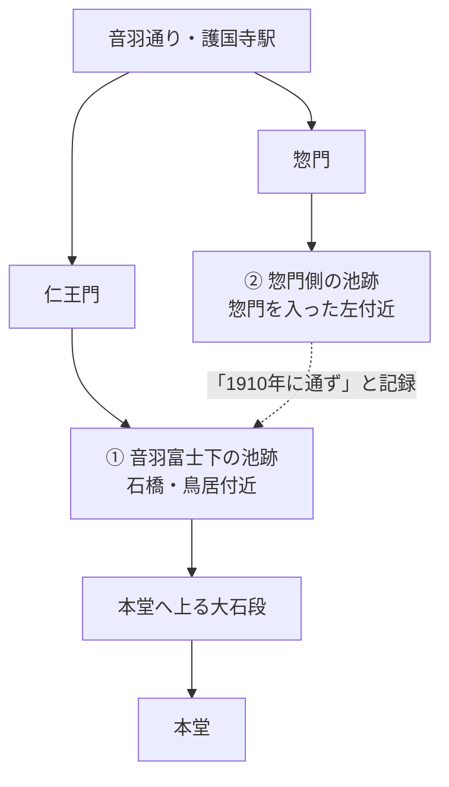

現在地で言えば、**最初に見に行くべきなのは①です**。仁王門から入って本堂へ向かい、石段の手前で右を見ると音羽富士の鳥居があります。そこにある**石橋の周囲が旧池・旧水路の有力地点**です。

genui{"map_widget":{"points":[{"address":"音羽富士 護国寺 東京都文京区大塚5-40-1","name":"音羽富士・旧池候補地","category":"旧池・旧水路"},{"address":"護国寺 惣門 東京都文京区大塚5-40-1","name":"惣門側の旧池候補地","category":"旧池"}],"answer":"音羽富士下の池は、仁王門から本堂へ向かった大石段の手前右側、現在の音羽富士入口・石橋周辺が有力です。もう一つは境内東側の惣門を入った左手、本坊への進入路付近にあったと考えられます。"}}

ただし、**池の岸線を「ここからここまで」とメートル単位で確定できたわけではありません**。特に惣門側は現在の建物配置がかなり変わっています。

1870～1910年代の境内実測図を現在図に重ねれば、**「今のこの舗装部分が池底だった」くらいまで絞れる可能性があります**。これはやってみる価値かなりあります。
---
[user] どこだよ
---
[assistant] その写真なら、**いま観音堂（本堂）の真正面、石段を上り切った上段**にいます。池跡の候補地はそこじゃないです。さっきの説明が分かりにくかった。

**写真を撮った位置から後ろを向いて、大きな石段を下りてください。** 不老門を抜けて石段を一番下まで降りたら、**下り方向を向いたまま左手**です。そこに「富士道」の石碑と小さな鳥居があって、その奥が**音羽富士**。資料でも「仁王門から入ると石段の右手に鳥居」とされる場所です。つまり本堂から戻る向きでは左右が逆になり、左手になります。citeturn777074search0turn777074search1turn777074search3

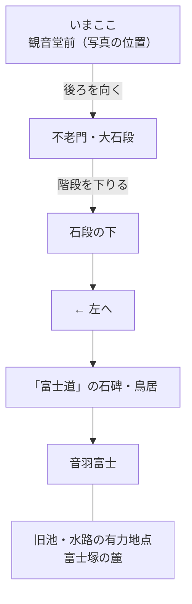

**要するに、この写真からだと「右後ろの下の方」**です。いったん階段を下まで戻るのが確実。

なお、探している「池」は現在水面が残っているわけではなく、**音羽富士の入口・石橋周辺が旧池の有力地点**という話です。鳥居か「富士道」の碑まで着いたら、そこで写真を送ってくれれば、そこから旧水路がどっちへ延びていたかまで一緒に絞れます。
---
[user] これのことならさっき見たけど池の跡どこ
---
[assistant] うん、それです。**2枚目が音羽富士の入口**。そして、ここは訂正します。さっき「この石橋周辺が池跡」と言い切ったのは強すぎました。

この石橋は、**消滅した護国寺境内の支流に架かっていたものを、現在の音羽富士の袂に保存したもの**です。つまり、**橋が今ある場所＝昔の川や池がそのまま存在した場所、とは限りません**。本田創も「境内の湧水池と支流はなくなり、流れに架かっていた石橋が音羽富士の袂に保存されている」としています。citeturn420597search0

さらに重要なのが、**音羽富士そのものも現在地が元の場所ではありません**。もともとは本堂のかなり西側にあり、1885年（明治18年）に現在地へ移されています。citeturn363175search0turn363175search1

なので、

> 「この鳥居の前に昔から池があって、この橋がそこに架かっていた」

とは現段階では言えません。

### じゃあ1910年の「山下に池あり」はどこ？

ここが面白いところです。『礫川要覧』は1910年なので、**音羽富士が現在地へ移った1885年より後**です。そして、

> 山下に池あり、東門（惣門）の池も通ず

と記録されています。citeturn897349search4

つまり1910年には、**現在の音羽富士付近に実際に池があった可能性が高い**。

そして現在も、音羽富士のすぐ隣にある**本坊前に錦鯉の池**があります。複数の現地記録で確認できます。citeturn291256search0turn897349search2

あなたの**1枚目はたぶん本坊前の枯山水部分**です。あの砂利・石組の庭そのものを「旧池跡」と断定はできません。現在水がある池は、あの庭と同じ**本坊前庭園の一角**にあります。

現地なら、

**2枚目の音羽富士から「本坊」と書かれた現代的な建物の正面へ回る**

と、錦鯉のいる池があります。資料では「本坊の看板の廻りに池」とまで書かれています。citeturn897349search2

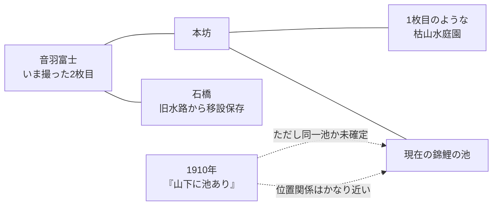

**いま一番見てほしいのは本坊前の「現役の池」**です。

ただし、ここで新しい疑問が出ます。

**現在の本坊前の鯉池は、1910年の「音羽富士山下の池」を改修して残したものなのか？**

これ、今のところ断定できません。でも位置関係的にはかなり怪しい。1922年の**「護國寺境内地實測圖」**が実在することも確認できました。citeturn363175search37

これと現在図を重ねれば、**あなたが今立っている場所のどこが1922年の池だったか**まで詰められる可能性があります。ここは帰ってからじゃなく、今かなり優先して調べたい案件です。
---
[user] こっちは見れないのか
---
[assistant] あ、**こっちの池のことか**。画像を見る限り、時層地図の青い池（`35.719924, 139.724759`付近）は、さっき見ていた現在の音羽富士前とは**別地点**です。

しかも、こっちの方がかなり重要です。

2枚目の写真では、黒いフェンスの奥がはっきり谷状に低くなっていて、位置も時層地図の池とほぼ重なっています。なので、**フェンスの奥の藪になっている窪地が、少なくとも戦後まで残っていた池の跡である可能性が高い**です。水面はもう見えませんが、池底の地形自体は残っているように見えます。

そして史料上、音羽富士はもともと現在地ではなく**護国寺本堂より西側**にあり、『江戸名所図会』ではその麓に**弁天池**が描かれています。西側一帯が1873年に陸軍埋葬地として接収されたため、音羽富士は1885年に現在地へ移されました。citeturn358068search1turn358068search11

つまり、

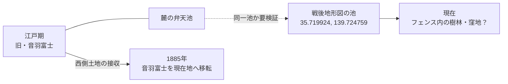

という関係が考えられます。

**「戦後地形図の池＝江戸時代の弁天池」まではまだ断定できません。** でも、「旧音羽富士が西側にあり、その麓に弁天池があった」という史料と、あなたが見つけた戦後まで残る池の位置関係は、かなり気になります。むしろこちらを優先して照合したいです。citeturn358068search0turn358068search1

で、肝心の「見られるか」ですが、**写真のフェンス内に一般に入ってよいという根拠は確認できません**。今のところは、フェンス越しに見るところまでにしておくのがよさそうです。護国寺西側には旧陸軍埋葬地などもあり、明治以降に土地利用がかなり変わっています。西側約5,000坪がかつて陸軍埋葬地になったことも確認できます。citeturn270759search4

ただ、**いま撮った写真はかなり価値あります**。池が完全に造成されて平坦になったのではなく、フェンスの向こうに低い窪地と湿地っぽい植生が残っているように見える。

もしまだ現地にいるなら、**フェンスを越えず、通行可能な道からこの窪地の北端・南端をそれぞれ撮ってほしい**。特に「池跡からどちら側へ谷が抜けているか」が分かる写真があると、旧弁天池→弦巻川方面への排水路まで追えるかもしれません。

これはGitHubにも「戦後まで池が残存していた可能性」として追記する価値あります。
---
[user] 江戸名所図会の画像全部見せで
---
[assistant] 護国寺関係の『江戸名所図会』なら、**挿絵は全部で6枚**あります。東京都立図書館の目録でも、90ウ91オ〜95ウ96オの6図として確認できます。citeturn639887search1turn777142view0

順番はこれです。

1. **大塚 護持院** — 惣門・護持院本坊側  
   url国会図書館で画像を見るhttps://dl.ndl.go.jp/pid/2563391/39

2. **其二 護国寺** — 仁王門から本堂周辺  
   url国会図書館で画像を見るhttps://dl.ndl.go.jp/pid/2563391/40

3. **其三 本浄寺** — 護国寺西側・本浄寺方面  
   url国会図書館で画像を見るhttps://dl.ndl.go.jp/pid/2563391/41

4. **其四 護国寺境内 西国札所写三十三所観音之図**  
   url国会図書館で画像を見るhttps://dl.ndl.go.jp/pid/2563391/42

5. **其五 同図**  
   url国会図書館で画像を見るhttps://dl.ndl.go.jp/pid/2563391/43

6. **其六 同図** — **旧音羽富士・弁天池を見るなら特に重要**  
   url国会図書館で画像を見るhttps://dl.ndl.go.jp/pid/2563391/44

**6枚を一度に並べて見たいなら、このページが一番見やすいです。** 「大塚護持院」「其二」「其三」「其四」「其五」「其六」が全部連続して掲載されています。citeturn563233view0  
url6枚をまとめて見るhttps://arasan.sakura.ne.jp/rekishi/edomeishozue12.html

そして、今あなたが見つけた**フェンス奥の池跡候補**を調べるなら、見るべきなのは特に**其四→其五→其六**です。この3枚は西国三十三所を西へたどる連続図で、**其六側に旧音羽富士と池が描かれます**。其二〜其六は互いにつながるパノラマ的な構成だと考えられています。citeturn647624search1

必要ならこの6枚を使って、**「池」「富士」「現在地 35.719924, 139.724759」を画像上で指し示して照合**します。これやると今いたフェンス奥との関係がかなりはっきりするはず。
---
[user] 中尺門？ってどこだ
---
[assistant] それ、**「中尺門」**で合ってそう。場所は、さっき見ていた西側の池・音羽富士の方ではないです。

『江戸名所図会』の「大塚 護持院」では、

**不忍通り → 現存する惣門 → 小池・小川 → 中尺門 → 玄関 → 方丈**

という順になっています。citeturn983708search0turn789256view0

つまり現在地に直すと、**仁王門より東にある「惣門」から入って、そのまま北へ進んだ先**です。ところが、江戸時代に中尺門・方丈などがあった護持院の主要部は、現在かなりの部分が**豊島岡墓地**になっています。護持院が廃止された後、その東側の大部分が1873年に豊島岡墓地になったことも確認できます。citeturn983708search4

ざっくりこう。

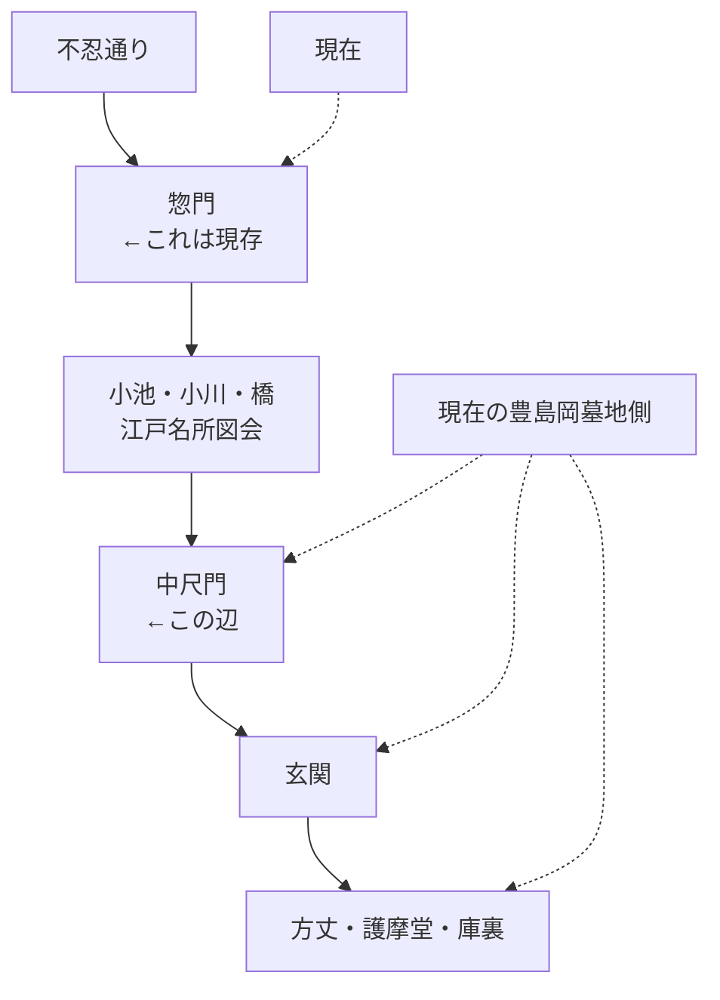

なので、**いま護国寺境内にいるなら「惣門の奥、豊島岡墓地方向」**と思えばいい。現在の一般参拝区域で「中尺門跡」というものが残っているわけではなさそうです。

しかもこれ、池を追う上で重要です。『江戸名所図会』では**惣門を入った後、中尺門へ行く途中に池と川を渡る**配置になっている。別資料でも「惣門を入ると左に小池があり、右手へ流れる川を橋で渡った」と読まれています。citeturn958923search6

つまり今探している**「護国寺東側の池」**は、

**惣門と中尺門の間**

にあった可能性が高い。

なお「中尺門」という名称はかなり珍しく、現状ウェブ上では『江戸名所図会』を読んだ複数資料がそう転記しているのを確認できるものの、**原版の文字そのものを拡大して「本当に尺の字か」まではまだ検証したい**です。citeturn512398search0turn512398search1

もしまだ現地なら、**惣門の写真を送って**。そこから「池はこの方向、中尺門はこの奥」と現場基準でかなり具体的に指せる。
---
[user] 惣門からまっすぐ行くと橋があって、その先に中尺門があったっぽいな
---
[assistant] そう。**この図を見る限り、その読みでかなり固い**。

下側の道路沿いにある「惣門」から境内へ入ると、参道が奥へ伸びていて、**途中で水路を橋で渡り、その先に「中尺門」**があります。さらに中尺門の奥が護持院の本坊・方丈側です。

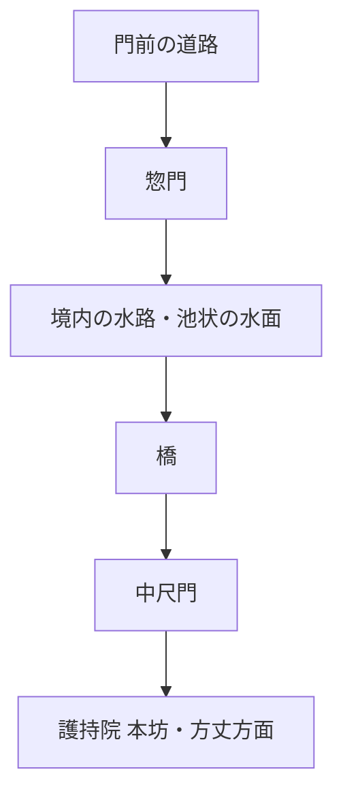

そして、この画像でもう一つ大事なのが、**池と川の位置関係**。

画像中央下の橋の**左側には明らかに幅の広い水面**が描かれています。一方、橋の右側にも細長い水路状の部分が続いている。だから「惣門の左に独立した池が一個あった」というより、

**惣門内の池状に広がった水面 → 細い流れ → 橋の下（または脇）を通過**

みたいな構造だった可能性があります。

つまり、前に出てきた『礫川要覧』の

> 「東門（惣門）の池」

という表現ともかなりきれいに合います。

画像上ではこんな感じです。

- **右下**：「惣門」
- **中央下**：石橋らしき橋
- **橋の左**：池状に広がった水面
- **中央左上**：「中尺門」
- **さらに奥**：護持院の建物群

なので、**「惣門からまっすぐ進むと水を橋で越え、その先に中尺門」**はほぼそのまま図から読めます。

あと、これを見ると今までの「惣門を入って左に池」という説明もちょっと雑でした。正確には、**惣門から中尺門へ向かう動線そのものが水系を横断している**と言った方がいい。

これ、現在地への比定にかなり使えます。**現存する惣門と中尺門推定位置を結ぶ線を現在地図に引けば、橋＝水路の位置もかなり狭い範囲に落とせる**はずです。今の護国寺境内図と重ねれば、数十mどころかもう少し詰められそう。
---
[user] これに関しては大江戸今昔めぐりも一理ありそうだ
---
[assistant] そう。**これはかなり一理ある**。むしろ今見せてくれた『江戸名所図会』と突き合わせると、大江戸今昔めぐりの復元は護国寺境内について結構ちゃんと辻褄が合っています。

大江戸今昔めぐりは、古地図画像をそのまま貼ったものではなく、江戸末期の諸資料をもとに**現代地図と重なるよう位置を補正して描き起こした「復元古地図」**です。公式も「幕末の地図を現代地図と正確に重なるよう描き起こした」と説明しており、国会図書館の解説では『復元・江戸情報地図』系の成果をアプリ化したものとして紹介されています。だから一次史料ではないけど、位置比定にはかなり使えます。citeturn554393search0turn554393search3

今回とくに重要なのが、この部分。

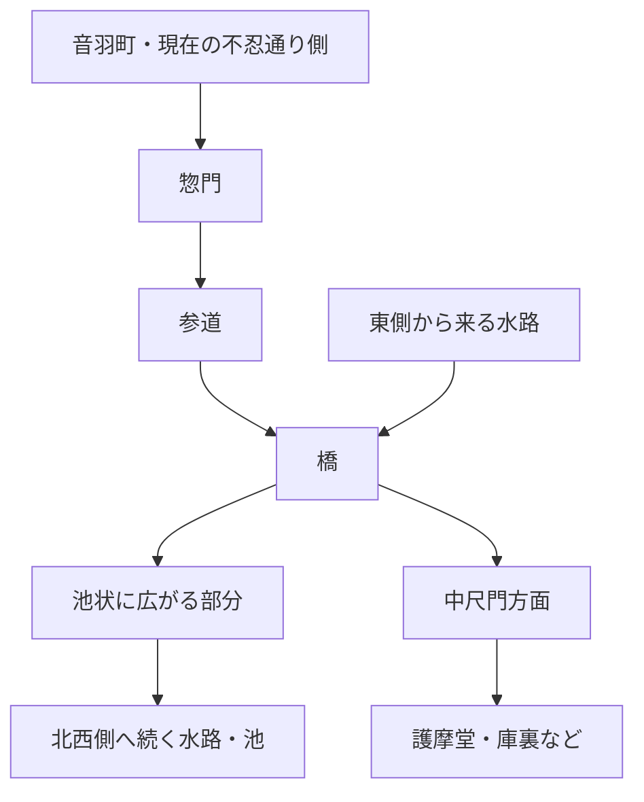

これ、さっきの『江戸名所図会』とかなり似ています。

『江戸名所図会』では、

**惣門 → 直進 → 水路を橋で横断 → 中尺門 → 本坊**

という配置。

今回の大江戸今昔めぐりでも、

**南側の門 → 参道 → 青い水路を橋で横断 → 護摩堂・庫裏などの建物群**

となっている。

しかも単なる一本の川ではなく、**橋の西～北西側で池状に膨らんでいる**。『江戸名所図会』でも橋の片側は幅広い水面として描かれていました。これは結構強い一致です。

そしてさらに気になるのが、あなたの青い現在地マーカー。

画像を見る限り、マーカーがほぼ**大江戸今昔めぐり上の池の北東岸～池内**に来ています。

つまり、GPSの多少の誤差と復元図自体の誤差はありますが、

> **「いま立っている辺りが江戸期の池・水路だった」**

という可能性が普通に出てきます。

ただし、ここは精度を分けた方がいい。

**かなり信頼できる**
- 惣門から本坊へ向かう途中に水路があった
- そこを橋で渡った
- 水路の一部が池状に広がっていた
- 護持院の建物群との位置関係

**まだそのまま信じない方がいい**
- 水際の曲線がこの形そのものだった
- 青線の中心が1～2m単位で正しい
- すべての水路が同時代にこの形だった

大江戸今昔めぐりは**復元図**なので、後者まで測量図のように扱うのは危険です。公式自身も「古地図そのまま」ではなく完全描き起こしだとしています。citeturn554393search0

でも今回の場合は、

**『江戸名所図会』という別系統の図像史料と配置が一致する**

のが強い。

さらに東京都公文書館には、明和～寛政期とされる**「小石川小日向台大塚護国寺迄之図」**も現存しています。彩色写図で、公開資料です。これを確認すれば、大江戸今昔めぐりが何を根拠にこの池・水路を置いたのか、もう一段詰められます。citeturn554393search1

なので評価を更新すると、

> **大江戸今昔めぐりの護国寺境内水路は、単なる雰囲気復元として無視するものではなく、『江戸名所図会』と照合して位置比定に使える有力な二次復元図。**

という感じ。

しかもこれ、**さっき見つけたフェンス奥の池とは別に、「惣門―中尺門間の池」をかなり具体的に現代座標へ落とせる**可能性が出てきました。

今現地にいるなら、スクショの青点の位置で周囲を一周撮っておく価値あります。特に**北・西・東の地面の高低差、排水溝、石積み、古そうな橋石**が残ってないかを見ると面白いです。フェンスや立入禁止区域には入らず、一般に通れる場所からで十分です。
---
[user] これなんですか？
---
[assistant] これ、かなり重要です。**見た目としては「池の中に築山（中島）を設けた庭園状の部分」**と読むのが自然です。

画像を細かく見ると、赤丸の中は、

- 横方向の細い線で**水面**が描かれている
- 中央に細長い**盛土・島状の高まり**がある
- 高まりの縁には杭・柵のようなものが並ぶ
- 左右には水を越えるための**細い橋または渡り**らしい構造がある

ので、単なる土手や畑には見えません。

そして大事なのは、**これは「旧音羽富士そばの弁天池」ではなさそう**ということです。旧音羽富士と弁天池が描かれるのは、後ろの「其六」の西国三十三所の図です。一方、これは「其二 護国寺」。其二はその前の「大塚 護持院」と絵が連続しており、仁王門・本堂・西国札所一番などを描いた部分です。citeturn557959search0turn300441search1

なので現時点では、

> **護持院の惣門側から続いてくる境内水系の一部で、池状に広がったところに中島・築山を設けたもの**

という解釈がかなり有力だと思います。

これ、さっきの39齣とつなげると面白いです。


実際、護持院の図については「惣門を入ると左に小池があり、川を橋で渡る」と読まれていて、39齣と40齣は東西方向につながる図だとされています。citeturn760556view0turn557959search0

ただし、**この赤丸部分そのものには名称の書き込みがない**。だから「○○池」と固有名を付けるのはまだ危ないです。

むしろ今のところ一番気になるのは、さっき見せてくれた**大江戸今昔めぐりの復元図**。あれでは護持院南側の水路が池状に広がり、さらに西・北西へ水路が延びています。『江戸名所図会』のこの描写とかなり似ている。

あと、上に見えている札はやっぱり**「西国札所一番」**です。其二では仁王門から上がった左側に「西国札所一番」が描かれていることが別の読み解きでも確認されています。citeturn300441search1

なので、この赤丸の位置を**「西国一番」「仁王門」「惣門」「中尺門」の4点から現在地に落とす**と、かなり正確に特定できるはずです。今見つけたこれは、護国寺の水系復元ではかなり当たりの部分だと思う。
---
[user] 位置的には弦巻川かと思います
---
[assistant] うん。**その見立て、かなり正しいです。さっき私が「池・中島っぽい」と読んだのは訂正します。**

この『江戸名所図会』「其二 護国寺」の**下端に描かれている水流は弦巻川**と考えるのが妥当です。実際、この図を護国寺・本浄寺の連続図として検討した解説でも、明確に「挿絵の下には、弦巻川が描かれています」とされています。citeturn238794view2

しかも図全体の位置関係とも合います。「其二」は東側で護持院の図につながり、西側は西国三十三所・本浄寺方面へ展開するパノラマ状の図です。仁王門から本堂へ上がる現在の護国寺境内を描き、その**南～西南側の低地**が図の下側に来ています。citeturn238794view3

なので赤丸部分は、おそらくこう読むべきです。

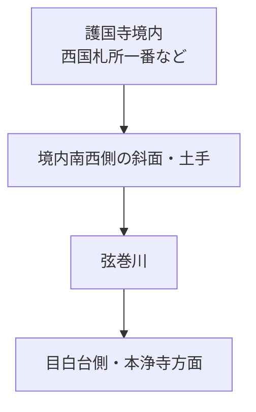

画像で「島」に見えた中央の盛り上がりも、**池の中島ではなく、弦巻川沿いの土手・中州状の土地あるいは斜面を遠近法で描いたもの**と見る方がよさそうです。水面を示す横線がその手前を横切り、右端にも水路らしい連続が見えます。

そして、これは今回の調査にはかなり重要です。

『江戸名所図会』が1830年代の護国寺南西側について、**弦巻川を絵としてかなり明瞭に描いている**ことになります。少なくとも、

> 「幕末以前には弦巻川が護国寺付近まで来ていなかった」

という可能性はかなり弱くなる。

さらに1851年の近吾堂系切絵図でも、弦巻川とみられる青線が護国寺南西端まで来て、その先にも短く続いていることをすでに確認しています。つまり、

**1830年代『江戸名所図会』 → 1851年切絵図 → 明治実測図**

と、護国寺付近の弦巻川を年代順につなげられそうです。

ただし一つ注意。「弦巻川が護国寺付近を流れている」ことと、**その川がそのまま現在知られる音羽通り西側の下流河道へ連続していたか**はまだ別問題です。ここを確定するには、赤丸部分から南へどのように描写が続くかを見る必要があります。

今回の指摘はGitHub側にも修正を入れた方がいいです。**「其二下端＝弦巻川」という史料を、弦巻川の近世確認資料として追加できるレベル**だと思います。
---
[user] 結構ちゃんと描かれてますね
---
[assistant] そう。**思っていた以上に「川」としてしっかり描いてますね。**  
これなら『江戸名所図会』を、弦巻川の護国寺付近の形を考える資料としてかなり使えます。

この41コマ（「其三 本浄寺」）を見ると、単に景観の端に水を一本入れただけではなく、

- 川が**谷底をかなり蛇行**している
- 川岸の線が両側とも描き分けられている
- 護国寺西側の斜面と、本浄寺側の高まりとの**間の低地を通る**
- 40コマ「其二 護国寺」で見えていた流れが、こちらでも連続している
- 川沿いに道・畦のような線、人の往来まで描かれている

のが見えます。

特に重要なのは**40→41コマの連続性**です。


さっき赤丸を付けていた40コマの水面だけ見ると、確かに「池か？」という余地がありました。でも41コマをこの縮尺で見ると、**同じ景観の低地を蛇行する河道として描いている**ことがかなり明瞭です。

しかも面白いのが、現在知られている弦巻川の位置とも合うこと。

本浄寺は護国寺の西側、現在の首都高5号池袋線沿いの谷にあります。その谷底を川が蛇行している。つまり『江戸名所図会』の作者は、少なくとも1830年代に、

**護国寺南西部 → 本浄寺東側の谷**

を通る水流を実景として認識していた可能性が高い。

ここまで来るとREADMEの

> 「音羽通り西側の弦巻川はいつ成立したか」

についても少し状況が変わります。

**1830年代には護国寺～本浄寺付近の弦巻川はかなり明瞭に存在していた**と言ってよさそうです。したがって未解決なのは、もはや「幕末に存在したか」より、

> **この河道がどこまで古く遡れるのか。1681年の護国寺造成以前からこの谷を流れていたのか、それとも近世に整形されたのか**

の方ですね。

あと、この画像は高解像度で保存しておいた方がいいです。**河道の曲がり方を現在の地形・明治実測図と重ねると、絵画だから多少誇張はあっても、どの斜面の裾を通ったかまで検証できそう**です。

これはかなり当たり史料です。
---
[user] ん?41ってどういう画角ですか？40の橋がなくなっている気がする
---
[assistant] その違和感、正しいです。**40→41をそのまま隣接する連続画として読んではダメそうです。** 前に私が「40から41へ川が連続する」と言ったのは訂正します。

『江戸名所図会』護国寺の図を詳しく並べ直した検討では、**其三＝41「本浄寺」は番号順の位置にない**とされています。推定される空間的な並びは、おおむねこうです。citeturn492314view2


つまり、**冊子のページ順は 39→40→41→42… だけど、実際の景観の並びはそうではない**可能性が高い。研究ページでも「其三は順番が狂っていて、其六の後につながるように思える」「其二の西隣は其四ではないか」としています。さらに其四～其六は連続する一方、其二とは視線方向も違うらしい。citeturn492314view2

だから、40に見える橋が41で突然なくなるのは不思議ではありません。**橋が消えたというより、41では数枚分西へ飛んだ別の区間を、別角度から見ている**可能性が高いです。

40は配置からかなり素直で、下側の仁王門から奥の本堂を見る構成なので、概ね**南側から北側の護国寺境内を見上げる画角**と考えられます。右側（東）が39の護持院につながることも確認されています。citeturn492314view2

一方41は、中心が**本浄寺**で、さらに「護国寺裏門」が画面上端に出てきます。つまり焦点がもう護国寺正面ではなく、**護国寺西側～本浄寺・星谷側の景観**へ移っている。citeturn970878search2turn492314view2

これ、弦巻川を見るうえでもかなり重要です。


なので41に描かれた蛇行河道を「40の橋の直下流」と即断するのも危ない。**同じ弦巻川系の流れである可能性は高くても、その間に42～44相当の空間が挟まっている**と考えた方がよさそうです。

これはむしろ面白い発見です。ページ番号に惑わされず、**39・40・42・43・44・41の順で画像を並べてランドマークを合わせる**と、護国寺西側のかなり大きなパノラマを復元できる可能性があります。citeturn492314view2
---
[user] 42にも境内に川を確認  
43にも池を確認  
41は目白台から川を挟んで反対側を見てるってことで合ってます?
---
[assistant] はい、42・43の読みはかなり筋が通っています。  
ただ、**41の画角については「目白台から反対側を見る」ではなく、むしろ逆寄り**に考えた方がよさそうです。

42では、西国札所の建物群の間を**細い水流が実際に蛇行している**のが見えます。これは40の下端に描かれた弦巻川とは別に、**護国寺境内の内部水路**として読むのが自然です。其四〜其六は西国三十三所を描く連続景観で、其四から其六へ西側に続くとする既存の読解とも一致します。citeturn243487search1turn243487search2

43はさらに明瞭で、**「富士」直下にかなり大きな池、その岸に「弁天」**がありますね。これはまさに後世の『礫川要覧』に出る「山下に池あり」という記述と対応する可能性が高いです。しかも池から右方向へ水路らしき線も続いている。つまり、

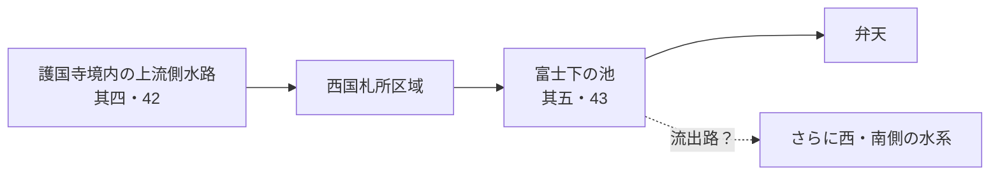

という水系を疑えます。

で、問題の41。

ここは**「目白台から弦巻川を挟んで護国寺側を見ている」だと少し合いません**。

41の中心に描かれているのは**本浄寺**です。そして本浄寺は現在の雑司が谷1丁目、護国寺の**西側＝目白台側**にあります。既存の読解でも「其三の中央は本浄寺」「上端に護国寺裏門」とされています。citeturn243487search1turn994115search8

だから、仮に41を普通のカメラのような一方向の眺望として考えるなら、

**目白台 → 東を見る**

ではなく、

**谷底～護国寺側寄り → 西～北西の本浄寺・目白台側を見る**

方が位置関係には合います。

ざっくり、

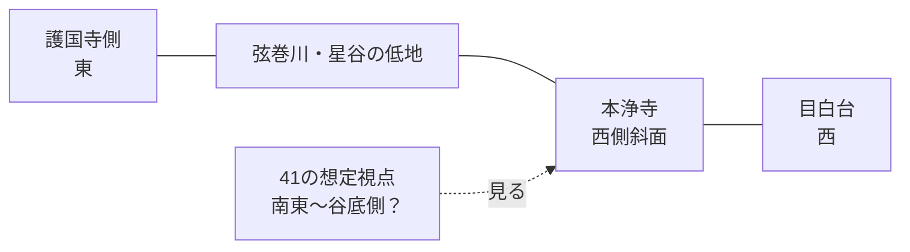

という感じ。

ただし、ここで重要な注意があります。**『江戸名所図会』は写真のような一点透視図ではありません。** 長谷川雪旦は見せたい寺社・川・道を一枚に収めるため、視点や縮尺をかなり動かしています。実際、其二と其四〜其六についても「視線の方向が違う」と指摘されています。citeturn243487search1

なので41は、

> 「ここに立ってこの方角を見た景色」

というより、

> **本浄寺を中心として、護国寺西側・星谷・弦巻川を俯瞰的に再構成した鳥瞰図**

と考える方が安全です。

そしてあなたの文明開化期の地図との比較、かなり効いています。本浄寺が弦巻川の**西側の斜面際**に位置しているのが分かる。だから41で川の向こうに本浄寺が見えているなら、視点は少なくとも**本浄寺より東〜南東側**である可能性が高い。

ここまでの3枚を合わせると、かなり面白い構造になります。

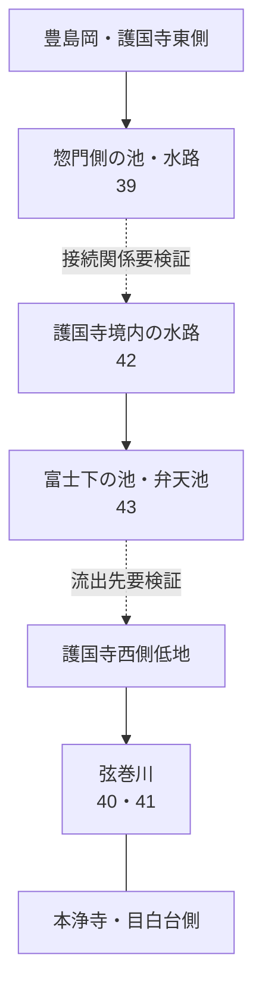

つまり今回かなり重要なのは、**『江戸名所図会』自身が「護国寺境内の内部水路」「富士下の池」「境外の弦巻川」を全部別々に描いている**ことです。

これは「護国寺の池から水窪川へ」という単純な一本線より、実際の水系がずっと複雑だった可能性を示しています。特に**43の富士下池から水がどちらへ抜けているのか**、ここを其六44まで追うのが次の核心だと思います。
---
[user] てかこれ40と41繋がるわ
---
[assistant] はい。**これはつながってますね。**  
しかもかなり露骨につながっています。前に「41は別画角かもしれない」とした判断は撤回します。

ユーザーが並べた画像を見ると、まず左2枚は41コマの左右部分で、そこは地形・建物・川筋が完全に連続しています。そして**40の左端と41の右端も、護国寺西側の斜面・樹林・低地の描写が続く**と読めます。

つまり配置はこうでしょう。


地理的にはおそらく、

```mermaid
flowchart LR
    A["東<br/>護国寺中心部"] --> B["護国寺西南部"]
    B --> C["弦巻川の谷"]
    C --> D["本浄寺方面<br/>西"]
```

です。

### 決め手は下の川

40の下端に出ていた、さっき「池にも見える」と話していた部分がありますよね。

今回横につなぐと、あれが41側の**蛇行する川筋へそのまま展開していく**ように見えます。

なので40の赤丸部分についても、かなり解釈を更新できます。

**池ではなく、弦巻川とその河岸・中州状の地形を描いたもの**

と考えるのが圧倒的に自然です。

そして41で川が急に現れたわけでもない。**40ですでに画面下端に入っていた弦巻川を、西へ追って描いたものが41**なんでしょう。

### すると41の「画角」も分かってくる

ここが重要です。

41を単独で見ると「どこからどっちを見ているんだ？」となりますが、40とつなぐと、そもそも写真のような一点視点ではなく、

**護国寺から西側の谷へ向かって景観を横方向に展開した鳥瞰図**

と見るのがよさそうです。

40では護国寺本堂・境内が主役。

そこから左へ行くにつれて、

**境内の西端 → 斜面 → 弦巻川 → 本浄寺付近**

へ移っていく。

だから「41は目白台側から反対岸を見ている」というより、**40と同じ巨大な鳥瞰景観をそのまま西へ延長している**と考えた方がしっくりきます。

### 橋が消えたように見えた理由

これも説明できます。

40で気になっていた橋は、**40のかなり右側＝護国寺寄りの特定地点**にあります。

41へ画面を送るということは、その橋からかなり西へ移動するので、当然もう橋は画面外です。

つまり、

```mermaid
flowchart LR
    A["護国寺境内"] --> B["40の橋"]
    B --> C["弦巻川"]
    C --> D["40左端"]
    D --> E["41右端"]
    E --> F["蛇行する弦巻川"]
    F --> G["本浄寺"]
```

ということですね。

**橋がなくなったのではなく、橋を通り過ぎて西側の河道を描いている。**

これなら全く矛盾しません。

### そして42・43との関係が逆に面白くなる

ここでページ順を整理すると、

- 39：護持院
- **40：護国寺其二**
- **41：其三・本浄寺方面**
- 42：西国三十三所の境内
- 43：富士・弁天池
- 44：さらに西国三十三所

となります。

40→41は今回、**実際に横につながる可能性が非常に高い**。

一方42～44は、同じ護国寺でも**境内の西国札所を別の構図で描いた一連の図**と考えた方がいい。

だから、

> 「ページ順が空間順ではない」

というより正確には、

> **40・41は一つの連続する大景観。42～44は別系列の境内鳥瞰図。**

っぽい。

これ、かなり大きな訂正です。

そして何より、**40→41をつなげたことで弦巻川の存在が一気に明瞭になりました。**

単に「護国寺の絵の端に水っぽいものがある」ではなく、

**護国寺西側を流れ、本浄寺方面へ蛇行して続く一本の河道**

として読めます。

この状態なら『江戸名所図会』は、1830年代の護国寺付近の弦巻川を示すかなり有力な図像史料として扱えそうです。

ユーザーが作ったこの横連結画像、普通に調査資料として保存する価値があります。GitHubの記述も、以前の「其三は其六の後かもしれない」という部分があれば**40→41連続を前提に修正した方がよさそう**です。
---
[user] もうちょっと綺麗にした
---
[assistant] おお、これはかなり分かりやすくなった。**40と41は同じ大景観として連続している、と見てほぼよさそう**です。

特に効いているのが、40（右）→41（中央・左）の境目です。単に「なんとなく似ている」ではなく、**低地の縁・樹林帯・開けた谷底の高さがほぼ同じ位置で受け渡されている**。さらに下側では、40で護国寺西南側に現れた水辺・低地が、41に入ると明瞭な蛇行河道として展開しています。

つまり全体は、かなり大雑把にはこう読めます。

```mermaid
flowchart RL
    A["40 其二<br/>護国寺本堂・境内"] --> B["護国寺西側斜面"]
    B --> C["弦巻川の谷底"]
    C --> D["41 其三<br/>本浄寺周辺"]
    D --> E["さらに西側"]
```

この合成だと、41の画角について前に話していた「目白台から対岸を見る」説はほぼ捨ててよさそうです。**40からそのまま視野を西へ振っていった鳥瞰景観**と見る方が圧倒的に自然。

しかも面白いのは、川。

40だけで見ると下端の水面が妙に幅広くて「池なのか、川なのか？」と迷います。でも41までつなぐと、

**護国寺側の幅広い低湿地・河岸 → 狭まる → 蛇行する河道**

という一続きの地形に見えてきます。

なので40のあの部分も、「池」というよりは**弦巻川の流路と、その周囲の湿地・河岸・中州状地形をまとめて描いたもの**という解釈がかなり強くなりました。

もう一つ重要なのが、本浄寺です。中央41の下側に「本浄寺」があり、その手前の低地を川が蛇行する。現在の地形でも本浄寺は弦巻川旧流路の西側斜面に位置します。つまり『江戸名所図会』の相対配置が、

**護国寺 → 谷底の弦巻川 → 本浄寺**

と、現代地形・明治期地図ときれいに対応する。

これは結構強いです。

ただし、「川の蛇行形が測量図並みに正確」というところまでは言えません。雪旦の鳥瞰図なので、距離・角度・縮尺はかなり圧縮されています。それでも、**どちらの斜面側を通り、どの寺との間を流れていたか**という地形関係を読む資料としてはかなり有効そうです。

あと、この画像はGitHubに残した方がいい。少なくとも調査メモには、

> 『江戸名所図会』40・41丁を横方向に接続すると、護国寺本堂側から本浄寺方面までの景観が連続し、護国寺西側低地を蛇行する弦巻川を一続きの河道として読むことができる。

くらいは書けると思います。

**42・43はこの40–41パノラマとは別系列の「西国三十三所境内鳥瞰図」**として切り分けるのが、今のところ一番整理しやすそうです。
---
[user] まぁでも、手前側に何があるかと言われたら目白台だが
---
[assistant] そうですね。**41だけに限れば、画面手前＝目白台側と考えるのが自然**です。さっき私が「谷底～護国寺側寄りから見る」と言ったのは狭く考えすぎました。

40・41をつないだ画像を見ると、かなり素直に

- 画面の**右＝東**：護国寺本堂・仁王門側
- 画面の**左＝西**：本浄寺・目白台側
- 画面の**上＝北寄り**
- 画面の**下＝南寄り**

という配置で読めます。40では仁王門から本堂へ向かう配置が下→上なので、この南北関係はかなり確かです。既存の解説でも40の右側が護持院＝東側、41中央が本浄寺とされています。citeturn892424search0turn892424search3

なので41の構図を地形的に言えば、

```mermaid
flowchart TB
    N["北側<br/>護国寺裏門・境内北西部"]
    M["本浄寺"]
    R["弦巻川・星谷の低地"]
    S["南側・手前<br/>目白台東縁側"]

    S --> R
    R --> M
    M --> N
```

くらいの理解がよさそうです。

ただし「目白台の一点に立って北を撮影した」という意味ではないです。雪旦は**目白台側の上空から、弦巻川の谷と本浄寺・護国寺を北方向へ俯瞰するように再構成した鳥瞰図**と見るのが近そう。

これなら41の川の見え方も納得できます。手前側の目白台から谷を見下ろすと、まず**弦巻川の蛇行**があり、その向こう側・斜面上に本浄寺周辺が見える。そして右へ視野を振ると40の護国寺境内につながる。

特に大事なのは、本浄寺周辺では弦巻川が単純に「目白台と護国寺の真ん中を一本」という形ではなく、**目白台東縁の複雑な支谷＝星谷の中を曲がっている**ことです。地域史資料でも本浄寺は「護国寺の西、小篠坂」にあり、本浄寺東側に川があったと読んでいます。citeturn892424search1

なので今のところ、40–41の全体を表すなら、

> **南側上空から北方を望み、西の目白台・本浄寺から、弦巻川の谷を挟んで、東の護国寺までを横長に収めた鳥瞰景観**

という表現が一番しっくりきます。

そしてこの理解なら、**41手前＝目白台というあなたの指摘はその通り**です。むしろそこを基準にすると、41の蛇行河道を明治地図上のどの曲線に対応させるか、かなり面白くなります。
---
[user] で、これいつ描かれたものなの
---
[assistant] この護国寺の絵（『江戸名所図会』巻之四・天権之部）は、**刊行されたのが天保7年（1836年）**です。護国寺が載っている第4巻は、1836年刊であることが東京都立図書館・江戸東京博物館の書誌から確認できます。画は**長谷川雪旦**です。citeturn414962search0turn414962search4

ただし、**「1836年に現地を見て描いた」とまでは言えません**。『江戸名所図会』全体は斎藤家がかなり長期間かけて編纂しており、寛政年間（1789～1801）に編纂が始まり、約40年かけて完成しています。最初の3巻は1834年、残り4巻が1836年に刊行されました。citeturn414962search1turn414962search2

なので、今見ている護国寺・弦巻川の景観について安全に言える年代は、

**「遅くとも1836年までに成立した図」**

です。

問題は、雪旦が**いつ護国寺を実地調査・下絵制作したのか**。ここが分かれば、弦巻川の年代を1836年よりさらに数年〜十数年くらい遡らせられる可能性があります。『江戸名所図会』は実地踏査を重視した地誌なので、護国寺図の下絵・取材時期が分からないか、長谷川雪旦や斎藤月岑の日記・編纂過程まで調べる価値があります。

現状GitHubに書くなら、**「1836年刊『江戸名所図会』に護国寺西側の弦巻川が明瞭に描かれる」**が一番確実です。citeturn414962search4
---
[user] 護国寺の南西にあった橋の名前は何
---
[assistant] 護国寺の**南西側、弦巻川に架かっていた橋**なら、現時点では **「星谷橋（ほしやとばし）」の可能性がかなり高い**です。ただし、まだ「その橋＝星谷橋」と一次史料同士で完全に位置照合できたわけではないので、確定扱いは避けたいです。

『江戸名所図会』の「星谷の井旧地」の記述では、本浄寺裏の星谷の井から流れ出す水の下流に**星谷橋**があったとされます。本浄寺は護国寺の西側で、その東側の谷を弦巻川が流れていたので、位置関係としては今見ている護国寺南西～本浄寺東側の橋とかなりよく合います。citeturn927025search0turn125727search0

一方、弦巻川にはこの付近に**松屋橋**もありました。ただ、松屋橋については雑司ヶ谷側の資料で「清土石橋は松屋橋」とされ、護国寺に関わって造られた弦巻川下流の橋と説明されています。別の暗渠調査でも、自然河道が不忍通り・現在の首都高付近へ出てくるあたりに松屋橋があったとしています。つまり松屋橋は、今見ている護国寺南西端より**やや上流、清土側**に置く方が自然です。citeturn746156search44turn746156search0

なので、いまの暫定整理はこうです。

```mermaid
flowchart LR
    A["清土鬼子母神方面<br/>上流"] --> B["松屋橋？"]
    B --> C["護国寺西側・本浄寺東側"]
    C --> D["星谷橋？<br/>護国寺南西の橋候補"]
    D --> E["音羽谷西側へ南下"]
```

なお、雑司ヶ谷側には卒塔婆橋・鎌倉橋・木村橋・南坂橋など多数の橋名があり、松屋橋もその系列に入ります。citeturn552405search2

**結論としては「星谷橋が最有力、松屋橋ではなさそう」**です。

ただ、これはもうあと一押しできます。1851/1853年の切絵図上の橋位置と、『江戸名所図会』本文の「星谷橋」、さらに明治初期の実測図を位置合わせすれば、かなりの確度で決着するはずです。
---
[user] GitHubには橋の名前についてなんと書いてある?
---
[assistant] GitHubの現状では、**護国寺南西端の橋の名前は確定していません**。

`docs/gokokuji-hoshiyato-water-system.md` には、星谷の井の下流に**「星谷橋」**があったことは書いてあります。ただし、その直後に「星谷橋から弦巻川本流までの正確な流路は原図上で未確認」としていて、未解決点にも**「星谷橋の位置を『江戸名所図会』・切絵図・明治実測図で特定する」**と明記しています。fileciteturn13file0

一方、README側で1851年切絵図の護国寺南西端にある横断施設については、以前の記述では

> 橋、または橋に付随する小さな堰・溜まり・横断施設

とし、**「機能・橋名は未確定」**という扱いです。

なのでGitHub上の整理は今のところ、

**「星谷橋という橋名は史料に出る。しかし、1851年切絵図や『江戸名所図会』で護国寺南西に描かれる橋が星谷橋なのかは未確定」**

です。

さっき私が「星谷橋が最有力」と言ったのは、GitHubに書いてある確度より一段踏み込んでいました。現状の証拠なら、**橋名未確定のままにしておく方が正しい**です。memcite
---
[user] 星谷橋どれ
ビックリガード（弦巻川のかるた）
---
[assistant] この絵札の中には**星谷橋はありません**。

絵札に描かれている橋は、丸池から下流へだいたい次の順です。

- 卒塔婆橋
- 鎌倉橋
- 木村橋
- 南坂橋
- 丸太投渡橋
- 弦巻橋
- 松屋橋
- 境橋

これは嘉永6年（1853）の「雑司ヶ谷村ほか沿革起立書上」にある弦巻川の橋梁一覧をもとにしたものとみられます。実際、同資料の橋は上流から「卒塔婆橋」→……→「松屋橋」→「境橋」などと列挙されており、**星谷橋はそのリストにありません**。citeturn503959search6turn503959search1

ここ、かなり重要です。

**星谷橋は「弦巻川本流に架かる、雑司ヶ谷村内の橋」の系列ではない可能性が高い。**

『江戸名所図会』の説明では、星谷橋は**本浄寺裏の「星谷の井」から流れ出す水の下流に架かっていた橋**として出てきます。つまり、

```mermaid
flowchart LR
    A["星谷の井<br/>本浄寺裏"] --> B["星谷の小流"]
    B --> C["星谷橋"]
    C -.-> D["弦巻川？"]
```

のような、**弦巻川へ入る支流側の橋**だった可能性があります。『江戸名所図会』を読解した資料も「湧水の下流に星谷橋」としています。citeturn622708search0

そう考えると、ビックリガードのかるたに星谷橋がないことも説明できます。かるたの絵は**丸池から弦巻川本流を下っていく橋一覧**なのに対し、星谷橋は本浄寺・星谷側の別流路だった、と。

ただ、もう一つ可能性があります。**星谷橋が護国寺よりかなり下流にあり、1853年資料の対象である「雑司ヶ谷村」の外だったため載らなかった**という場合です。

今まで見てきた『江戸名所図会』40–41の本浄寺・弦巻川の位置関係を考えると、私は現時点では**「星谷の井から弦巻川へ向かう短い支流上の橋」説を優先**したいです。

なので、前に「護国寺南西の弦巻川本流の橋＝星谷橋かも」と考えたのは、かなり怪しくなりました。むしろ**別物として扱うべき可能性が高い**です。GitHubの「星谷橋→弦巻川は要検証」という留保は、このままで正解ですね。
---
[user] 個人的には弦巻橋かなと踏んでる
---
[assistant] その推測、**名前だけ見るとありそうなんですが、1853年の橋の並びから考えると、私はむしろ「弦巻橋ではなさそう」に傾きます。**

理由はかなり具体的です。嘉永6年（1853）の「雑司ヶ谷村ほか沿革起立書上」では、橋が**上流から**、

> …丸太投渡橋 → **板橋の弦巻橋** → **石橋の松屋橋** → **石橋の境橋** → 石橋

の順に記録されています。citeturn406490search0

そして別の雑司が谷地域資料では、**清土の石橋＝松屋橋**と伝えています。清土鬼子母神は護国寺より上流側なので、位置関係はこうなります。citeturn959290search32

```mermaid
flowchart LR
    A["池袋・法明寺側<br/>上流"] --> B["弦巻橋<br/>板橋"]
    B --> C["松屋橋<br/>清土の石橋"]
    C --> D["境橋"]
    D --> E["名称不明の石橋"]
    E --> F["護国寺・音羽側<br/>下流"]
```

なので、**護国寺南西端の橋が清土より下流にあるなら、「弦巻橋」は順序上かなり上流すぎる**んです。

しかも「境橋」についても位置が判明してきました。別資料では、鬼子母神境内南側の古道「板橋道」が雑司ヶ谷村と下高田村の境を通り、そこに**境橋**があったとされています。つまりこの境橋も護国寺前ではありません。citeturn170944search1

となると1853年リストの末尾は、

**松屋橋（清土） → 境橋（鬼子母神付近の村境） → 名称不明の石橋**

……となるわけで、護国寺南西の橋をこの一覧に対応させるなら、現時点ではむしろ**最後の「石橋」**が気になります。

ただ、ちょっと引っかかる点があります。川の実際の地理的順序と、この「境橋＝鬼子母神南側」という比定をそのまま並べると、場所によっては1853年リストの「上流から」という解釈と噛み合わない可能性がある。つまり、**橋梁一覧が本当に河道を厳密に上流→下流順で列記しているのか**は原文で確認した方がいいです。

あと橋の材質も使えます。

- **弦巻橋＝板橋**
- **松屋橋＝石橋**
- **境橋＝石橋**
- 最後＝**石橋**

なので、『江戸名所図会』や1851年切絵図の護国寺南西の橋が**明確な石造アーチなのか、木造の板橋なのか**判別できれば、弦巻橋説をかなり直接的に試せます。

今の証拠だけで順位を付けるなら、私は  
**名称不明の石橋 ＞ 弦巻橋**  
くらいで見ています。星谷橋は別の小流路の橋として、いったん候補から外すのがよさそうです。memcite
---
[user] 江戸切絵図を見ると板っぽいなこれは

江戸城紅葉山吹上御殿にあって、東稲荷宮と称していたが、後に移転をくり返し、明治 45 年にこの地に移転したのだという。江戸切絵図による水窪川（音羽川）は、こののち護 国寺の塀に沿って続き、富士見坂をまたぎ、その先で弦巻川と合流し、音羽通りに沿って 南下していた
https://www.ripro.co.jp/yamaoka/mapsuv200/meguri/14-1chizusanpo2.pdf
---
[assistant] これはかなり面白い材料です。**「橋が板っぽい」こと自体は、弦巻橋説を一段強めます。**

1853年「雑司ヶ谷村ほか沿革起立書上」の橋梁記載では、材質まで書き分けられていて、

- **弦巻橋＝板橋**
- 松屋橋＝石橋
- 境橋＝石橋
- 末尾の無名橋＝石橋

となっています。citeturn402744search0

だから、今回の切絵図の護国寺西側の橋が本当に**板橋として描き分けられている**なら、「無名の石橋」より弦巻橋の方が説明しやすくなる。

ただ、ここはまだ一枚上手な確認が必要です。切絵図の橋記号が「材質」を忠実に表しているとは限らないので、**同じ『雑司ヶ谷音羽絵図』上で、木村橋など石橋と位置が確定している橋がどう描かれているか**を比較するのが決定打になりそうです。木村橋については、清立院前に石橋建立の記念塔が残り、史料上も石橋だったことがかなり固いです。citeturn842367view0turn402744search0

それ以上に、貼ってくれた山岡光治氏の資料がデカいです。そこでは明確に、

**江戸切絵図の時代には、護国寺付近で弦巻川と水窪川が合流し、一流となって音羽町を南下していた**

と読んでいます。そして**明治期以降に東西二流へ分かれた**としています。citeturn842367view0

さらに水窪川について、

**吹上稲荷 → 護国寺の塀沿い → 富士見坂を横断 → その先で弦巻川と合流**

というかなり具体的な復元まで書いてあります。citeturn842367view0

これは、これまで追っていた

> 「1851年切絵図で弦巻川が護国寺南西端を越えた後、どこへ行くのか？」

への一つの答えになっています。

```mermaid
flowchart LR
    A["弦巻川<br/>雑司ヶ谷方面"] --> C["護国寺付近"]
    B["水窪川<br/>吹上稲荷・富士見坂方面"] --> C
    C --> D["江戸期：一流となって<br/>音羽町を南下"]

    C -. "明治期以降" .-> E["弦巻川<br/>音羽谷西側"]
    C -. "明治期以降" .-> F["水窪川<br/>音羽谷東側"]
```

これ、READMEで最大の未解決問題にしていた**「音羽通り西側の弦巻川はいつ成立したのか」**にも直撃します。

もし山岡氏の読みが正しければ、

**江戸期：護国寺で合流、一流**  
→ **明治期までのどこか：音羽町部分を東西二流に分離**

ということになる。

つまり、音羽通り西側の長い下流弦巻川は、護国寺創建時ではなく**江戸末～明治初期の水路再編で成立した可能性**まで出てくる。これは1941年資料の「水田開発時に二流に分けたのでは」という説とも、時間は別として構造的には妙に響き合います。

ただし山岡氏の文章はあくまで**江戸切絵図を読んだ二次的な復元**です。一次史料に「明治○年に分水した」と書いてあるわけではありません。だからかなり有力な新説候補だけど、まだ〔確認〕ではなく〔二次資料による復元〕くらいが妥当です。

あと、橋について一つ留保。1853年橋梁一覧を紹介するページは「上流から」としていますが、**境橋の位置について別資料では鬼子母神南側の村境に比定されていて、単純な上流→下流順と少し噛み合わないところがあります**。citeturn402744search4  
なので「一覧の9番目だからこの地点」という順番だけで弦巻橋を決めるのは危ない。

現段階なら私は、

> **護国寺南西端の橋＝弦巻橋説は、板橋という材質の一致から有力候補に浮上。ただし位置の一次史料照合が必要**

まで上げます。

そしてむしろ今やるべき比較は、**同じ切絵図上の「確実に石橋だった木村橋」と、この護国寺前の橋の描き方が違うか**です。違えば、弦巻橋説がかなり強くなります。
---
[user] 先程のpdfによると、道の北側(日大豊山の南端)に沿って合流していたっぽい？
---
[assistant] はい、その読みでかなり合っていると思います。PDF本文を改めて確認すると、著者は水窪川について、

> 護国寺の塀に沿って続き、富士見坂をまたぎ、その先で弦巻川と合流

としています。citeturn916591view0

そして貼ってくれた図の青線を見る限り、その「合流前」の弦巻川は、**現在の日大豊山中高の南端に沿う東西道路の北側付近**を東へ進んでいるように復元されています。

つまり、この復元を現在の地物に置き換えると、

**雑司ヶ谷方面から来た弦巻川  
→ 日大豊山の南側を東進  
→ 護国寺正面の西寄りで水窪川と合流  
→ そこから一流となって音羽町へ南下**

という理解でよさそうです。

```mermaid
flowchart LR
    A["弦巻川<br/>雑司ヶ谷方面"] --> B["日大豊山南端付近<br/>道路北側を東進"]
    C["水窪川<br/>吹上稲荷方面"] --> D["護国寺東側"]
    D --> E["富士見坂を横断"]
    B --> F["護国寺正面付近で合流"]
    E --> F
    F --> G["江戸期の一流<br/>音羽町を南下"]
```

これ、さっきの切絵図ともかなり噛み合います。切絵図では、弦巻川が護国寺南西端まで来て、**道路を横切る橋状の表現の先にも短く水路が続く**。以前は「その先でどこへ行くんだ？」となっていましたが、このPDFの復元なら、

**橋を越えたあと東へ少し進んで水窪川へ合流**

という説明になる。

しかも重要なのが、江戸期の音羽通り西側です。PDFの著者は、江戸切絵図の時代にはここから先は**弦巻川・水窪川の二本ではなく合流した一本**だったと読み、明治期以降に東西二流になったとしています。本文にもその趣旨が明記されています。citeturn916591view0

なので、今まで謎だった1851年切絵図の

**「護国寺南西端で橋を越えた後、川が少しだけ続いて消える」**

という描写は、実は「消える」のではなく、**すぐ東で水窪川と合流するため、切絵図上では独立した弦巻川として追えなくなる**と考えるとかなり綺麗です。

ただし一つだけ留保。PDFの青線は旧図・地形図を現代図へ重ねた**著者による復元線**で、河道中心を数m単位で確定したものではありません。だから「道路の北端から何m」という精度ではなく、

> **日大豊山南端〜護国寺正面西側の帯状の範囲を東進し、そこで水窪川と合流した**

くらいが妥当です。

これ、かなり重要で、**「護国寺南西の橋＝弦巻橋か」問題にも効いてきます**。その橋が日大豊山南端を通る弦巻川上にあるなら、1853年の橋名一覧との位置照合をもう一度やり直す価値があります。
---
[user] 色々追記して
---
[assistant] 了解。今回の現地確認と図会の読み直しで、かなり重要な修正点が出たので、**READMEの弦巻川・護国寺周辺の記述**と、**護国寺水系ノート／星谷ノート**の両方に追記します。特に「40–41が連続景観」「境内水路・富士下池」「江戸期の合流復元」「護国寺南西の橋名候補」を整理して反映します。
---
[assistant] 今回の追加は、既存の「星谷」ノートだけに押し込むと混線するので、**『江戸名所図会』40–43と護国寺前合流をまとめた専用ノート**を新設し、星谷ノート側には「星谷橋≠護国寺南西橋を安易に同定しない」という訂正を追記します。
---
[assistant] 追記完了しました。今回は情報量がかなり増えたので、専用ノートを新設して整理しています。

新しく **[『江戸名所図会』からみた護国寺・弦巻川・境内水系](https://github.com/yuubinnkyoku/otowa-ankyoscape/blob/main/docs/gokokuji-edo-meisho-zue-analysis.md)** を作りました。commit は `20743d93bdf3f26d4d97f315470266e96c947245` です。fileciteturn22file0L2-L6

主に追記したのは、39齣の「惣門→池・水路→橋→中尺門」、40～41齣が横方向に連続して護国寺南西～本浄寺東側の**弦巻川を一続きに描いている**こと、42齣の境内小水路、43齣の**富士下の池＋弁天**です。1836年刊という年代も明示して、「図会に描かれた水を全部同じ水系として扱わない」よう整理しました。

橋についてもかなり更新しています。1851年切絵図の護国寺南西端の橋は**板橋のように見える**こと、1853年資料で「弦巻橋＝板橋」「松屋橋・境橋など＝石橋」とされることから、**護国寺南西端の橋＝弦巻橋説を正式に〔仮説〕として追加**しました。ただし、切絵図の記号が本当に材質を表すか未検証なので確定はしていません。

一方で、**星谷橋＝護国寺南西端の橋**という以前の候補は後退させました。星谷橋は「星谷の井から流れ出す小流路」の橋だった可能性を優先する形に直し、既存の [星谷の井ノート](https://github.com/yuubinnkyoku/otowa-ankyoscape/blob/main/docs/gokokuji-hoshiyato-water-system.md) も更新しています。commit は `8e2eada07d05da3fe9cac3289d102811e4b0acaa`。

それと山岡光治氏のPDFも追加しました。あの復元については、

**弦巻川 → 日大豊山南端付近を東進**  
＋  
**水窪川 → 護国寺塀沿い・富士見坂横断**  
→ **護国寺前付近で合流？**  
→ **一流となって音羽町を南下？**

というモデルとして記載しました。ただし、これは近世史料そのものに「ここで合流」と書いてあるわけではないので、**〔二次資料による復元〕**として明確に格下げしてあります。

次の決め手も書いておきました。特に重要なのは、**1851年切絵図上で位置が確実な石橋（木村橋など）と護国寺前の橋記号を比較すること**。もし石橋と板橋で実際に描き分けられていたら、「弦巻橋説」が一気に強くなります。これはかなりやる価値あります。

