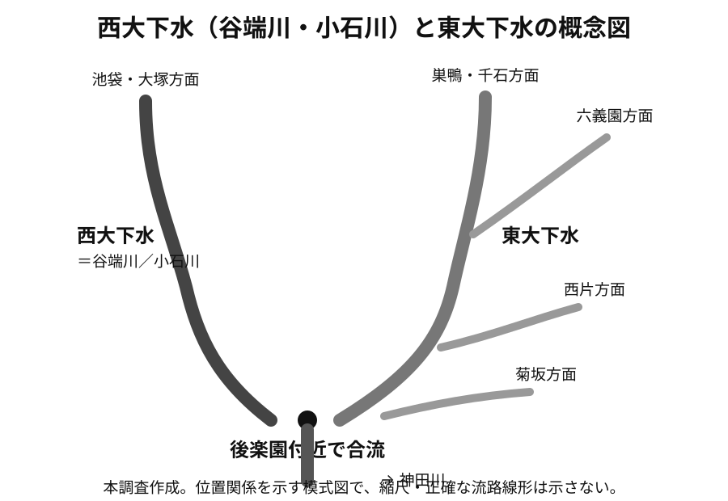

# 谷端川

## 池袋の森の井戸水と「島田牧場支流」仮説の区別（2026年11月1日追記）

豊島区の公園施設案内「**池袋の森**」（**2015年2月25日更新**）は、**池袋1-7-10**の同公園（**1997年4月開園**）にある池を**「井戸水をくみ上げた池」**と記す。〔**確認：区公式施設案内**〕 NPOいけぶくろねっとの**2023年10月13日**の記事は、**2021年設置の現地案内板**を引用し、**1907～1928年**に島田牧場が営業し、池の水に牧場時代の井戸水を利用していると紹介する。〔**観察：案内板の二次紹介／井戸施設の同一性は未確認**〕

D.2.C.の**2015年7月**の暗渠記事索引には**「トンボ池（湧水）／谷端川 島田牧場支流・島田屋敷支流」**という呼称がある。〔**確認：個人サイトの調査上の呼称**〕 ただし、**現在の池は少なくとも区公式説明では揚水による池**であり、「湧水」という見出しをそのまま自然湧出口の証拠に使うことはできない。現代の池・牧場の井戸・旧谷端川支流候補を同一施設や連続する水路とみなすには、**1907～1928年の地籍図、当時の井戸・牧場施設記録、旧水路の線形**をそれぞれ照合する必要がある。〔**観察：水源認定への注意／未解決：支流の実在・流向・接続・井戸深度・揚水開始年**〕

出典：[GOV-028](sources/gov/GOV-028.md)／[豊島区「池袋の森」](https://www.city.toshima.lg.jp/340/shisetsu/koen/064.html)（2015年2月25日更新）／[いけぶくろねっと](https://w3.ikebukuro-net.jp/archives/info/bokujyo202310)（2023年10月13日）／[D.2.C. 2015年7月](https://d-2-c.jp/column_back84.html)。

## 1929年『五千分之一東京市地図』小石川区関係図葉（2026年10月31日追記）

内山模型製図社『**五千分之一東京市地図**』（**1929年3月刊、縮尺1:5,000**）について、東京都立図書館の地形図目録（2023年版）は**第6・7・12・13図**に「小石川区（一部）」が含まれると記す。資料コードは順に**1128746294・1128746300・1128746356・1128746365**で、第6図は個別書誌と画像閲覧画面も公開されている。〔**確認：公的所蔵目録・個別書誌**〕

1903・1904年の区全図と1931年の地籍図の間に位置する**別系統の大縮尺地図候補**として、旧谷端川（小石川）の橋・河道・道路・宅地の変化を比較できる可能性がある。〔**推定：年代比較資料としての有用性**〕 ただし**原画像の河道細部は未判読**で、各図葉がどの区間を含むか、河川が描かれているか、刊行年が測量・修正年と一致するかは未確認。既収録の図名未詳1929年図との同一性も判断できない。〔**未解決**〕 出典：[MAP-110](sources/maps/MAP-110.md)／[都立図書館の地形図目録](https://www.library.metro.tokyo.lg.jp/search/uploads/chizumokuroku202306_5-1_chikeizu_zenhan.pdf)／[第6図の公開書誌](https://archive.library.metro.tokyo.lg.jp/da/detail?tilcod=0000000008-00001469)。

## 2016年の流出計算に現れる谷端川幹線と石神井川の雨水吐（2026年10月31日追記）

関根正人・近藤恭平・神山宙大・小林香野「石神井川流域を対象とした豪雨時の内水氾濫と河川洪水流の一体予測計算」（『土木学会論文集B1（水工学）』**72巻4号、2016年、pp.I_337–I_342**）は、東京都下水道台帳の枝管・道路・雨水吐・ポンプ所等を用い、石神井川を含む**110.2km²**の排水系統を解析する。第3章(2)・図4の**地点A・B**は石神井川の雨水吐で、それぞれ**田柄川幹線・谷端川幹線**が接続する。断面積を等価な円形に換算した直径は、順に**約5m・3m超**と記す。〔**確認：原論文本文・図4の説明**〕

**旧谷端川（小石川）が神田川へ流れたという河川史と、現代の谷端川幹線が石神井川へ雨水を放流するという下水道施設の記述は、対象時代・施設が異なる。** これを同じ「川の河口」として混同しないことが重要である。〔**観察：歴史的流路と現代の排水系統の区別**〕 ただし論文だけでは、石神井川への吐口の正確な位置・施工年、どの時点で流域・下水道の系統が変更されたかは分からない。〔**未解決**〕

計算は**2005年9月の杉並豪雨（総雨量263mm、最大時間雨量112mm/h）と同じ降雨が区域全体に一様に降る**と仮定したもので、**2016年の現地実測でも、2005年の谷端川幹線での観測記録でもない**。また、図4(e)の河川から下水道への**逆流例は地点C**であり、谷端川幹線につながる地点Bでの逆流の証拠ではない。〔**確認：計算条件と図の区別／注意**〕

出典：[PAP-008](sources/papers/PAP-008.md)／[J-STAGE原文PDF](https://www.jstage.jst.go.jp/article/jscejhe/72/4/72_I_337/_pdf)（2016年、第2・3章、図4）。

## 2022年景観計画の三河川比較図（2026年10月31日追記）

豊島区『**豊島区景観計画**』（**2022年6月改定**）の「池袋西地域」印刷**p.78・図表5-49**は、国土地理院の数値標高モデルに基づく等高線図に**水窪川・弦巻川・谷端川**の名称を併記する。印刷**p.81**の「明治42（1909）年の市街地の様子」は、三河川のほか**千川上水本流・長崎分水**を表示し、河川・水田・畑／雑木林・集落・街道・鉄道を区別する。〔**確認：原PDFの図題・凡例・文字**〕 **1909年図は2011年の『豊島区地域地図第四集』などに基づく後年の編集図**で、原測量図ではない。地形・土地利用の比較資料にはなるが、旧河道の正確な中心線、三河川の合流、千川上水との直接接続を証明しない。〔**観察・留保／未解決：図形の精密判読・旧地籍との位置合わせ**〕 出典：[GOV-024](sources/gov/GOV-024.md)／[豊島区公開PDF](https://www.city.toshima.lg.jp/documents/22568/kaitei_keikankeikaku_5-06.pdf)。

## 1993年の公園計画における谷端川緑道の位置づけ（2026年10月31日追記）

豊島区都市整備部都市計画課『**みどりと広場の基本計画**』（**1993年3月初版**）の印刷**p.31**は、**1992年4月1日時点の区内の公園・児童遊園等を144か所、154,324m²**と集計し、そこに「目白庭園」と「谷端川緑道」を含めると明記する。同頁の表3-2では、谷端川緑道を種別F「**自由庭園など**」の例に挙げる。〔**確認：1993年刊の区の原資料**〕

既収録の**1991年4月1日の緑道全線開通**記録と合わせると、少なくとも**1992年4月の行政計画上、谷端川緑道が公園等の集計対象として位置づけられていた**ことを確認できる。〔**観察：二つの区資料の年代照合**〕 ただし、**154,324m²は区内の公園等の総面積**であり、谷端川緑道の面積ではない。また、計画上の種別Fを河川・下水道の法的区分や実際の全区間の開放状況と混同しない。〔**未解決：1992年の区間別面積、覆蓋上使用許可・公園台帳との対応**〕

同書の印刷pp.10–12には国土地理院の土地条件図を基にした図2-1と、東京都現存植生図を基にした図2-2が掲載される。〔**確認：図題・典拠表記／細部未判読**〕 旧谷端川の谷筋を地形と緑地の両面から検討する資料候補だが、旧河道の位置を確定する測量図ではない。〔**推定・留保**〕

出典：[GOV-023](sources/gov/GOV-023.md)／[豊島区『みどりと広場の基本計画』原本（1993年3月）](https://adeac.jp/viewitem/toshima-history/viewer/viewer/13_H050611_05/data/13_H050611_05.pdf)。

谷端川について、現在までに確認できた主要事項をまとめる。主要出典は各記述の直後に示し、一覧は [出典一覧](出典一覧.md) にまとめる。

## 小石川植物園の旧養生所井戸：谷筋周辺の水利用を示す比較資料（2026年10月31日追記）

旧谷端川（小石川）の谷に隣接する白山側の小石川植物園では、**旧小石川養生所で使われた井戸**が現存する遺構として公式に紹介されている。東京大学理学部附属植物園の田中康義「古い時代の小石川植物園」（『東京大学理学部広報』**1973年7月10日、pp.4–5**）は、養生所を**1722年（享保7年）設置**と説明し、**1973年時点で園内中央付近に当時の井戸が残っていた**と記す。〔**確認：1973年の原誌面の記述**〕 同誌p.4には、1915年の「植物園一覧図及び沿革誌参考図類」から採った旧薬園図も掲載される。〔**観察：歴史的な土地利用図の存在／水路の描画内容は未判読**〕

小石川植物園の公式案内もこの井戸を紹介し、**1923年の関東大震災時に飲料水として利用された**と説明する。〔**確認：施設管理者の歴史解説、2026年10月31日閲覧／1923年の利用台帳は未確認**〕 これは谷端川の旧河道を直接示す証拠ではなく、**近接する台地側の地下水利用と、谷底の旧河川・用水の利用を区別して比較するための資料**である。〔**推定**〕 井戸の掘削年・水位・水質・取水層、旧谷端川や千川上水との水理的接続、現在の使用状況は未確認。〔**未解決**〕

出典：[PAP-007](sources/papers/PAP-007.md)（1973年原誌面）／[ORG-005](sources/org/ORG-005.md)（東京大学小石川植物園公式案内）。

## 水源と流路

豊島区の2000年1月21日付プレス資料は、谷端川を**要町の粟島神社境内にある自然湧水池「弁天池」を水源とし、旧長崎村・滝野川村・巣鴨村を経て小石川村へ通じ、神田川へ合流する延長約11kmの河川**と説明している。〔確認〕  
出典：豊島区広報課「かつて区内を流れていた川筋を辿って 冊子『旧谷端川の橋の跡を探る』」（2000年1月21日） [PDF](https://adeac.jp/viewitem/toshima-history/viewer/viewer/pressH120121/data/pressH120121.pdf) / [GOV-007](sources/gov/GOV-007.md)(出典一覧.md)

大塚以南で「小石川」「礫川」などの名が使われ、資料・地域によって「氷川」の呼称も見られることは、『失われた川を歩く 東京「暗渠」散歩 改訂版』などの二次資料に整理されている。〔書籍資料〕  
出典：本田創編著『失われた川を歩く 東京「暗渠」散歩 改訂版』実業之日本社、2021年。[出版社書誌](https://www.j-n.co.jp/books/978-4-408-33965-8/) / [BOOK-001](sources/books/BOOK-001.md)(出典一覧.md)

### 1918年刊『北豊島郡誌』の谷端川記述（2026年10月25日追記）

『北豊島郡誌』（北豊島郡農会編、大正7年／1918年刊、614頁）の地理篇・水利（印刷38〜42頁＝画像44〜46）に、谷端川の独立項目がある（[GAZ-002](sources/gazetteers/GAZ-002.md)(出典一覧.md)）。

> 「【谷端川】 長崎村より出る細流合して一となり、池袋より板橋町の南邊に沿ひ、瀧野川町に出、西巣鴨町の北部を経過して、小石川區に入る、所謂小石川これ也、流末は神田川の上流に合す」

- **源流**：長崎村（現・豊島区要町＝粟島神社弁天池源流説と整合）。
- **流路**：池袋 → 板橋町南辺 → 瀧野川町 → 西巣鴨町北部 → 小石川区 → 神田川上流。
- **千川用水**：北回り灌溉本流として「上板橋村・長崎村・板橋町・瀧野川町を流れて王子村に至り石神井用水に合ふ」と記す。元禄九年に仙川村の太兵衛・徳兵衛が幕府の命で掘削。
- **千川上水跡**：新座郡保谷村より玉川上水を分ち、**本郡巣鴨村まで行程六里餘**、堀割ありて**巣鴨庚申塚邊より本郷湯島浅草邊に通じ、浅草御殿等へ掛りし上水**。**享保七年（高倍率再判読で確認）に廃せられ**近隣村々の用水となった。さらに郡誌は**別伝**として「常盤□殿の御代、**板橋の西・練馬の南・石神井池**より本郷及柳原筋に引れし水流」が文昭院殿の御代に停止したと記しつつ、**石神井池引水説は誤りで実際は柳窪の湧水**と訂正し、**明和六年再興・安永年中落成で庚申塚より駒込本郷湯島下谷浅草邊まで掛り、天明七年又廃止**、跡は下板橋宿・瀧野川村等で近郷用水の助水となったと記す。
- **石神井用水**：三寶寺池・大沼田用水・田無用水の残水を水源とし、明治十九年に水利組合を設置。

## 猫又橋：正保期の橋記号候補と明治の石橋寸法

国立公文書館所蔵『正保年中江戸絵図』（請求番号177-0665）は、**嘉永6年（1853年）の写本**であり、描かれた江戸の状況は屋敷名から**1644〜1645年頃**と推定される。所蔵目録は「橋は赤で描かれる」と説明する。地域史の読図記事「千石の坂道」は、現在の猫又坂下・旧谷端川（小石川）横断位置付近の**赤い橋記号**を、後世の猫又橋に対応する橋として紹介する。〔**確認：公的所蔵目録／二次観察：橋記号の位置比定／原図該当箇所の独立判読は未了**〕

この比定が正しければ、**護国寺創建（1681年）より前に同地点付近に橋が描かれていた可能性**がある。ただし、図は1853年の写本で、測量精度も未検証である。**「猫又橋」という橋名の1644年時点での使用、同一橋体の連続、旧河道の正確な中心線**は確認できない。既収録の1864年錦絵より古い橋梁位置の検証候補として扱う。〔推定・未解決〕

また、小石川新聞社編『礫川要覧』（**1910年10月**）の猫又橋条について、2021年公開の転記は、**1895年（明治28年）の架替えで石橋となり、長さ20尺（約6.06m）、幅5尺6寸（約1.70m）**だったと記す。〔**二次転記／原本の該当頁未照合**〕 現存する親柱に「大正七年三月成」とあるという既収録の写真観察（1918年）と照らすと、**1895年の石橋→1918年の橋**という構造更新の経過を追える。ただし、**橋長は河道の水面幅と同義ではなく、取付部や河岸の変化を別に検証する必要がある**。〔観察・注意〕

出典：[MAP-051](sources/maps/MAP-051.md)／国立公文書館[『正保年中江戸絵図』](https://www.digital.archives.go.jp/file/1795289.html)／地域史の読図[「千石の坂道」](https://ma-maison.sakura.ne.jp/hill/sakamichi/sakamichi5_sengoku.html)／[BOOK-009](sources/books/BOOK-009.md)・[『礫川要覧』原本](https://dl.ndl.go.jp/pid/764460)／[1910年地誌の転記と写真考証（2021年4月11日）](https://okaaaaab9.blog.fc2.com/blog-entry-2701.html)。

## 茗荷谷の人参川との区別

茗荷谷・清水谷から神田川へ下るとされる人参川（後世の地形解説で「古茗荷谷川」と呼ばれる谷筋）については、[人参川](人参川.md)に独立して記録した。金剛寺坂下の「人参川」という歴史的な名称が確認される一方、茗荷谷上流の流路や古茗荷谷川との同一性は未確定。**大塚以南で「小石川」と呼ばれる谷端川本流と混同しない。**

## 西大下水＝谷端川・小石川と東大下水

小石川下流部を調べる際は、谷端川だけでなく**東大下水（ひがしおおげすい）**を別系統として扱う必要がある。

暗渠・旧水路の現地調査サイト「水の行方を追って」は、本郷台地西側を流れる谷端川（小石川）が俗に**西大下水（にしおおげすい）**と呼ばれ、その東側を流れて現在の東京ドーム付近へ向かう別水路が**東大下水**と呼ばれた、と整理している。東大下水については、巣鴨・千石方面、六義園方面、西片方面、菊坂方面などからの複数の流れを集め、後楽園へ流入する水系として説明される。〔二次資料／現地調査〕  
出典：「水の行方を追って」[「東大下水（ひがしおおげすい）―誤解を招く現代用語との意味の違い―」](https://wanjin.blog.fc2.com/blog-entry-26.html) / [BLOG-004](sources/blogs/BLOG-004.md)(出典一覧.md)

別の旧河道調査「谷端川の跡を歩く」でも、小石川下流で谷端川を「小石川大下水」「西大下水」とし、東大下水との合流後に後楽園内へ進むという関係が整理されている。〔二次資料／現地調査〕  
出典：[「文京区千石編1」](https://warpal.sakura.ne.jp/river-yabata/b-koishi4/koishi4.htm) / [BLOG-005](sources/blogs/BLOG-005.md)(出典一覧.md)

  

本調査作成の模式図。位置関係の理解用であり、縮尺・正確な河道線形を示すものではない。

### 1912年『東京市及接続郡部地籍地図』での確認

**最新の引継ぎ（582コマまで確認終了）**：[1912年地籍図読図・引継ぎメモ](1912年地籍図読図・引継ぎ.md)。従来の577・578コマまでの引継ぎメモも履歴として以下に残す。

[2026年10月19日・577コマまでの調査引継ぎメモ](引継ぎメモ-2026-10-19-1912地籍図.md)（全体の要点・未解決事項・再開手順）。

**過去の引き継ぎ・全体要約**：[2026年10月19日・1912年地籍図の578コマまでの調査引き継ぎ](2026-10-19・1912年地籍図読図引継ぎ.md)。以下は各コマの詳細観察。

東京市区調査会『東京市及接続郡部地籍地図』上巻（1912）は、国立国会図書館デジタルコレクションでインターネット公開されている（PID 966079、PDM）。小石川区は504コマから始まる。〔一次史料〕  
原資料：[国立国会図書館デジタルコレクション](https://dl.ndl.go.jp/pid/966079) / [MAP-008](sources/maps/MAP-008.md)(出典一覧.md)

2026年9月、本調査で小石川区の地籍図をコマごとに確認した。現時点の観察メモは次のとおり。〔本調査による画像観察〕

- 512コマ：谷端川が後楽園へ入る前の区間を確認。
- 513コマ：後楽園内から合流部付近までの水路を確認。
- 514コマ：初音町付近の谷端川。ここからは図面上端が北とは限らないため方位に注意。
- 515コマ：そのやや上流側の谷端川。
- 516コマ：掃除町付近の谷端川。
- 519コマ：戸崎町付近の谷端川。
- 526コマ：小石川植物園南側の谷端川。
- 528コマ：植物園北側に、谷端川本流とは別の水路らしい描写を確認。
- 529コマ：氷川下町付近の谷端川（西大下水）が図の西端にわずかに見える。〔利用者による原図観察〕
- 530コマ：小石川植物園北西側で、東大下水系の南側支流とみられる水路が見える。〔利用者による原図観察／系統比定は仮〕
- 531コマ：530コマの東側へ続く東大下水系とみられる水路が見える。〔利用者による原図観察／要図郭照合〕
- 532コマ：旧巣鴨病院南方・現在の駕籠町小学校周辺に、水路と似た着色表現がある。水路か敷地・池など別の記号かは未判定。〔利用者による原図観察〕
- **533コマ：西原町一・二丁目・宮下町付近、35.730152, 139.740712 に、東大下水の「指ヶ谷支流（仮）」の源頭ないし地図上の描画上流端候補を確認したとの報告。** 現在の千石4丁目・巣鴨大鳥神社のすぐ東側に位置する。〔利用者による原図観察＋現代座標の照合〕 1912年地籍図だけでは湧水点とは断定できず、雨水・農地排水を集める上流域かもしれない。既往の現地調査も「大鳥神社周辺から集水、特定の湧水源は不明」とする。[指ヶ谷支流（仮）の現地調査](https://wanjin.blog.fc2.com/blog-entry-27.html)／[巣鴨大鳥神社所在地（文京区）](https://www.city.bunkyo.lg.jp/b014/p003811.html)／[地籍図533コマ](https://dl.ndl.go.jp/pid/966079/1/533)。
- 534コマ：砂利場坂（丸山町・大原町付近）が確認できる一方、当該図郭には川が描かれていないとの報告。**未描画は近傍に水路が存在しないことの証拠ではなく、図郭・図式・暗渠などの可能性を保留。**〔利用者による原図観察〕 [地籍図534コマ](https://dl.ndl.go.jp/pid/966079/1/534)。
- **535コマ：氷川下町付近、35.721924, 139.739104 の谷端川（西大下水）に、川が二手に分かれて中央に中洲状の土地を囲むように見える箇所があるとの報告。** ただし原図の当該部分の拡大画像は本記録時に直接検証していない。自然の中洲・人工的な分流・水路に囲まれた敷地区画などの可能性を区別し、地籍図の線種・着色・地番・隣接図郭と旧版地形図で要検証。〔利用者による原図観察／解釈未確定〕 [地籍図535コマ](https://dl.ndl.go.jp/pid/966079/1/535)。
  - **同コマ右側の図では、上記の左側の観察地点より北に当たる 35.724377, 139.737553 付近で、谷端川がほぼ直角に屈曲する描写**が見えるとの追加報告。これは二股・中洲状描写とは別の観察地点。屈曲方向、旧流路の改修・人工的な付け替えの有無は未判定であり、地籍図の図郭方位と地理的な方位を取り違えず、前後のコマや旧版地形図と照合する。〔利用者による原図観察／形態解釈未確定〕
- **536コマ（大塚仲町付近）：当該図郭に川は見えないが、35.721527, 139.731803 付近の現在大きな交差点となっている場所について、拡幅・改変前の道路配置と、都電（当時の市電）線路の描写を確認したとの報告。** 交差点の当時の道路境界・軌道位置を後年の道路拡幅図や別年代の地形図と対比するための基準点となる。交差点名、拡幅工事の年代と範囲、線路図式の細部は原図・別史料で未照合。川が見えないことは周辺に河道が存在しなかったことを意味しない。〔利用者による原図観察〕 [地籍図536コマ](https://dl.ndl.go.jp/pid/966079/1/536)。
- **537コマ（大塚窪町・現在の教育の森公園付近）：北西寄りの 35.720381, 139.734224 付近で、道路に色が付いている箇所を確認したとの報告。** 利用者は河川ではなく道路の着色表現と判断している。水路としては未同定であり、周辺の筆界・道路幅・地図の色凡例と隣接コマを確認するまでは河川として数えない。〔利用者による原図観察／河川とは未認定〕 [地籍図537コマ](https://dl.ndl.go.jp/pid/966079/1/537)。
- **538コマ（大塚町、陸軍兵器支廠＝現在の筑波大学附属高等学校付近）：敷地西側の崖と、その崖沿いに続く水窪川とみられる線状の描写を確認。ただし水路部分には色が付いていない**との報告。〔利用者による原図観察／流路同定は旧地図との照合を要する〕 537コマの「色が付いていても川ではない可能性がある」例と対照的に、**水窪川と考えられる線に着色がない**ため、1912年地籍図での河川判読は着色だけで決めず、崖・道路・筆界・他年代の河道と合わせて判断する。[地籍図538コマ](https://dl.ndl.go.jp/pid/966079/1/538)／詳細は[水窪川](水窪川.md)も参照。
- **539コマ（大塚上町・大塚辻町付近）：35.723884, 139.730850 付近を含む、新大塚駅〜護国寺東側の水窪川とみられる水路が見える**との報告。水路を示すと思われる着色が線形・区画とずれている箇所があり、さらに**護国寺東側で水路が二股に分かれるように描かれている**という観察。〔利用者による原図観察／図面上の不整合候補〕 着色のずれは彩色・印刷・複製時の位置ずれの可能性があるが原因は未確定。二股は実際の分流・取水路・排水路・道路越えの接続関係・図式の誤認などを区別する必要があり、単純に製図ミスとして退けない。538コマの無着色水路や、540・541コマとの連続性、他年代の実測図を照合する。[地籍図539コマ](https://dl.ndl.go.jp/pid/966079/1/539)／[水窪川の記録](水窪川.md)。
- **540コマ（護国寺境内を全体的に収録）：護国寺東側の 35.722450, 139.730027 付近では、539コマから続く水窪川とみられる二股状の描写のうち南側が着色されているが、実際の流路は北側の線だったのではないか**との利用者による原図観察・推定。**護国寺西側には弦巻川とみられる水路も描かれる**が、着色の位置は線形と一致せず、色から正確な河道位置は特定できない。〔利用者による直接観察／着色ミス・北側流路説・各河川比定は未確定〕 539コマとの接続、541コマ、他年代の実測図・地番境界・地形・護国寺境内図を照合する。**二股の南側を実河道として採用したり、弦巻川の河道を着色だけで確定したりしない。** [地籍図540コマ](https://dl.ndl.go.jp/pid/966079/1/540)／[水窪川](水窪川.md)／[弦巻川](弦巻川.md)。
- **541コマ（大塚坂下町北部）：35.725805, 139.727532 付近で、水窪川とみられる水路が道路を横断する箇所**を確認。利用者提供の同コマの画面撮影では、灰色の太い着色帯が道路交差部で不規則につながり、**道路西側で二股に分かれているかのように見える**。利用者は**実際の流路は道路東側の線に沿っていたのではないか**と推定する。〔利用者による原図直接観察＋画像提示／東側流路説は未検証〕 539・540コマと同様、着色された幅・分岐のみを河道線として扱わず、線描・地番・筆界・道路形状を優先して検討。着色ずれなのか実際の分岐・付替えなのかは、前後のコマおよび他年代の実測図と照合して判定する。[地籍図541コマ](https://dl.ndl.go.jp/pid/966079/1/541)／[水窪川側の詳細](水窪川.md)。
- **542コマ（久堅町付近）：播磨坂の東側に谷端川とみられる水路が描かれている**との報告。〔利用者による原図観察／流路の同定は隣接コマと要照合〕 1912年地籍図の同コマで水路が見えるという事実を記録し、具体的な屈曲・分岐・着色状態や隣接する543コマとの接続については未確認として残す。[地籍図542コマ](https://dl.ndl.go.jp/pid/966079/1/542)。
- **543コマ（小石川植物園南側）：35.718856, 139.742543 付近で、谷端川が短い区間で2回屈曲するように描かれている**との報告。〔利用者による1912年地籍図原図観察／屈曲形態・位置の照合は未実施〕 542コマの播磨坂東側の流路と連続する可能性があるが、図郭間の具体的な接続は未照合。この2回の屈曲が自然河道・人工的な流路変更・地図の図式化のいずれによるかは、このコマだけでは判断しない。[地籍図543コマ](https://dl.ndl.go.jp/pid/966079/1/543)。
- **544コマ（竹早町、現在の竹早中学校周辺）：水路の描写は確認できなかった**との報告。〔利用者による原図観察／このコマでの不掲載〕 「河川が存在しなかった」ではなく、**同コマでは見えない**として記録する。[地籍図544コマ](https://dl.ndl.go.jp/pid/966079/1/544)。
- **545コマ（544コマの隣接図郭、利用者のいう清水谷町付近）：同様に川の描写は確認できなかった**との報告。〔利用者による原図観察／地名・位置比定は再照合対象〕 こちらも不掲載を河川不存在の証明には使わない。[地籍図545コマ](https://dl.ndl.go.jp/pid/966079/1/545)。
- **546コマ（竹早町、545コマの北側にあたる図郭）：川の描写は確認できなかった**との報告。〔利用者による原図観察／この図郭での不掲載〕 未確認を実際の水路不存在の証明としては扱わない。[地籍図546コマ](https://dl.ndl.go.jp/pid/966079/1/546)。
- **547コマ（表町・富坂上の交差点付近）：35.710404, 139.746518 付近の交差点を確認したが、河川の描写は見当たらなかった**との報告。〔利用者による原図観察／同コマでの不掲載〕 交差点の同定・後年の道路改変との比較は別途可能だが、ここでは流路の存在・不存在を推論しない。[地籍図547コマ](https://dl.ndl.go.jp/pid/966079/1/547)。
- **548コマ（表町、傳通院・伝通院付近）：川の描写は確認できなかった**との報告。〔利用者による原図観察／このコマでの不掲載〕 544〜547コマと同じく、地籍図上で水路が見えないという観察のみ記録し、河川自体の不存在とは判断しない。[地籍図548コマ](https://dl.ndl.go.jp/pid/966079/1/548)。
- **549コマ（大門町・水道町と推定される頁）：色塗りだけがあり、文字・地番・記号・黒い線描が見えない**との利用者の直接観察。独立のコマ別目録にも「549/？（大門町・水道町だと思われるが黒色が出ていない）」との注記があるため、閲覧者固有の表示問題とは限らず、黒版の未再現（印刷・原本・撮影のいずれの段階かは不明）の可能性がある。**この頁は川の有無を判定不能とし、着色だけから水路を同定しない。** 同目録では551コマも同様の注記があり、後に利用者が551コマも不可解な着色だけの状態だと直接報告した。〔利用者直接観察＋二次目録による補強／原因未確定〕 [地籍図549コマ](https://dl.ndl.go.jp/pid/966079/1/549)／[コマ別目録](https://kindaidigital.blogspot.com/2012/02/blog-post.html)。
- **550コマ（金富町、金剛寺付近）：水路・河川の描写は確認できなかった**との報告。〔利用者による原図観察／このコマでの不掲載〕 近隣に水路が存在しなかった証拠とはしない。[地籍図550コマ](https://dl.ndl.go.jp/pid/966079/1/550)。
- **551コマ（三軒町・清水谷町と推定される頁）：549コマと同様に、色塗りだけが残る不可解な表示**との直接観察。二次的なコマ別目録でも「黒色が出ていない」とされる。**線描・文字・記号が欠ける原因は原本印刷／撮影／複製のどの段階か不明で、河川の有無は判読不能**。〔利用者直接観察＋既存の二次目録との一致〕 [原図551コマ](https://dl.ndl.go.jp/pid/966079/1/551)／[コマ別目録](https://kindaidigital.blogspot.com/2012/02/blog-post.html)。
- **552コマ（第六天町・人参川下流域）：水路を思わせる着色がある**との利用者による原図観察。ただし利用者が比較した同時期の他の旧地図には対応する川の描写が見られず、**1912年当時に地表を流れる開渠が存在したとは未認定**。着色が水路敷・排水溝・暗渠化した経路・河道跡・道路／敷地の着色・単純な彩色ずれのどれに当たるか、線描・地番・凡例と同年代地図を照合する必要がある。〔利用者による原図観察／解釈未確定〕 [原図552コマ](https://dl.ndl.go.jp/pid/966079/1/552)／[人参川](人参川.md)。
- **553コマ（茗荷谷町、現在の拓殖大学付近）：道路に沿って人参川とみられる線状・水路状の描写がある**との利用者による原図観察。これが1912年当時の開渠・側溝などの排水路を示している可能性はあるが、**人参川との同定、実際の流水、開渠か暗渠かは未確定**。552コマ（第六天町）で見つかった着色との連続性、別年代地形図・道路境界との位置関係は要照合。〔利用者による原図観察／水路の同定・存続形態は仮説〕 [地籍図553コマ](https://dl.ndl.go.jp/pid/966079/1/553)／[人参川](人参川.md)。
- **556コマ（小日向水道町東部・久世山南東付近）：35.709928, 139.735237 付近の着色が気になる**との利用者観察。**神田川の描写は別に確認できる**ため、その着色を旧神田上水の水路敷とみる仮説が出た。ただし、着色と実際の水路線の一致、旧神田上水の経路の同定は原図・他年代図の照合待ち。〔利用者による原図直接観察／旧神田上水比定は仮説〕 [556コマ](https://dl.ndl.go.jp/pid/966079/1/556)。
- **557コマ（小日向水道町東部）：556コマと類似するが、より明るい・薄い表示のページに見える**との利用者観察。556と同一範囲の別刷り・色版なのか、対象区画の異なる図なのか、撮影・原本の濃度差かは未判定。**「556の複製」とは決めつけず、黒色の線描・文字・地番・図郭番号を要照合。**〔利用者による原図観察／再現条件未確認〕 [557コマ](https://dl.ndl.go.jp/pid/966079/1/557)。
- **558コマ（小日向水道町西部・久世山付近）：神田川と、それとは別の旧神田上水とみられる水路が描かれ、後者が途中で途切れているように見える。また、弦巻川とみられる水路も同じ付近で途切れる**との報告。利用者は**弦巻川が旧神田上水水路へ合流していた可能性**を指摘した。〔利用者による原図観察／合流点の接続は未検証〕 Natrium.jpも「大正期の地図では弦巻川が江戸川橋西側で旧神田上水（神田川よりやや北）へ流れ出るように描かれる例」を報告しており、整合的な仮説だが、**両水路の終端描写だけでは実際の合流・工事時期・水理を断定できない**。近代上水としての使用終了後の旧水路と現役の飲料水用上水を区別する。[558コマ](https://dl.ndl.go.jp/pid/966079/1/558)／[Natrium.jp 弦巻川](https://natrium.jp/canal_lot/kanda/tsurumaki/index.html)／[東京都水道局・神田上水史](https://www.waterworks.metro.tokyo.lg.jp/suidojigyo/gaiyou/rekishigallery)。
- **559コマ（小日向水道町西部）：558コマに対応する明るい・薄い表示のページに見える**との利用者観察。556/557ペアと同様に、同じ図の別版か、白黒線描の違いや画像再現上の問題かは未判定。**着色が薄いことだけを河川の消失・変更とは解釈しない。**〔利用者による原図観察／要原本比較〕 [559コマ](https://dl.ndl.go.jp/pid/966079/1/559)。
- **560コマ（水道端町一丁目）：35.710075, 139.740012 付近、および 35.708782, 139.742331 付近に、南北方向へ延びる着色された水路状の筋を確認したとの報告。** 利用者は**1921年頃の1万分1地形図にも対応する筋が見える**と比較しており、1912年の単純な着色ミスではなく、実在した水路・排水路等を反映する可能性が高まった。〔利用者による二地図比較／同じ水路の同定・開渠か否かは未確定〕 この時点では東西2地点の線形・流向・相互接続を断定しない。[地籍図560コマ](https://dl.ndl.go.jp/pid/966079/1/560)。
- **561コマ（後楽園付近）：神田川の描写を確認。** 〔利用者による原図観察〕 [561コマ](https://dl.ndl.go.jp/pid/966079/1/561)。
- **562コマ（水道端町の隣接図郭）：通常の描写に比べて明るい・薄い表示のページ**との報告。557・559コマと類似した状態だが、原本の別刷り・彩色工程・撮影処理等のどの原因かは未判定。水路が薄い・見えないことを河道変化と解釈しない。〔利用者による原図観察／判読条件に留意〕 [562コマ](https://dl.ndl.go.jp/pid/966079/1/562)。
- **563コマ（武島町・西江戸川町付近）：560コマの「東側」に描かれた水路状の着色・線形が、下流で神田川へ合流するように見える**との観察。**560コマの西側のものは563コマでは描かれていない**。〔利用者による原図観察／合流・図郭間の同一水路判定は未確定〕 その水路が実際に1912年時点で開渠だったか、川名が何か、神田川への排水管・暗渠との接続かは引き続き要照合。[563コマ](https://dl.ndl.go.jp/pid/966079/1/563)。
- **564コマ（松枝町・東西古川町・小日向町付近）：蟹川とみられる水路が神田川へ合流する描写を確認した**との報告。また、利用者のいう**「北川の支流」**に相当する別の枝状水路が明瞭に描かれ、比較した1万分1地形図ではその枝流が描かれていなかったとの観察。〔利用者による原図観察／川名・支流系統の再同定待ち〕 「北川」の指示対象が特定の川名か「北側の川」の意味か、地名・河川名を原図と別史料で確認するまで確定しない。縮尺・図式・年代の差が不掲載の理由かもしれず、他図の不掲載は1912年時点の不存在を意味しない。[564コマ](https://dl.ndl.go.jp/pid/966079/1/564)。
- **565コマ（小日向町・松枝町周辺の続き）：564コマに対応する明るい／薄い版のように見える**との利用者の原図観察。564コマと同一区域の別版か、刷色・撮影・画像処理上の差なのかは不明。564コマにある蟹川等の線が565でも判別できるかは要比較。〔利用者による原図観察／判読条件未確定〕 [565コマ](https://dl.ndl.go.jp/pid/966079/1/565)。
- **566コマ（東青柳町・西青柳町・音羽町一丁目付近、護国寺南方）：水窪川と弦巻川の両方の河道が描かれており、1921年の1万分1地形図で確認した東西二流の位置関係と一致する**との利用者の原図・地形図比較報告。〔利用者による二資料の直接読図／本ノートでは重ね合わせ未実施〕 **1912年段階で護国寺南側に二つの水路線があったことを検討する重要な比較箇所**。ただし、着色のずれを538～541コマで確認しているので、両河道の細かな線形・幅・接続先は色ではなく黒い描線・筆界・隣接567コマと照合して確定する。また、この二流の存在から17世紀の開削・寺域造成時期は直接推定しない。[566コマ](https://dl.ndl.go.jp/pid/966079/1/566)／[水窪川](水窪川.md)／[弦巻川](弦巻川.md)。
- **567コマ（音羽町二・三丁目）：水窪川と弦巻川の両方が描かれている**との利用者の直接観察。566コマに続き護国寺南側の東西二流を追跡できる。**現「附属横坂」付近で水窪川を渡る橋の描写は確認できない**との報告があるが、橋が1912年当時に存在しなかったことを確定するものではない。現在の講談社付近には**「佐藤○○邸」と読める屋敷名があり、講談社の表示は見えない**とのこと。所有者の正確な氏名・敷地範囲は原図の再判読と地番照合待ち。**以前話題になった講談社付近の池状地物は本コマでは確認できない**が、過去の池状表現（例えば音羽二丁目・水窪川西側、35.717529, 139.728814付近）との同一地点比定も未済であり、不掲載を埋立時期の確証とはしない。〔利用者の1912年原図直接観察／橋・屋敷・池の同定未確定〕 講談社は1909年に本郷区で創業、野間清治が音羽の旧山田顕義邸を購入したのは1921年で、本社社屋竣工は1934年（[講談社公式沿革](https://www.kodansha.com/jp/history/)／[講談社野間記念館](https://noma-museum.note.jp/n/n0dfb8dec8e46)）。**佐藤某邸が山田旧邸に相当するかどうかは断定しない**。[地籍図567コマ](https://dl.ndl.go.jp/pid/966079/1/567)／[水窪川](水窪川.md)／[弦巻川](弦巻川.md)。
- **568コマ（音羽町四・五丁目）：566・567コマから続いて、水窪川と弦巻川の東西二つの水路が描かれている**との利用者による原図観察。各水路の正確な描線・敷地境界との対応は未重ね合わせ。〔利用者の直接読図〕 [568コマ](https://dl.ndl.go.jp/pid/966079/1/568)。
- **569コマ（音羽町六・七丁目）：引き続き水窪川と弦巻川の双方が描かれる**との利用者による原図観察。**河道と判読できるのに、対応する部分に適切な水路色が付けられていない箇所がある**という重要な指摘。〔利用者の直接読図／原図の色凡例と水路描線の独立照合は未実施〕 538～541コマの無着色・着色ずれの観察と同様、**着色の有無や位置だけをもって水路の所在・分岐・幅を確定しない**。[569コマ](https://dl.ndl.go.jp/pid/966079/1/569)。
- **570コマ（音羽町六・七丁目の隣接ページ）：569コマより明るい・薄い版のように見える**との利用者の観察。569コマと同じ区域を示す別刷り・印刷版・複製濃度の違いかは未判定。**明暗差から河川の有無や時代差は推論しない**。〔利用者の原図観察／複製・印刷工程未確認〕 [570コマ](https://dl.ndl.go.jp/pid/966079/1/570)。
- **571コマ（音羽町八・九丁目・桜木町付近）：今宮神社前の橋が明瞭に描かれ、弦巻川下流の線が西方向へ急に屈曲している**との利用者の原図直接観察。今宮神社の前の現存石橋跡は現地調査にも記録があり、地籍図の橋との位置照合に価値がある（[現地踏査](https://lotus62ankyo.blog.jp/archives/7711808.html)）。屈曲区間が**旧神田上水そのもの／旧神田上水への接続／神田川方面への別の河道**のいずれかは未判定。Natrium.jpは大正期の地図で弦巻川が旧神田上水へ注ぐように見える例を指摘する一方、別の読図（1883年五千分一図）では弦巻川が神田上水の下を伏樋で通って神田川へ流入していたとの解釈がある。**年代差・描写差・地図上の線種を確認するまでは合流を確定しない**。また図郭の切れ目や本来の流向も要確認。〔利用者による直接観察／旧上水比定は仮説〕 [地籍図571コマ](https://dl.ndl.go.jp/pid/966079/1/571)／[Natrium.jp](https://natrium.jp/canal_lot/kanda/tsurumaki/index.html)／[東京の水・弦巻川断章](https://tokyoriver.exblog.jp/13903570/)／[弦巻川側の詳細](弦巻川.md)。
- **572コマ（大洗堰付近）：神田川の早稲田側（南岸側）に、蟹川の支流とみられる水路が描かれている**との利用者の原図観察。〔直接読図／蟹川水系への同定は未検証〕 564コマで観察された蟹川の神田川合流・枝流との関係、および後続573コマとのつながりは図郭・線描・地形図の照合を要する。[地籍図572コマ](https://dl.ndl.go.jp/pid/966079/1/572)。
- **573コマ（江戸川橋西側付近）：35.709719, 139.728268 付近に水路とみられる線があり、蟹川の支流の可能性もあるが、別の川かもしれない**との利用者の原図観察。〔座標付き直接読図／水路名・系統・前後コマとの接続は未同定〕 **蟹川支流として確定せず、独立した未同定水路候補**として保留する。572コマの早稲田側水路・564コマの蟹川水系と比べ、接続する線が描かれているか、神田川への合流方向・地番境界を検証する。[地籍図573コマ](https://dl.ndl.go.jp/pid/966079/1/573)。
- **574コマ（関口・関口台方面）：前後のコマより明るい／薄い表示の版のように見える**との利用者による原図観察。573コマと同一図郭の別版か、原本・印刷・撮影の差かは未確認。**このコマでの河川の有無は未判定**とする。[地籍図574コマ](https://dl.ndl.go.jp/pid/966079/1/574)。
- **575コマ（音羽町五・六丁目の西側、目白台付近）：弦巻川とみられる水路が描かれている**との利用者による原図観察（報告では「鶴巻川」と表記）。566〜569コマなど音羽谷側で追ってきた弦巻川と、目白台側の水路がどう接続するかは、隣接図郭と地番を照合して判断する。着色だけで正確な河道を確定しない。〔利用者による原図直接観察／系統・位置の詳細照合待ち〕 [地籍図575コマ](https://dl.ndl.go.jp/pid/966079/1/575)／[弦巻川](弦巻川.md)。
- **576コマ（椿山荘周辺）：神田川の描写を確認できる**との利用者による原図観察。〔利用者の直接読図／そのほかの支流の有無は未判定〕 [地籍図576コマ](https://dl.ndl.go.jp/pid/966079/1/576)。
- **577コマ（音羽町七・八丁目西側の目白台付近）：場所の同定について報告あり**。このコマにおける弦巻川その他の河川の有無については**まだ観察結果が報告されていないため未判定**。〔利用者による場所の指摘〕 [地籍図577コマ](https://dl.ndl.go.jp/pid/966079/1/577)。
- **578コマ（目白台付近）：明るい・薄い版のように見える**との利用者による原図観察。577コマと同区域の複製・別刷りか、画質差なのかは未確認。**水路の有無も未判定**。〔利用者の直接読図／複製原因未解決〕 [地籍図578コマ](https://dl.ndl.go.jp/pid/966079/1/578)。
- **579コマ（目白台付近）：利用者が図郭の場所を目白台と報告**。河川の有無・着色・流路形態についての具体的な観察はまだないため**判定保留**。〔位置の観察のみ〕[579コマ](https://dl.ndl.go.jp/pid/966079/1/579)。
- **580コマ（目白台付近）：利用者が図郭の場所を目白台と報告**。河川の有無はまだ報告されておらず、**「河川なし」ではなく未判定**とする。〔位置の観察のみ〕[580コマ](https://dl.ndl.go.jp/pid/966079/1/580)。
- **581コマ（旧東京盲学校・腰掛稲荷神社付近）：弦巻川が明瞭に描かれている**との利用者による原図直接観察。**現代の地図には、すぐ近くに「弦巻稲荷神社」もある**との発見。〔1912年地籍図の河道観察＋現代地図の社名観察〕 弦巻稲荷は文京区目白台3丁目、不忍通り「護国寺西」交差点付近、腰掛稲荷の崖下の建物の階段踊り場に現存すると現地記事が説明している。独立した暗渠調査でも弦巻川の旧谷底付近として紹介される（[弦巻稲荷の現地記事](https://sanpo-nikki.com/shrine/tsurumakiinarijinja/)・[Natrium.jp](https://natrium.jp/canal_lot/kanda/tsurumaki/index.html)）。**社名が旧河道の地域認識と関係する可能性はあるが、創建・命名年代や1912年図での社の存在は未確認**。腰掛稲荷との成立史・同一性も不明。東京盲学校は1910年に建造された校舎の一部が明治村に保存されており、地籍図の年代と整合する（[明治村](https://www.meijimura.com/sight/%E6%9D%B1%E4%BA%AC%E7%9B%B2%E5%AD%A6%E6%A0%A1%E8%BB%8A%E5%AF%84/)）。〔原図観察／社名由来・地形関係は研究仮説〕[581コマ](https://dl.ndl.go.jp/pid/966079/1/581)／[弦巻川](弦巻川.md)。
- **582コマ（日本女子大学の北側付近）：581コマ（旧東京盲学校・腰掛稲荷神社付近）より少し上流側の弦巻川とみられる水路が描かれている**との利用者による1912年地籍図原図の直接観察。〔直接読図／正確な図郭間の線形・位置合わせは未実施〕 581コマで確認した明瞭な弦巻川の描写と併せ、**目白台〜雑司ヶ谷方面へ上流側の流路を追える**手掛かりとなる。水路の幅・着色・橋・分岐等については報告を受けておらず、描写の有無を超えて推定しない。[地籍図582コマ](https://dl.ndl.go.jp/pid/966079/1/582)／[弦巻川](弦巻川.md)。

当初、528コマ付近から見える別水路を「谷端川の支流」とだけ捉えていたが、後世の地形図・既往の暗渠調査と照合すると、**東大下水系の流路を見ている可能性が高い**。ただし、1912年図上で東大下水の全線・各支流・西大下水との合流点をまだ連続してトレースし終えていないため、各コマの水路を機械的にすべて東大下水へ帰属させない。

また、1917～1928年頃の地形図を用いた「東京時層地図」の表示でも、指ヶ谷町・丸山方面の低地に明瞭な水路が確認でき、本調査で1912年地籍図から見出した別水路が単なる筆界表現ではなく、実在水路だった可能性を補強する。ただし「東京時層地図」は複数年代・縮尺の図を組み合わせた閲覧サービスなので、厳密な年代確認には元の地形図を用いる。

### 「水の行方を追って」の流路図について

同サイトには東大下水・西大下水の関係を地形陰影上に示した流路図が掲載されており、本調査でも位置関係の理解に有用だった。ただし、同サイトは流路地図について**第三者への提供・共有を想定していない**旨を明記しているため、このリポジトリでは元画像・スクリーンショットを転載しない。掲載元へのリンクを残し、上の概念図は本調査で独自に作成した。  
掲載元：[「東大下水（ひがしおおげすい）―誤解を招く現代用語との意味の違い―」](https://wanjin.blog.fc2.com/blog-entry-26.html)

## 千川上水からの分水

谷端川は千川上水から実際に分水を受けていた。練馬わがまち資料館は、要町3丁目付近から南東へ分かれる**「長崎村外三村分水」**が、粟島神社の池を水源とする谷端川へ接続していたことを説明し、明治10年（1877）の「千川用水組合村樋口伏替願」に「長崎村、中丸村、池袋村、金井窪村四ケ村用水」と記されることも紹介している。〔確認〕  
出典：練馬わがまち資料館 [「千川上水の分水を訪ねて（2）」](https://www.nerima-archives.jp/column/3572/) / [GOV-005](sources/gov/GOV-005.md)(出典一覧.md)

この「千川用水組合村々樋口伏替願」は、国立国会図書館サーチで**1877年（明治10）7月6日付の現存古文書**として書誌を確認できる。提出者は15か村の村役人・惣代、水路見守人の千川善蔵、第八大区七小区戸長の岩佐満房、宛先は東京府知事・楠本正隆で、原本は杉並区立郷土博物館所蔵の星野家文書に含まれ、杉並区指定有形文化財（古文書）となっている。〔原史料書誌確認〕  
したがって、四ケ村用水という呼称を伝える練馬わがまち資料館の記事は、少なくとも資料の存在・年代・行政文書としての性格について独立した公的書誌で裏付けられる。ただし、NDLサーチでは原文画像は公開されていない。なお、翻刻書『星野家文書 千川用水関係史料』23頁の樋口一覧1項目では、読点なしの形「但長崎村中丸村池袋村金井窪村四ケ村用水」が確認されており、この1項目に限っては練馬記事の転記と翻刻が一致する。全文転記は未了で原本も未閲覧のため、文書全体の文言としては引き続き区別する。〔確認／注意〕  
出典：翻刻書 [BOOK-032](sources/books/BOOK-032.md) / 樋口伏替願 [GOV-016](sources/gov/GOV-016.md)
出典：国立国会図書館サーチ [『千川用水組合村々樋口伏替願』](https://ndlsearch.ndl.go.jp/books/R100000094-I1542114)（1877年7月6日、杉並区立郷土博物館原本所蔵）

分水の開始時期については、深田伊佐夫「千川上水における流域環境の変化と宗教的構築物について」（『中央学術研究所紀要』42、2013年、pp.158–180）が、先行研究をもとに千川上水の用途変化を整理し、**宝永4年（1707）に流域20か村の嘆願によって灌漑利用が認められ、その時期に自然河川である谷端川・石神井川への分水が開削された**としている。〔学術論文による既存仮説の補強〕  
これは、1877年文書で確実に存在する長崎村外三村分水を、少なくとも研究史上は1707年の灌漑利用開始期まで遡らせる根拠になる。ただし同論文の1707年記述は大石ら（2006）、大松騏一（1996）、豊島区郷土資料館（1992）、千川の会（1982）等を基礎にした整理であり、**1707年当時の谷端川分水口の位置や工事内容を記す一次史料を本調査で直接確認したわけではない**。したがって「現在の要町3-45付近の分水口が1707年にそのまま開削された」とは断定しない。〔確認／推定範囲の限定〕  
出典：深田伊佐夫「千川上水における流域環境の変化と宗教的構築物について」『中央学術研究所紀要』42、2013年、pp.158–180。[中央学術研究所書誌](https://www.cari.ne.jp/search/detail/paper/id/648) / 補助確認：[日本宗教学会『宗教研究』87巻別冊](https://jpars.org/journal/bulletin/backnumber/vol_87.pdf)

安永9年（1780）の史料**「千川素堀筋普請所積見分」**について、地域史調査記事に掲げられた転記には、長崎村分水口の上流側に**「長崎悪水吐潜樋　長六間」**、その付近に**「往来道ニ石橋有」**とする記述があり、その後に長崎村分水口が記録される。〔二次転記による史料内容の確認〕  
これは、18世紀後半の長崎村分水付近が単なる取水口だけではなく、**悪水を上水路の下へ通す潜樋と往来道の石橋を伴う交差施設群だった可能性**を示し、分水口周辺の位置復元に使える新しい手掛かりになる。一方、転記記事自身が距離解釈に矛盾の可能性を指摘しており、各「○間目」がどの地点を起点とするかは未確定である。また本調査では原史料画像を直接確認していないため、分水口寸法の読取りや絶対位置は断定しない。〔観察／位置具体化の手掛かり／要原典照合〕  
出典：地域史調査記事 [「千川親水公園」](https://ameblo.jp/kazuaruki/entry-12940933918.html)（「千川素堀筋普請所積見分」安永9年・1780年の該当部を転記） / 関連史料集の書誌確認：豊島区立郷土資料館編『千川上水関係史料集 1』豊島区教育委員会、1995年3月、146p（[国立国会図書館サーチ](https://ndlsearch.ndl.go.jp/books/R100000002-I000002419137)）。ただし、今回の転記箇所が同史料集の何頁に収録されるかは未確認。

したがって、現在は次のように区別する。

- 千川上水 → 谷端川：〔確認〕
- 千川上水 → 弦巻川：〔未確認〕
- 千川上水 → 水窪川：〔未確認〕

弦巻川・水窪川への直接分水を主張するには、取水口・樋・分水路・管理文書などの具体的な証拠が必要である。

## 極楽水と谷端川（小石川）

小石川4丁目の**極楽水**は、谷端川下流部の周辺湧水を考えるうえで重要な地点である。江戸後期『御府内備考』の転記では、松平播磨守屋敷内に「極楽水」が湧出し、**「吹上水」**とも呼ばれたことが吹上坂の由来として記される。また『江戸名所図会』では宗慶寺境内の井戸として極楽水が描かれるが、別記録では、もとの湧水は松平播磨守屋敷内にあり、その水を宗慶寺へ引いたとされる。安政4年（1857）の小石川絵図でも、宗慶寺・極楽水・松平播磨守屋敷の位置関係を確認できる。〔近世史料の二次転記＋古図所在確認〕  
出典：[坂と歴史の町・小石川の坂道](https://ma-maison.sakura.ne.jp/hill/sakamichi/sakamichi2_koishikawa.html)（『御府内備考』『新撰東京名所図会』の転記） / [江戸名所図会の小石川を歩く](https://ma-maison.sakura.ne.jp/hill/meishozue/zue_koishikawa.html) / ROIS-DS人文学オープンデータ共同利用センター [「小石川絵図」](https://codh.rois.ac.jp/edo-maps/owariya/26/)

重要なのは、極楽水の位置そのものより**その下方の地形**である。文京区教育委員会の吹上坂解説は、坂下を「播磨たんぼ」と呼ばれた水田とし、そこを**小石川が流れていた**と明記する。極楽水はこの低地より高い斜面側に位置するため、湧出水・庭園池の余水は地形的には播磨たんぼ側へ落ち、最終的に小石川＝谷端川水系へ排水されたと考えるのが自然である。〔地形・位置関係からの推定〕  
出典：坂学会「[吹上坂](https://www.sakagakkai.org/profile/bunkyo/fukiagezaka.html)」（文京区教育委員会、昭和61年3月の坂標識本文を掲載）

ただし、現時点では**極楽水から谷端川までを連続して描いた専用の開渠・支流を一次史料で確認できていない**。したがって、「極楽水は谷端川に注いでいた」と水系レベルで表現することは妥当性が高い一方、**独立した恒常支流が一本存在した**とまでは断定しない。2026年の水文学論文も極楽水を小石川4丁目の湧水・地下水観察地点として扱うが、谷端川の直接支流とは記していない。〔推定範囲の限定〕  
出典：森和紀「[東京の地下水ガバナンス―過去・現在とこれから―](https://doi.org/10.4145/jahs.56.79)」『日本水文科学会誌』56、2026年、pp.79–87

現在、小石川パークタワー敷地内には極楽水が庭園状に再現されている。2026年9月25日の本調査の現地写真でも、「極楽水（この下）」の表示と、水を湛えた石組みの池状施設を確認した。ただしこれは旧湧水池そのものの水面形状を保存したものとは扱わず、**現代の再現施設**として区別する。既往の現地調査では1991年に再現されたとされる。〔現地観察＋二次資料〕  
参考：[「谷端川の跡を歩く・文京区千石編1」](https://warpal.sakura.ne.jp/river-yabata/b-koishi2/koishi2.htm)

## 神田上水と関口大洗堰（下流の受け手）

谷端川・水窪川・弦巻川の流末が注ぐ神田川筋では、河川としての区間名とは別に、人工上水路としての**神田上水**が管理されてきた（区間名と施設名の区別は[地名・河川名対照表](地名・河川名対照表.md)参照）。文京区公式「関口大洗堰」によれば、大滝橋近くに設けられた関口大洗堰は神田上水の水位を上げ、上水路を通して小石川の水戸藩上屋敷（現・東京ドーム一帯）の池（大泉水）を調整池とし、余った水は神田川に流した。飲用水への利用は明治34年（1901）に終え、工廠の移転した昭和8年（1933）に廃止された。〔確認〕  
出典：文京区公式 [「3.関口大洗堰」](https://www.city.bunkyo.lg.jp/rekishikan/p004330.html) / [GOV-014](sources/gov/GOV-014.md)

一方、東京都水道歴史館の資料解説では、1901年の飲用廃止後も小石川の**巻石白堀**が砲兵工廠への工業用水路として**1935年頃まで**維持されたとされる。大洗堰・神田上水の廃止（1933）と巻石白堀の工業用水路の廃止（1935年頃）は施設・段階が異なる可能性があり、同一の廃止年として一本化しない。文京区公式ページに「巻石白堀」の語はなく、1935年頃という年代の典拠の精査は今後の課題とする。〔公的資料間の年次差／未解決〕  
出典：東京都水道歴史館 [GOV-010](sources/gov/GOV-010.md)

## 近代の利用と改修

豊島区史年表には、明治28年（1895）4月23日、小石川区掃除町23の宇野伊兵衛が**巣鴨村大字巣鴨字新田928の谷端川に新規水車を設立するため願い出たが、不許可となった**記録がある。したがって、これは「水車が存在した」記録ではなく、具体的な水力利用計画があった記録として扱う。〔確認〕  
出典：豊島区史年表（ADEAC）[「谷端川」検索結果](https://adeac.jp/toshima-history/detailed-search?mode=timeline&word=%E8%B0%B7%E7%AB%AF%E5%B7%9D) / [GAZ-005](sources/gazetteers/GAZ-005.md)(出典一覧.md)

谷端川の改修・暗渠化は一度に完了したのではなく、下流部から段階的に進んだ。河川廃止後の暗渠上部については、豊島区公式の南・北緑道ページが、その後の公共空間化の年代を具体的に記録している。

### 1950年代の改修・分水路・暗渠工事（2026年10月25日追記）

『豊島区政広報』（豊島区議会図書館デジタルブック）には、豊島区側谷端川の1950年代工事が年次で記録されている。

| 号（日付） | 記事 | 内容の要点 |
| --- | --- | --- |
| 第15号（1951年2月10日） | 「【土木事業】の計画予定」 | **谷端川改擴工事の完成**と**千川中学附近の汎濫防止工事**を計画として並記 |
| 第16号（1951年3月1日） | 「谷端川改修工事 起工式挙行さる ―水魔の悩みこゝに解消―」 | 前年（1950年）6月の千余世帯浸水、2月27日土木事業計画決定、**3月16日午前十時・佛泉寺（位置要確認）で起工式**、工事範囲は三工区 |
| 第19号（1951年6月15日）p.3 | 「谷端川改修工事竣エす」 | **三月中起工・六月末竣工**、区施行、**水路幅九米**（判読留保）、橋梁架替・両側道路整備を含む |
| 第40号（1953年3月15日）p.2 | 「谷端川分水路の新設工事進む」 | **西武線椎名町駅附近は毎年谷端川が氾濫し附近一帯は出水する**ため、**上流より分水路を設ける大工事**として、**総額八百七十万円で地下に太コンクリート土管を設置**することになり、**去る1月16日より着手、竣工は4月15日頃の予定**。「上図の太線は分水路の略図」として平面図付き。別記事「池袋八丁目目谷端川上道路舗装工事を実施」（池袋八丁目と滝野川境の道路に簡易舗装、竣工は三月末日頃の予定）。〔2026年10月25日の高解像度再判読による訂正：以前の記録にあった「石神井川に落とす」「五ヶ年計画の第一段」「2月12日着工・4月末日完工」「全長約千五百米」は本記事に見出せない〕 |
| 同号 p.1 | 「区内土木工事現場視察」 | 区議会**建設委員**（委員九名、副議長・課長ら）が現場及び予定地を視察：**一、陳情箇所（イ）千川上水路暗渠工事（ロ）西武鉄道沿線に併行してある下水改修工事 二、谷端川分水路新設工事**。〔「してある」の部分は判読留保〕 |
| 第78号（1956年4月15日）p.1 | 「谷端川暗渠工事完成」 | **3月31日工事完了**、内訳に約千二百余米（判読留保）の暗渠、**来年度に上部工事完成の予定** |
| 昭和32年回顧記事 | 「谷端川暗渠工事」 | 昭和32年度成果として言及 |

〔確認：いずれも区広報本文の画像判読／数値は原典で要再確認〕

これらは、**豊島区側で1951年に開渠のままの改幅（起工式1951年3月16日→竣工6月末）が行われ、1953年に椎名町駅附近の氾濫対策として上流からの分水路（地下太コンクリート土管）が新設され、1956年3月に一部区間の暗渠が完成した**ことを区の同時期広報で示す。既収録の1962年河川廃止・1964年全域暗渠完成説・1965年3月上流改修竣工との関係は、**区間単位で整理が必要**である。また1953年分水路と、二次資料に見える1924年石神井川放水路・1965年第二排水路の新旧・同一性は未確定。〔未解決：区間比定・分水路の同一性・暗渠完成区間〕

豊島区史年表には、1957年（昭和32）10月29日に**区議会全員協議会が「谷端川暗渠計画実現のため区議会挙げて猛運動を展開することに決定」した**記録もある（年表の典拠表記は『豊島新聞』）。1956年3月の暗渠工事完成（支流の千早町〜長崎の310m工区と要町側工区、年表による）の後も、未施工区間の暗渠化を求める政治的な働きかけが続いていたことを示すが、対象工区は年表からは特定できない。〔確認：豊島区史年表／対象工区は未解決〕  
出典：豊島区史年表（ADEAC）[「谷端川」検索結果](https://adeac.jp/toshima-history/detailed-search?mode=timeline&word=%E8%B0%B7%E7%AB%AF%E5%B7%9D) / [GAZ-005](sources/gazetteers/GAZ-005.md)

### 1953年分水路平面図の流路判読（2026年10月25日追記）

第40号p.2の平面図（「上図の太線は分水路の略図」）を高解像度で再判読した結果、次の構成が読み取れる。〔画像判読／一部は推定〕

- **地図の範囲は椎名町駅の上流側、谷端川上流域**である。左端の縦走する帯（二重線＋斜線模様）＝**西武池袋線に沿って南北に流れる谷端川の開渠**、下端の斜走する帯＝**西武池袋線**（その右端付近に「椎名」の地名表記＝椎名町・椎名町駅方向）、上端の東西の二重線＝**川越街道**（要町・千川方向）と読める。地図中央の縦書き町名は末尾が「丁目」と読めるが、町名部分は太線との重なりで判読不能。**以前の記録が「池袋八丁目附近の平面図」とした比定は訂正する**（池袋八丁目＝現・上池袋は板橋区境側の別地域で、本図の範囲に含まれない。p.2の舗装記事が別案件として「池袋八丁目と滝野川境にある道路」に言及するのみ）。
- **太線（分水路）は、谷端川の南北区間の中ほど（西池袋4丁目附近とみられる）から東へ分岐し、東進ののち北東へ折れ、図郭の北東方向へ抜ける階段状の線**として描かれる。北東方向＝板橋区中丸町方面＝**石神井川方向**と整合するが、**記事本文に落とし先（石神井川）の明記はなく、放流点は図外**のため、石神井川落としは現時点では地形整合による推定にとどめる。〔推定：流路比定・落とし先は未確定〕
- 分水路は「地下に太コンクリート土管」の暗渠工であり、分岐部以降の谷端川本流は1951年改修後も開渠のまま残り、1956年の暗渠工事・1962年河川廃止へと続く。分水路自体の竣工確認（第40号以降の広報）は未確認。〔未解決：分水路の竣工記事・現行管路との同一性〕

同号p.1の「区内土木工事現場視察」は、1953年3月時点で**谷端川分水路新設工事が進行中の区事業**であることを裏付けるとともに、**千川上水路暗渠工事**（千川上水の豊島区側暗渠化が1953年3月時点で着工・進行中）と**西武鉄道沿線に併行する下水改修工事**（谷端川幹線系の下水道工事とみられる）を同時期の案件として記録する。千川上水の消失を1952年に結び付ける聞き取り（記憶の遺産80 No.17「昭和27年・千川が消えた日」、既収録）と整合する。〔確認：区広報本文の判読〕

出典：豊島区『豊島区政広報』[第15号](https://toshima.rlibrary.jp/archive/19510210_0015/pdf/19510210_0015.pdf)・[第16号](https://toshima.rlibrary.jp/archive/19510301_0016/pdf/19510301_0016.pdf)・[第19号](https://toshima.rlibrary.jp/archive/19510615_0019/pdf/19510615_0019.pdf)・[第40号](https://toshima.rlibrary.jp/archive/19530315_0040/pdf/19530315_0040.pdf)・[第78号](https://toshima.rlibrary.jp/archive/19560415_0078/pdf/19560415_0078.pdf)（豊島区議会図書館・広報としまデジタルブック）／README「現時点で重要なこと」の1950年代谷端川2エントリ。

### 池袋本町では昭和30年代まで開渠だった（写真資料）

豊島区立郷土資料館だより『かたりべ』95号（2009年）の「セピア色の記憶 第24回 谷端川の流路について考えた」は、**池袋本町三丁目4番街区付近**をほぼ同じ地点から撮影した昭和30年代の写真と2009年9月の現在写真を並べて掲載する。昭和30年代の写真の時点では、この付近の谷端川はまだ開渠だった。豊島区側の1956年暗渠完成（区広報）とは対照的に、下流側では昭和30年代まで開渠が残ったことを、地点を絞った写真資料で確認できる（板橋駅付近で1974年頃まで開渠が残ったとする観察記録とも整合する）。〔確認：誌面の直接読取〕  
出典：豊島区立郷土資料館『かたりべ』95号 [GOV-018](sources/gov/GOV-018.md)

なお、[未反映分メモ](2026-10-11・音羽暗渠調査・未反映分.md) は同誌による「池袋本町二丁目4番街区付近」から「三丁目4番街区付近」への所在地訂正と記録していたが、95号の誌面に訂正記事はなく、説明文は当初から三丁目表記であることを確認した。「訂正」の経緯は確認できないものとして扱う。

### 河川廃止後の暗渠上部

豊島区公式「谷端川南緑道」は、谷端川が**1962年（昭和37）に河川として廃止され、暗渠の下水道幹線として使用されるようになった**とし、南側では1966年に第1～第3児童遊園、1967年に第4児童遊園、1980年に遊歩道として開放され、1983年からの改修を経て1990年に現在の南緑道整備が終了したと説明する。〔確認〕  
出典：豊島区公式 [「谷端川南緑道」](https://www.city.toshima.lg.jp/340/shisetsu/koen/033.html) / [GOV-008](sources/gov/GOV-008.md)(出典一覧.md)

ただし、豊島区広報課の2000年1月21日付資料は、暗渠化が段階的に進み、**1964年（昭和39）に「全域の暗渠が完成」した**と説明している。したがって、現時点では**1962年＝行政上の河川廃止・下水道幹線への転用、1964年＝同広報資料上の全域暗渠完成**として区別する。さらに豊島区史年表には1965年3月の上流改修工事竣工も残るため、1964年をその後の改修まで含む最終工事完了年とはみなさない。〔公的資料間の年代差確認／要工区照合〕  
出典：豊島区広報課「[かつて区内を流れていた川筋を辿って 冊子『旧谷端川の橋の跡を探る』](https://adeac.jp/viewitem/toshima-history/viewer/viewer/pressH120121/data/pressH120121.pdf)」（2000年1月21日） / 豊島区史年表（ADEAC）[「谷端川」検索結果](https://adeac.jp/toshima-history/detailed-search?mode=timeline&word=%E8%B0%B7%E7%AB%AF%E5%B7%9D)

北側は、豊島区公式「谷端川北緑道」によれば、1971年に谷端川第5児童遊園・遊歩道として開放され、1990年に施設改修が行われた。〔確認〕  
出典：豊島区公式 [「谷端川北緑道」](https://www.city.toshima.lg.jp/340/shisetsu/koen/042.html) / [GOV-009](sources/gov/GOV-009.md)(出典一覧.md)

豊島区史年表では、これらの施設について「開設」の日付が別に記録されている：**第1～第3児童遊園は1967年1月10日**（目白2丁目児童遊園と同日）、**第4児童遊園は1967年12月3日**、**第5児童遊園は1971年12月4日**。さらに**谷端川親水公園（池袋3-2-5）は1985年4月1日開設**、**谷端川第2親水公園（西池袋5-22-11）は1987年8月1日開設・同年10月31日に完成式（開園式）**とある。第1～第3児童遊園について公式緑道ページの「1966年に開放」という年次と年表の「1967年開設」は1年ずれるため、施設台帳上の**「開設」と実際の「開放」は別の手続きを指す可能性があり、混同しない**（手続き上の関係は未確定）。児童遊園の設置に先立つ動きとして、1965年3月には大明小学校PTAが暗渠の上を児童公園として開放するよう署名運動を始めた記録も年表にある。〔確認：豊島区史年表／開設と開放の関係は未確定〕  
出典：豊島区史年表（ADEAC）[「谷端川」検索結果](https://adeac.jp/toshima-history/detailed-search?mode=timeline&word=%E8%B0%B7%E7%AB%AF%E5%B7%9D) / [GAZ-005](sources/gazetteers/GAZ-005.md)

これらの**上部利用開始年は、暗渠内部の工事完了年そのものとは別**に扱う。

## 池袋モンパルナスとの関係

豊島区公式「池袋モンパルナスとよばれたまち」は、池袋モンパルナス関連地の一つとして**「谷端川アトリエ群跡」（西池袋4丁目28付近）**を挙げている。〔確認〕  
出典：豊島区公式 [「池袋モンパルナスとよばれたまち」](https://www.city.toshima.lg.jp/129/miryoku/shiru/bunka/montparnasse.html) / [GOV-006](sources/gov/GOV-006.md)(出典一覧.md)

旧河川沿いの低地と、アトリエ村・町工場・鉄道などの土地利用を重ねると、谷端川は単なる水路史だけでなく、池袋周辺の都市形成を読む軸にもなる。ただし、個々のアトリエが谷端川の存在によって立地したと因果関係まで断定するには、別の資料が必要である。

## 小石川の印刷工場と谷端川（千川）

播磨坂下・現在の共同印刷本社周辺は、谷端川下流域の近代的な水利用と工業立地を考えるうえで重要な地点である。

共同印刷の公式沿革によれば、前身の博文館印刷工場は1897年に京橋区竹川町（現・銀座6丁目）で創業し、**1898年に小石川区久堅町（現・共同印刷本社所在地）へ工場を移転**、合資会社博進社印刷工場へ改称した。〔確認〕  
出典：共同印刷『CORPORATE PROFILE 2024』[PDF](https://www.kyodoprinting.co.jp/company-profile/pdf/profile2024.pdf) / [ORG-001](sources/org/ORG-001.md)(出典一覧.md)

一方、文京区公式「氷川下町会」に掲載された地域史は、**1896年に博進社印刷工場が「播麿たんぼの真中」に進出した**とする。共同印刷公式沿革の1898年小石川移転とは2年の差があるため、現時点では1896年を小石川移転の確定年として採用しない。創業・進出・工場名変更のどの時点を地域史が指すのか、当時の会社資料・地籍・商工資料で確認する。〔資料間の年代不一致〕  
出典：文京区公式 [「氷川下町会」](https://www.city.bunkyo.lg.jp/b011/p001251.html)

この移転と川との関係について、文京区の地域誌『MITAMIYO!!』Vol.1に掲載された共同印刷取材記事は、**印刷には大量の水が必要で川沿いが都合よく、現在の千川通りにあたる場所を流れていた「千川」の水を印刷に使っていた**と説明している。記事は共同印刷への取材をもとにした後世の地域誌であり、1898年当時の取水設備図や契約文書そのものではないが、工場立地と河川水利用の関係を直接述べる資料として重要である。〔取材記事による確認／一次史料未確認〕  
出典：『MITAMIYO!!』Vol.1「共同印刷」[Web版](https://mitamiyo.net/%E6%98%94%E3%82%82%E4%BB%8A%E3%82%82%E5%85%B1%E3%81%AB%E5%8A%9B%E3%82%92%E5%90%88%E3%82%8F%E3%81%9B%E3%81%A6%E5%8D%B0%E5%88%B7%E3%81%99%E3%82%8B%E4%BC%9A%E7%A4%BE/) / [PDF](https://www.colomaga.jp/wp/wp-content/uploads/2025/02/mitamiyo_vol1-1.pdf) / [BOOK-007](sources/books/BOOK-007.md)(出典一覧.md)

ここでいう「千川」は、上流の豊島区側で「谷端川」、小石川側で「千川」「小石川」など複数の呼称が使われてきた同一水系の下流部として扱う。ただし、**共同印刷がどの地点から、どのような設備で、どの程度の水量を取水していたかは現時点で未確認**である。したがって「谷端川の存在が1898年の移転先選定の理由の一つだった」ことは取材記事から支持される一方、具体的な取水口や利用期間は別途史料で確認する必要がある。

### 旧小石川工場跡地と現在の街区

共同印刷の小石川拠点は長く「本社・小石川工場」として使われたが、本社建替えに伴って土地利用が大きく変わった。共同印刷は2019年、本社社屋建替えによって現有敷地内に生じる「活用可能な土地」を更地とし、定期借地権を設定する方針を公表した。2022年には日鉄興和不動産との一般定期借地権設定契約を締結し、対象地を**小石川4丁目70番17号、12,487.08㎡、契約期間2022年6月1日～2097年7月31日**としている。〔確認〕  
出典：共同印刷「本社土地活用に関する基本協定書締結」（2019年7月24日）[PDF](https://www.kyodoprinting.co.jp/release/2019/ir_info_20190724-1700.pdf)、共同印刷『第143期 有価証券報告書』[PDF](https://www.kyodoprinting.co.jp/release/2023/ir143_yuho.pdf) / [ORG-002](sources/org/ORG-002.md)(出典一覧.md)

共同印刷は2024年のニュースリリースで、現在建設中の**「リビオシティ文京小石川」を「当社の旧社屋跡地を活用」した開発**と明記している。したがって、播磨坂下で現在見える共同印刷新本社と大規模マンション建設地は、旧小石川工場・社屋の広い敷地が再編された結果として読むことができる。〔確認〕  
出典：共同印刷「文京区で開発中の大規模マンション『リビオシティ文京小石川』において…」（2024年3月13日）[Web](https://www.kyodoprinting.co.jp/release/2024/20240313-8685.html) / [ORG-002](sources/org/ORG-002.md)(出典一覧.md)

### 光圓寺との位置関係

共同印刷本社の北西側には現在も浄土宗**光圓寺（文京区小石川4-12-8）**があり、同寺の沿革ページは現在の境内について「2,300余坪」と記している。〔寺院公式資料〕  
出典：光圓寺「光圓寺の沿革」https://kouenji.site/history/ / [ORG-003](sources/org/ORG-003.md)(出典一覧.md)

古地図でこの一帯に「光圓寺」の大きな表記が見える場合でも、**地図上の寺名ラベルの位置だけから、後の共同印刷敷地全体が旧光圓寺境内・寺領だったと判断することはできない**。寺域・地番の変遷を確認するには、年代の確定した地籍図・公図・土地台帳を重ねる必要がある。特に1898年の博進社移転時点で、どの地番を取得・借用したのかは未確認である。

## 現在の下水道幹線

谷端川の名を引き継ぐ下水道幹線は、現在も都市基盤・浸水対策の一部として使われている。

### 1999年時点の谷端川幹線の終点と1981年の橋梁跡（2026年10月25日追記）

桜井氏の旧GeoCitiesサイト「東京西北部の中小河川―谷端川」（1999年11月7日踏査・本文最終更新2003年1月1日、Wayback 2003年保存版の画像判読）は、現在の谷端川幹線の末端について次を記す。

- **JR板橋駅西側の歩行者用地下道の右側にコンクリート壁の橋梁跡があり、銘板は「1981-3」**。以前は幅・深さとも約5mの3面コンクリート張り水路で、中央に水が流れていた。〔目撃記録。銘板＝1981年（昭和56年度）工事。工事種別は未特定〕
- **現在の谷端川（雨水幹線）の終点は、石神井川の埼京線橋梁下堤防に開いた直径5〜6mの排水口**。**千川上水も板橋駅前でこの雨水幹線に合流して石神井川へ放流している**（1999年時点）。
- 板橋駅から下流の旧河道は「全く失われている」との1999年観察。著者の「山手線大塚〜巣鴨間カーブ南側の開けた部分＝谷端川の谷」という解釈は二次推定。

〔確認：保存本文の判読／1981年工事の種別・竣工図は未確認〕  
出典：Wayback保存本文 [2003年8月2日保存版](https://web.archive.org/web/20030802211558/http://www.geocities.co.jp/Outdoors-River/1259/ybt/yabata.htm)（最終更新2003年1月1日）／[2026-10-23・InternetArchiveと消失サイト追加調査](2026-10-23・InternetArchiveと消失サイト追加調査.md)

ページ本文の改訂履歴は、Wayback保存版4点の比較（2026年10月25日）で完結する。2003年8月9日版で**Ｃ地点の神社名が「粟島神社」と特定**され、**暗渠化前の板橋駅付近空中写真（ybt99.jpg）が追加**された。そのキャプションは「**74年、暗渠化される前の板橋駅付近の谷端川**」で、出典は**国土情報ウェブマッピングシステム**（国土交通省）。1974年頃の空中写真に板橋駅付近の開渠が写っていたという著者の記載は、**豊島区側の1956年暗渠完成（広報としま第78号）とは対照的に、板橋駅付近では1970年代まで開渠が残っていたことの傍証**であり、上記の銘板「1981-3」の記述とも整合する。〔確認：保存本文の判読／空中写真自体の判読・撮影年度の特定は未実施〕 千川上水の合流に関する記述には「現地の案内板による」との出典注が付された。最終改訂の2004年7月2日版ではＡ地点（板橋高校近く6差路の旧池）に「いずれにせよ千川上水から水を受けていたことは確かであろう」との**著者の推定**が追記された。〔推定：著者個人の推論〕 2006年2月・4月保存版の本文は2004年7月2日版と完全に一致する。  
出典：Wayback保存本文 [2004年6月15日保存版](https://web.archive.org/web/20040615093315/http://www.geocities.jp/tokyochushokasen/ybt/yabata.htm)・[2005年4月5日保存版](https://web.archive.org/web/20050405111031/http://www.geocities.jp/tokyochushokasen/ybt/yabata.htm)・[2006年2月10日保存版](https://web.archive.org/web/20060210192507/http://www.geocities.jp/tokyochushokasen/ybt/yabata.htm)・[2006年4月20日保存版](https://web.archive.org/web/20060420130312/http://www.geocities.jp/tokyochushokasen/ybt/yabata.htm)

2001年の東京都議会公営企業委員会では、**谷端川一号幹線**について、西池袋5丁目地先～池袋4丁目地先の約1,600mを利用して約32,000tを暫定貯留する計画が説明されている。〔確認〕  
出典：東京都議会 [平成13年公営企業委員会速記録第三号](https://www.gikai.metro.tokyo.lg.jp/record/public-enterprise/2001-03.html) / [GAZ-006](sources/gazetteers/GAZ-006.md)(出典一覧.md)

同年7月31日の豊島副都心開発調査特別委員会資料「**谷端川一号幹線の一部完了について（報告）**」には、流域と過去の主な浸水箇所に重ねて、**谷端川幹線（既設）・谷端川一号幹線（今回施工）・同（将来計画）を線種別に描いた平面図**が残る。山手通り・川越街道・環七・旧中山道・明治通り・池袋駅・石神井川などとの位置関係を同一図上で確認できるため、2001年時点の新旧幹線配置と浸水対策対象を具体的に位置合わせする基準資料になる。〔公的図面確認／観察〕  
下段の「雨水貯水のしくみ」断面図は、谷端川一号幹線を地表から**図上約28～33mの深部**に置き、地下鉄池袋駅の地下構造物との位置関係や排水ポンプを模式的に示す。これは一号幹線が単なる旧河道覆蓋ではなく、池袋駅周辺の地下構造物を避けながら深部に新設された貯留・排水施設であることを視覚的に補強する。ただし模式図の深さを全線共通の施工深度とはみなさず、平面図の「過去の主な浸水箇所」も個々の浸水年月・件数を示さないため、地点別の災害記録とは区別する。〔観察／注意〕  
出典：豊島副都心開発調査特別委員会 資料1（平成13年7月31日、土木部道路整備課）[「谷端川一号幹線の一部完了について（報告）」](https://adeac.jp/viewitem/toshima-history/viewer/viewer/13_H130731_15/data/13_H130731_15.pdf)

2016年の東京都議会資料では、下板橋駅付近で**谷端川幹線が道路整備と干渉し、移設方法を協議していた**ことが確認できる。〔確認〕  
出典：東京都議会 [平成28年第3回定例会 一般質問](https://www.gikai.metro.tokyo.lg.jp/netreport/2016/report07/4.html) / [GAZ-007](sources/gazetteers/GAZ-007.md)(出典一覧.md)

これらは現代の下水道施設の資料であり、**現在管路が暗渠化前の自然河道を全区間そのまま踏襲していることを証明するものではない。** 旧河道との一致は下水道台帳・旧版地図で区間ごとに確認する必要がある。

### 千川増強幹線の「整備完了」と接続工事の延長（二次情報・2026年時点）

[未反映分メモ](2026-10-11・音羽暗渠調査・未反映分.md) の照合記録によれば、東京都下水道局の2024年度決算では**千川増強幹線の「整備完了」**が記録される一方、地元区議の報告（2025年5月・2026年7月15日）では、第二千川幹線との接続は完了したが**千川幹線との接続は未了**で、北大塚二丁目の路上工事が2027年5月まで、上池袋東公園内の工事が2027年3月まで延長される予定とされる。延長の背景には、北大塚の試掘で既設千川幹線が想定と異なる位置に見つかったことがあるという。したがって「整備完了」は全ての接続工事の完了を意味しない可能性があり、事業区分の違いとして区別する必要がある。工期情報は時点依存のため、本記録は2026年7月時点の二次情報として扱い、原資料（決算書・都の工事情報）との直接照合は今後の課題とする。〔二次情報／原資料未照合〕

## 戦災復興区画整理換地確定図との重なり（索引図による下調べ・2026年10月25日追記）

東京都建設局の索引図（sel_map、高精細PDF）の判読では、谷端川沿いに関係し得る戦災復興系区画整理地区として次が読み取れる。

- **豊島区「池袋・大塚周辺」**：戦災第10地区（池袋駅西側・西池袋1〜3丁目・南池袋2丁目西端、2工区1〜7）、戦災第12地区、戦災第13地区（西巣鴨1〜2丁目・北大塚3丁目附近＝下流低地に接する）、池袋駅東側の工区1〜7、大塚・北大塚の番号3・4区域。**上池袋1〜2丁目（旧池袋八丁目＝中間区間）は色付き地区に含まれない。**
- **板橋区「板橋周辺」**：戦災第14地区（板橋3〜4丁目・中丸方面＝石神井川・谷端川沿い）、工区1〜11の区域（板橋1〜2丁目＝旧河道付近）。
- **豊島区「駒込・巣鴨周辺」**：戦災第31地区（駒込2〜4丁目・巣鴨2丁目＝下流〔小石川〕沿い）、戦災第24地区（本駒込・千石方向）。

〔観察：索引図PDFの判読〕索引図は平成16年度航空写真基準の現行地図に地区界を重ねたもので、**地区内の全筆が換地対象とは限らず、旧河道のどの部分が対象かは換地確定図原本・工区図で確認する必要がある**。〔未解決：地区内の旧河道部分の同定〕

出典：東京都建設局 [索引図一覧](https://www.kensetsu.metro.tokyo.lg.jp/application/youshiki/youshiki/fukkou/sel_map)／[豊島区・池袋大塚周辺](https://www.kensetsu.metro.tokyo.lg.jp/documents/d/kensetsu/000009691)／[駒込巣鴨周辺](https://www.kensetsu.metro.tokyo.lg.jp/documents/d/kensetsu/000009693)／[板橋区・板橋周辺](https://www.kensetsu.metro.tokyo.lg.jp/documents/d/kensetsu/000009645)（**2026年10月25日取得**）

## 古環境研究の候補

谷端川源頭部の更新世後期以降の地形・土地利用を検討する資料として、甲田篤郎・斉藤崇人・辻本崇夫「谷端川水源地付近における更新世後期以降の環境変遷と土地利用」がある。  
CiNii Research：https://cir.nii.ac.jp/crid/1520295049406774016

この研究は、谷端川源頭側の古環境・地層を、弦巻川・水窪川側との旧河道接続仮説と照合する候補資料である。現時点では本文精査前なので、旧河道の流向を直接支持する資料としては扱わない。

## 未解決

- 谷端川源頭部の更新世後期以降の地形・古環境を、発掘調査・古環境研究からどこまで復元できるか。
- 弦巻川・水窪川側の浅い谷と谷端川側の谷がつながっていた時期、その際の流向。
- **1912年地籍図上で東大下水本流・各支流・西大下水との合流点を連続して確定できるか。**
- **1912年地籍図535コマ（35.721924, 139.739104）の二股状描写は自然の中洲か人工分流・敷地境界か。旧地図・公図・地番を照合。**
- **東大下水の各支流の歴史的名称・成立時期を一次史料で確認できるか。**
- 暗渠化・下水道化の区間別工期と、緑道整備時期の対応。
- 『王子電気軌道株式会社三十年史』（1940年刊とされる）に谷端川鉄橋の写真が掲載されると [未反映分メモ](2026-10-11・音羽暗渠調査・未反映分.md) が記録する。NDLデジタルコレクションに同書の書誌が存在し、メモの **NDLJP 1684418** と一致することを確認した（2026-10-27）。写真の掲載ページ・撮影年月・橋の位置の特定は未実施。
- 宮仲橋：1920年代には河川橋の旧宮仲橋と1924年架設の山手線跨線橋の2つが併存した可能性を高橋俊一の二次研究（2010年掲載・2020年改定）が示すと未反映分メモが照合する。1887年測図の「宮中」と1909年地図の「宮仲」の表記差も指摘される。河川橋の撤去年・正式な改称の有無は未確認。
- 谷端川の支流・水路敷候補として、未反映分メモは長崎公園・高松小学校・西武線沿い・松浦橋・南大塚・空蝉橋・大塚駅北側の蓋暗渠などを挙げる。いずれも仮説段階で、旧地籍図・貨物駅構内図・下水道台帳との照合待ち。
- 旧橋・鉄道横断構造物・工場・アトリエ群を旧河道と精密に位置合わせできるか。
- **1898年の博進社（後の共同印刷）移転時の地番・取水口・取水設備・利用水量を一次史料で確認できるか。**
- **光圓寺の旧境内・寺領と、共同印刷旧小石川工場敷地の境界変遷を地籍図・公図・土地台帳から復元できるか。**

## 主な出典

- [出典一覧](出典一覧.md)
- [分割前README全文](分割前README全文.md) — 調査経緯・旧出典番号の保存版。本文の出典代わりにはしない。

## 大塚駅東側での山手線横断（2026年10月24日追記）

- **位置**：35.731102, 139.730255（利用者提供の東京時層地図「関東地震直前」画面の座標）。大塚駅東方、北大塚・南大塚間で谷端川が山手線築堤を横断していた付近。〔利用者提供画像の観察／座標の詳細対応は未精査〕
- **旧地図の読図**：画面では谷端川の水色の河道が北側から南下し、鉄道の線を横断後に向きを変えて南東へ続く。図上の曲がりは描かれているが、図の縮尺と重ね合わせ誤差を踏まえ、中心線や開口位置を座標の小数桁まで確定したとは扱わない。
- **鉄道築堤下の通水**：旧河道調査サイト「山手線が渡る橋・くぐる橋／番外・谷端川アーチ・カルバート」は、明渠時代の谷端川が山手線の盛土の下をアーチ・カルバートで通過していたと記す。〔二次資料〕 [谷端川アーチ・カルバート](https://warpal.sakura.ne.jp/yamanote/14ohtsuka/5yabata/yabata-r.htm)
- **鉄道との関係**：1903年4月に大塚駅を含む日本鉄道豊島線開業、1910年複線化、1924年12月に池袋―巣鴨間複々線化。谷端川のこの区間の暗渠化は1934年頃とする現地調査がある。1921年の地形図・1929年の地形図と現在写真を照合した資料：[「谷端川の跡を歩く・豊島区南大塚その1」](https://warpal.sakura.ne.jp/river-yabata/t-mo/t-mo.htm)。〔二次資料、暗渠化年には確認余地あり〕
- **歴史的構造物**：豊島区立郷土資料館『かたりべ』46号（1997年）「山手線の歴史的建造物をたずねて」は、大塚駅東側の谷端川（現暗渠）上に架かる**大塚架道橋**の煉瓦造橋台について1902年築部分と1923年築部分があると記す（PDF p.4）。この**大塚架道橋**と、**1977年3月に新設された大塚79号架道橋**は別の構造物。[豊島区資料](https://www.city.toshima.lg.jp/documents/2548/kataribe46.pdf)／[79号架道橋の構造と開通年](https://warpal.sakura.ne.jp/yamanote/14ohtsuka/4ohtuka79/otuka79.htm)。〔豊島区刊行物＋二次資料〕
- **留保**：アーチ・カルバートの現存状況や断面、正確な埋設位置、戦前の暗渠化後の鉄道下の通水路の改造履歴は未確認。「1923年の地図に川が描かれている」ことと「現在も同じ開口部がある」ことは別問題。大塚架道橋の煉瓦橋台と旧アーチ・カルバートの構造上の対応も追加検証を要する。

## 地図による時系列（地図一覧から移設・手書き管理）

1643頃 — → 1682 ? → 1683–84頃 ? → 1687 ? → 1716 — → 1744–1748頃 ? → 1772 — → 1772–89写 ? → 1764–1801頃 ? → 1801 △ → 1801頃 △ → 1817 ? → 1849 △ → 1851 — → 1852 ? → 1853 — → 1854 △ → 1854 △ → 1857 — → 1873 ? → 1880–86 ? → 1883–84 ? → 1880年代後半 ? → 1896 ? → **1909 ◎** → 1911 △ → 1912 ○ → 1916 △ → 1920 △ → 1921 △ → 1926 ? → 1926 ? → 1926–27 ? → 1929 △ → 1930 △ → 1931 ? → 1947 ? → 1970 ?

近世の谷端川については、1801年巣鴨村図の原図確認と、それ以前の村絵図・江戸外縁図の探索が必要。
